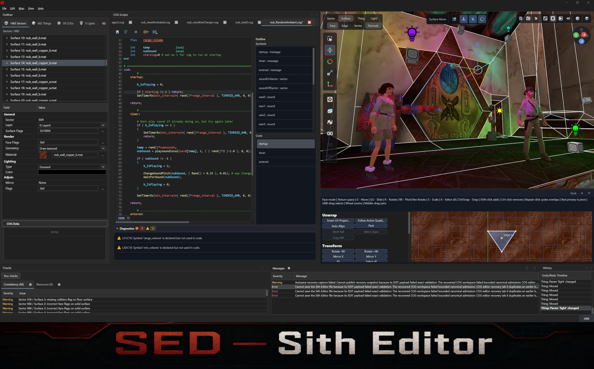

<p align="center">
  
</p>

<h1 align="center">SED - Sith Editor</h1>

<p align="center">
  A modern WYSIWYG-style level editor for LucasArts’ Sith engine games<br>
  Create levels visually and see changes as you work
</p>

SED **0.4.0** is the current ground-up Qt/OpenGL C++ application, rebuilt from scratch around the established
Sith/JED data model and influenced by the refurbished Pascal editor. It is the active editor in this repository.

<p align="center">
  <a href="https://github.com/smlu/SED/releases">Releases</a> ·
  <a href="docs/user_guide.md">User Guide</a> ·
  <a href="CHANGELOG.md">What’s new</a>
</p>


<p align="center">
  
</p>

<a id="features"></a>

## ✨ Features

- **3D viewport**

    - Textured, solid, wireframe, and vertex views
    - Perspective and orthographic cameras with a separate Game Preview
    - Transform gizmos, multi-selection, and precise snapping

- **Geometry tools**

    - Cleave sectors and surfaces, and extrude faces
    - Multi-cut with editable rectangle, N-Gon, arch, and star shapes
    - Join sectors and merge adjacent sectors or surfaces

- **UV editor**

    - Multi-island transforms with geometry, grid, and sub-grid snapping
    - Smart UV Project, alignment, stitching, and packing

- **Things, lighting, and sound**

    - Surface-aligned and brush placement with editable Thing Frame paths
    - Baked lighting and live viewport rendering of dynamic Thing lights and headlights
    - IJIM Sector point lights with live previews
    - MotS architectural lighting authoring and model-vertex previews
    - Sector sound playback

- **Scripts and resources**

    - COG script editor with diagnostics, completion, and formatting
    - Sprite, Sound Class, UNI, and Template editors with resource previews

- **Projects and recovery**

    - Native `.sed` projects preserve the level and editor session, including views, selections, layouts, and unfinished work
    - Undo/Redo with optional saved history
    - Parity-based self-healing for limited file damage
    - Autosave history and recovery after crashes
    - JKL, JED, and NDY levels with mounted GOB/GOO resources

- **Supported games**

    - *Star Wars Jedi Knight: Dark Forces II*
    - *Mysteries of the Sith*
    - *Indiana Jones and the Infernal Machine*

## Contents

- [System requirements](#system-requirements)
- [Releases](#releases)
- [History](#history)
- [Help and documentation](#help)
- [Contributing](#contributing)
- [Development and source builds](#development)
- [License](#license)

<a id="system-requirements"></a>

## 💻 System requirements

- 64-bit Windows 10 or Windows 11
- The Windows Release package includes the official Visual C++ runtime beside `sed.exe`; keep all extracted files
  together
- OpenGL 3.3 capable graphics hardware with a current driver
- Project or game data from a supported title

<a id="releases"></a>

## 📦 Releases

Published Windows builds, when available, are listed on the [Releases page](https://github.com/smlu/SED/releases).

Download a release, extract the complete archive, and run `sed.exe`. Keep the extracted files and folders together so
SED can find the included runtime, plugins, and editor data.

On first launch, use the start screen to create or open a project for the intended game. Add resource roots or mount
GOB/GOO archives through the File commands when the project needs external resources; the [User Guide](docs/user_guide.md#1-start-a-project)
covers project setup and resource discovery.

<a id="history"></a>

## 🏛️ History

SED builds on JED and the refurbished Pascal SED, and on the idea of a modern game level editor where level designers
make changes visually and immediately see how those changes should appear in final gameplay. Version 0.4.0 reimagines
that workflow as a ground-up C++ and Qt application while preserving the established Sith-engine level-design model.

Special thanks go to Alexei Novikov and the Code Alliance for creating the original JED, and to the reverse-engineering
and level-design communities whose format knowledge makes modern Sith-engine tooling possible.

<a id="help"></a>

## 📖 Help and documentation

The [User Guide](docs/user_guide.md) covers project setup, editing, resources, saving, and recovery.

- See the [resource authoring contracts](docs/resource_authoring.md) for SPR, SND, and UNI file details.
- Read the [Changelog](CHANGELOG.md) for new features and fixes.
- Use [GitHub Issues](https://github.com/smlu/SED/issues) to report a reproducible problem or request an improvement.

<a id="contributing"></a>

## 🤝 Contributing

Contributions are warmly welcome. You can help by writing code or tests, improving documentation, reporting a problem,
or proposing a useful feature or enhancement. AI-assisted code contributions are welcome as well.

Please read [CONTRIBUTING.md](CONTRIBUTING.md) before submitting an issue or pull request. It explains how to provide
useful details, follow the project’s code style and naming conventions, and test code changes properly.

<a id="development"></a>

## 🛠️ Development and source builds

This section is for contributors who want to build or change SED. General users can download a packaged version from
the [Releases page](https://github.com/smlu/SED/releases) instead.

Run the commands below from this repository root, which contains `CMakePresets.json`.

### Requirements

- CMake 3.25 or newer for the included presets; manual configuration requires at least CMake 3.21
- A C++20-capable compiler; CMake uses C++26 or C++23 when supported
- Visual Studio C++ Build Tools with the Windows SDK
- Ninja available in the developer shell; Visual Studio's C++ CMake tools can provide it
- A matching Qt 6 MSVC kit with Widgets, OpenGL, OpenGLWidgets, Concurrent, and Multimedia
- OpenGL 3.3 capable graphics support

### Build and test on Windows

Open an x64 Developer PowerShell for Visual Studio (or start PowerShell from an x64 Native Tools Command Prompt) before
running these commands. Point `QTDIR` at a compatible Qt MSVC kit, then use the included Ninja Multi-Config preset.

Run the complete Release suite on an idle Windows desktop; native GUI/input tests activate their own windows.

```powershell
$env:QTDIR = "<Qt MSVC kit directory>"
cmake --preset msvc-ninja
cmake --build --preset msvc-ninja-release --parallel 1
ctest --preset msvc-ninja-release
```

Set `QTDIR` to one exact Qt MSVC kit directory containing `bin/qmake.exe`, not a parent directory containing multiple kits.

The built application and its required Qt runtime are written to `build/ninja/src/app/Release/`. For alternative build
options and the complete test requirements, read the [Developer Documentation](docs/README.md). Before publishing,
follow the [release preparation checklist](docs/README.md#release-preparation-checklist) for the source and binary
boundaries, active assets, tracked-file review, package contents, and extracted-package startup check.

### Project layout

- `src/core/` — level data, file formats, and editing algorithms
- `src/app/` — the Qt application, 3D renderer, editor tools, interface, and application tests
- `cmake/` — release packaging and deployment scripts
- `data/` — data distributed with SED
- `docs/` — level-designer and developer documentation

<a id="license"></a>

## ⚖️ License

SED is licensed under the GNU General Public License version 3. See [LICENSE](LICENSE). Qt is not included in the source
repository; source users and binary distributors must follow the license terms of the Qt build and plugins they use.
See [THIRD_PARTY_NOTICES.md](THIRD_PARTY_NOTICES.md).
