# 🎮 SED Level Designer Guide

This guide is for people building and maintaining levels in SED. It explains the editor as it appears on screen,
the usual workflows, and the safety features around saving and recovery. It deliberately avoids implementation details.

SED supports Jedi Knight, Mysteries of the Sith, and Indiana Jones and the Infernal Machine projects. Some fields,
resources, lights, and export limits differ by project, so create or open the correct project type before authoring.

## 🧭 Quick task map

Use these links when you already know what you want to do.

**Getting started and navigating**

- 🚀 [Create or open a project](#1-start-a-project)
- 👁️ [Understand Editor mode and Game Preview](#2-understand-the-two-viewport-modes)
- 🧭 [Navigate](#3-navigate-and-select)
- 🎯 [Choose edit modes and submodes](#4-edit-modes-and-submodes)
- 🛠️ [Select and transform tools](#5-transform-tools)

**Building and authoring**

- 🧱 [Build and reshape sectors](#6-build-and-edit-sectors)
- ⚠️ [Safely remove or force-delete vertices](#7-surface-vertices-and-deliberate-destructive-repair)
- 🎨 [Extrude surfaces and edit UVs](#8-surface-extrusion-and-uv-editing)
- 🎭 [Place Things and manage templates](#9-things-resources-and-templates)
- 🗂️ [Organize the level with layers](#10-layers)
- 🧰 [Browse resources and previews](#101-resource-categories-and-previews)
- ✍️ [Author loose resource files](#author-loose-resource-files)
- 📐 [Work with viewport settings and the grid](#11-grid-and-viewport-settings)
- 💡 [Edit lighting](#12-lighting)
- 📜 [Write and check COG scripts](#13-built-in-cog-script-editor)

**Saving, recovery, and project maintenance**

- ↩️ [Use history, undo, and redo](#14-history-undo-and-redo)
- 💾 [Save and export](#15-save-save-as-and-engine-export)
- 🛟 [Use autosave and crash recovery](#16-autosave-history-and-crash-recovery)
- 🩹 [Understand self-healing and damaged files](#17-self-healing-and-damaged-files)
- 🩺 [Run checks and troubleshoot](#18-checks-messages-and-troubleshooting)
- ⚙️ [Change preferences and key bindings](#19-preferences-and-key-bindings)
- ✅ [Follow a safe level-design routine](#20-a-safe-level-design-routine)

> 💡 **New to SED?** Continue in order: start a project, learn the viewport modes, then practice navigation and
> selection before changing geometry.

## 🚀 1. Start a project

The start screen provides three common paths:

- Create a new level for the chosen game.
- Open an existing native `.sed` project or supported engine level.
- Reopen a recent file, including pinned favorites.

The start screen uses SED's rounded minimal dark window and client-drawn top bar instead of an operating-system title
bar. Its Close control stays at the far right and the whole window is fitted inside the current monitor at high-DPI
display scaling.

A new project starts with a `2 x 2 x 1` room matching the original SED proportions, a player start, a baked light, and a
default layer. It is still an untitled project until it is saved. Save it early if you plan to create loose resources
such as COG scripts, because their normal folder is resolved relative to the saved project.

Opening a JKL or NDY imports engine level data into the editor. For a JKL, SED determines whether the file is JKDF2 or
MotS before resolving MAT dimensions, so same-named textures from the other game's resource set cannot change the
imported UV scale. Opening a native SED project also restores editor state
such as the viewport, selection, layers, open COG buffers, and undo/redo history when those optional parts are healthy.
Older SED V1/V4 projects store texture mapping in pixel units. The default opening policy converts the complete project
and its Undo/Redo history to normalized UVs when every required MAT size is available, without changing how textures
look. If one current or historical MAT is missing or invalid, SED keeps the whole project in legacy pixel space and
reports the exact Surface that prevented conversion; it never leaves one history timeline in mixed UV spaces. Change
this behavior under **Preferences > Save & Recovery > Legacy Level UVs** to ask before conversion or always keep legacy
pixel space. In Ask mode, Cancel leaves your existing workspace unchanged.
The amber status-bar text shows **UV: Legacy pixels** while a required MAT size is unavailable and **UV: Ready to
normalize** when the complete document can be converted but your selected policy leaves that choice pending.
Opening a Dark Forces `.lev` first asks for its coordinate scale, whether imported surfaces should keep converted
texture names or use `DFLT.MAT`, and whether to import objects from the matching `.O` file. The default scale is `40`,
matching the original SED workflow. Cancel leaves the current level unchanged.
After an engine/legacy import finishes, SED waits for the final panel layout and then frames the complete level from
above. This final fit is kept pending through large Outliner/check rebuilds, including when a changed previous project
was discarded, so the newly opened map should not inherit an unusable zoom from the preceding document.

## 👁️ 2. Understand the two viewport modes

The viewport has two distinct working modes.

### 🛠️ Editor mode

Editor mode is where level authoring happens. Choose an edit mode from the top-left mode bar, then choose a selection
submode or tool when one is available. The top-center bar shows options for the active tool. The top-right bar controls
rendering, the grid, X-Ray selection, camera behavior, and other viewport settings. Game Preview is isolated at the
far left of that bar, while sector-sound mute is the far-right control. On a new installation, fog
rendering starts off in Editor mode so it does not obscure geometry work.

### Read the viewport bars

The corner bars are context-sensitive controls. They stay attached to the viewport while the center rows make room for
the active tool. Hover a button for its current tooltip; the text and enabled state reflect the selected project,
selection, and edit mode. Viewport tooltips show the control name and explain the effect of clicking or changing it,
including relevant modifiers and current key bindings.

**Top-left edit modes and submodes**

| Control | Choices | What it selects or edits |
| --- | --- | --- |
| Edit mode | **Sector**, **Surface**, **Thing**, **Light** | Limits picking, the Item Edit fields, and the tools shown below the mode row. |
| Surface submode | **Face**, **Edge**, **Vertex**; **Normals** toggle | Chooses the selection detail. Normals is a separate display toggle for selected faces, not a fourth selection submode. The strict edge/vertex choice can also appear in the contextual row. |
| Thing submode | **Frame** | Edits frame points for the selected Thing. |
| Light submode | **Baked**, **Thing**, **Arch**, **Sector** | Chooses SedLight, Thing/headlight, MotS ARCHLIGHTING, or IJIM Sector point-light ownership. **Arch** is shown only for MotS; **Sector** is shown only for IJIM. |
| Read-only badge | Hidden layer, locked layer, or both | Selection and navigation remain available, but editing commands are disabled for the selected content. |

The vertical strip at the far left holds the transform tools **Select**, **Move**, **Rotate**, and **Scale**. Its
orientation button chooses **Local** or **World** axes. Move and placement options such as **Grid snap** and **Grid
stick** appear in the contextual row when their operation supports them. Context tools appear below the transform
strip and change with the active mode.
Sector mode offers **Cleave**, **Join sectors**, **Merge sectors**, **Sector thrust** for IJIM, and **Add sector shape**.
Surface mode offers **Cleave**, **Merge**, **Extrude**, **Flip**, **Adjoin**, **Unadjoin**, and **Connect** where the
selection supports them. Frame mode offers **Add frame** and **Delete frame**. Light mode offers **Add Light** for baked lights, **Add Thing light** (with
**Thing light** or **Actor headlight** in its menu) for Thing lights, and **Add Sector light** for IJIM Sector lights.
MotS **Arch** mode uses vertex-first selection. Every Thing with the effective **Arch flag** (`thingflags & 0x8`) has one ARCH owner
marker, including a Thing whose ARCHLIGHTING index is `-1` and therefore has virtual zero values. Click its marker to select
all published vertices, click one vertex to narrow that expansion, use Shift to add vertices, or use Ctrl to remove
them. **Delete** resets explicit ARCHLIGHTING values to zero while preserving the Thing's flag and binding; resetting an
already-zero virtual or explicit record is a no-op. In this submode, **Ctrl C** snapshots the active Arch owner, including a virtual
zero owner, and **Ctrl V** applies it to compatible selected model Things; Paste can promote an unflagged model target. Tools are disabled when
the selection or required model data is unsuitable. The strip and every editing/tool-options overlay are hidden in Game Preview.

The top-center rows are contextual. They can show transform choices, light-bake controls, sector join or thrust
options, Thing placement/move choices, Surface Extrude options, or Cleave options. If a row would overlap a corner bar,
SED moves it down below the bar and reflows the other rows. A narrow viewport therefore changes the rows' positions,
not their meaning; use the button tooltips when an icon is the only visible part of a row.

**Top-right rendering and viewport controls**

The controls run from left to right inside the right-aligned bar as follows:

| Control | Choices or action | Notes |
| --- | --- | --- |
| **Game Preview** | Toggle Editor/Game Preview | This is the control users often call **Play**. It renders the inspection pipeline and does not launch gameplay. |
| **Level Settings** | Open level-wide fields and **Extra buffers** | The fields differ by project; see [Level Settings](#level-settings-by-project). |
| **Camera settings** | **Orthographic** or **Perspective**; FOV; Near; Far; **Enable clipping** | FOV applies to Perspective. Near, Far, and clipping control camera-plane clipping. |
| **Viewport Settings** | Grid, fog, X-Ray Selection, Orbit Around Selection, and collapsible **Appearance**, **Gizmos**, **Grid Behavior**, **Grid Appearance**, and **Grid Transform** groups | **Gizmos** controls **Baked Lights**, **Thing Lights**, **Thing Types**, **Arch Things** in JKDF2/MotS, and **Sector Lights** plus **Sector Thrust Vectors** in IJIM. In JKDF2/MotS, Thing flag `0x8` is the **Arch flag**; the **Arch Things** gizmo visibility in Editor and Game Preview is independent. |
| **Level geometry mode** | **Textured**, **Solid**, **Wireframe**, **Vertices** | Chooses the main geometry presentation. |
| **Wireframe overlay** | Toggle level-geometry wireframe over the current presentation | With the viewport focused, **Tab** toggles the overlay without changing the current **Textured**, **Solid**, or **Vertices** mode; a second press restores the previous overlay visibility. In text editors, Tab keeps its normal editing behavior. **Shift Tab** retains its existing Surface-submode and Thing-frame commands. |
| **Lighting mode** | **Fully Lit**, **Lit**, **Diffuse**, **Gouraud**, then **Thing Lights** and **Sector Point Lights** below a separator | The four modes choose viewport presentation. **Thing Lights** includes runtime Thing emitters, actor headlights, and owner self-light; **Sector Point Lights** includes IJIM contributions and is disabled outside IJIM. Neither switch rewrites baked lighting. |
| **Thing rendering** | Rendering on/off; Hidden Things; Non-visual Cubes; **Shaded**, **Wireframes**, **Boxes**, or **Dots**; **Collision Shapes**; **Visual Bounds**; classic **3DO Model LOD** | The checked button means that the options panel is open. A crossed icon means Thing rendering itself is off. Toggle these choices under **View > Things** too. Collision Shapes and Visual Bounds default on in Editor and off in Game Preview; 3DO Model LOD defaults off in both. SED remembers each mode separately. |
| **Sector sound** | Mute or unmute ambient sector sound | Editor and Game Preview remember this choice independently. |

Viewport Settings remains open while you choose an item from one of its dropdowns. Click outside the panel and its
dropdown to dismiss it.

**Collision Shapes** uses bright green: it draws the Thing's sphere for collide=1, one static sphere per 3DO hierarchy
mesh for MotS collide=2, and face collision geometry for collide=3; collide=0 has no collision shape to draw. MotS
`treesize` sets a separate Thing-wide broad-phase radius; it does not size the per-mesh spheres. Those spheres use each
3DO `MESH RADIUS` with the engine's fixed 0.75 narrow-phase multiplier. The MotS preview-scale preference changes only
the editor drawing and never changes template values, level data, or exports. A hierarchy node with flag `0x2` can inherit
its effective mesh radius from the nearest unflagged ancestor during MotS rendering; SED applies that substitution as a
stable preview approximation. Before the first engine draw, collision may still see the node's authored radius, and shared
mesh references can make the engine's render-time mutation order-dependent. The collide=1 sphere follows the effective
`size` value from either the Thing or its template while editing. **Visual Bounds** uses
amber and shows the transformed local-vertex bounds for 3DOs. It uses geoset 0 even when a lower-detail model is
shown. Fixed-orientation sprites show a tight world-aligned bound around the currently rendered card. A type-0 Game Preview billboard uses a conservative, camera-independent enclosing
bound that contains the sprite at every orbit angle. When a face collision wire shares edges with Visual Bounds, its
green line is drawn last and slightly thicker so it remains identifiable. A selected Thing also receives a brighter,
wider outline for each enabled collision or bounds overlay. The outline remains depth-tested against opaque level geometry.
Both overlays follow hidden Thing and layer visibility and the current Editor or Game Preview pipeline. In Thing selection,
click a visible overlay line or cross it with a selection rectangle to select its owning Thing. Overlay picks follow
scene-depth visibility; the existing through/X-Ray selection options bypass that depth check. This supplements the existing
model, sprite, and fallback picks. During viewport Move/Rotate gestures and Item Edit transform scrubs, enabled
collision and bounds wires follow the Thing preview immediately.

For JKDF2 and MotS, **3DO Model LOD** chooses a model's detail level from the level-header distances as the camera
moves. It is off by default, so SED shows the highest-detail geoset (LOD 0). It is available in the viewport Thing
rendering panel and **View > Things**, with independent Editor and Game Preview choices. IJIM does not offer this
classic 3DO option. Ordinary Things can switch geosets; an **Arch Thing** (effective
`thingflags` bit `0x8`) stays at geoset 0 because the classic engine draws it with sector geometry. A model
with only one geoset also stays at geoset 0. The visible model and its selection outline use the chosen geoset,
while Collision Shapes, Visual Bounds, and MotS ARCH vertex editing use geoset 0 as a stable authoring guide.
A placement preview can show the chosen geoset; its collision and placement guides still use geoset 0.

**Reading a dense MotS collision tree:** With `collide=2`, each usable 3DO hierarchy node that references a mesh
contributes one green sphere at that node's transformed center. Each sphere is drawn as three perpendicular rings, so
ten nodes can produce thirty overlapping circles. Nodes that reference the same mesh still have separate spheres; a
node flagged `0x2` keeps its own center but uses the inherited effective radius described above. The single magenta
`treesize` sphere is the broad-phase guide around the Thing. If the rings hide the model, turn off **Collision Shapes**
temporarily or adjust **Preferences > Viewport > Things > Collision preview > Node mesh radius scale** for inspection.
That scale does not change the broad-phase guide or game collision.

When there is not enough room below a top-right control, its popup is clamped to the viewport. Level Settings and Viewport
Settings are scrollable when their full content is taller than the available viewport; the Thing rendering panel stays
anchored below its launcher. Use the popup instead of relying on the icon alone. In Game Preview, Editor-only mode and
tool controls disappear, grid-only controls are hidden, and the Preview visibility choices for light, Arch Things,
and IJIM thrust overlays remain available through their separate preferences.

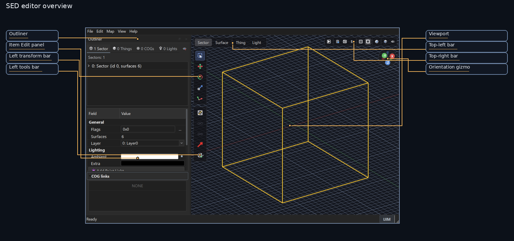

These reference sheets place the controls beside the instructions above. The captures use synthetic projects and contain
no original game assets.

#### Viewport bars and mode controls

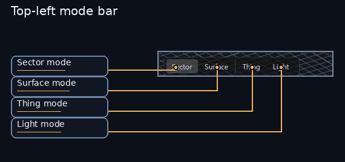

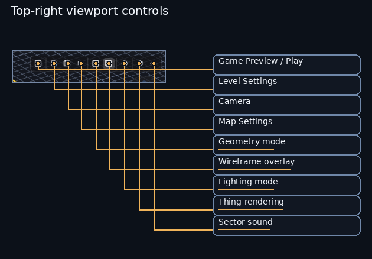

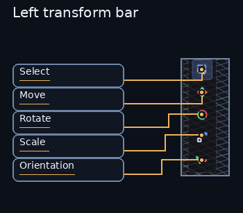

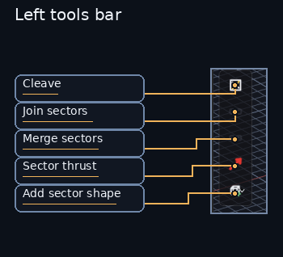

Open viewport menu and panel details

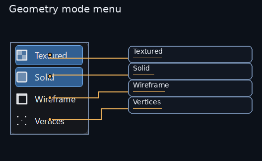

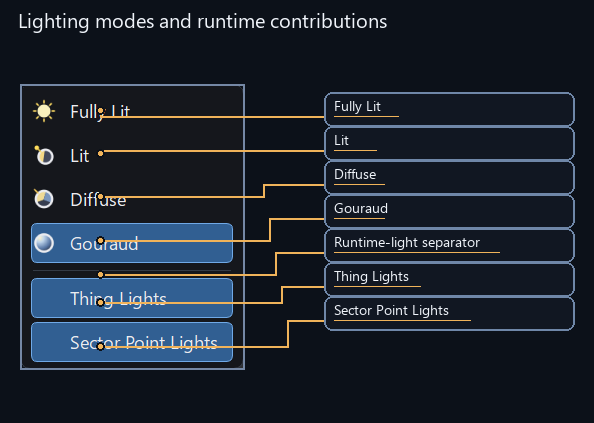

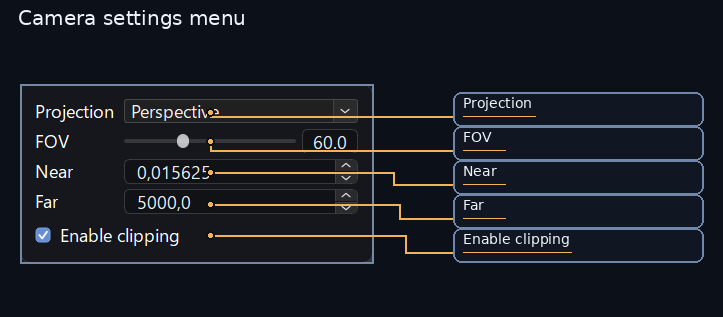

### 🎮 Game Preview

Game Preview is a render-and-inspection pipeline, not an executable gameplay simulation. Editing tools and
viewport-dependent Edit commands are disabled while preview is active. Selection, camera movement, and other
non-destructive viewing controls remain available. Grid-only controls are hidden; light and thrust overlays use their
own Game Preview visibility preferences. Return to Editor mode to modify geometry, Things, lights, frames, or COG
placement. Fog rendering starts on in Game Preview. The Editor and Game Preview fog choices are independent and are
remembered after you change them.

> 💡 **Checking classic Sector Tint:** In Jedi Knight and Mysteries of the Sith, Game Preview uses the Tint of the
> sector containing the camera for the whole scene. If the camera is outside every sector, neutral Tint is expected—even
> when the editor viewpoint exposes interior geometry through the back or a missing part of the level shell. That is not
> a normal in-game camera position and should not be reported as a Preview Tint bug. For a meaningful engine comparison,
> place the camera inside a valid sector and inspect geometry visible through its adjoins. A Solid adjoin keeps its own
> material color and face translucency; the mirror sector's Tint does not replace that portal material before the camera
> crosses it. Editor mode may keep otherwise exposed tinted interiors easier to inspect from outside. Indiana Jones and
> the Infernal Machine does not use classic Sector Tint.

Preview also hides the UV editor, COG Script editor dock, Thing placement palette (expanded or collapsed), and every
editing/tool-options overlay. Returning to Editor restores the exact panes, UV splitter allocation, COG dock width,
and expanded/collapsed Thing palette geometry that were visible before Preview in one settled layout pass; it does
not replay their normal open animations. That visibility snapshot belongs to the current document only, so opening or
creating another project while Preview is active cannot resurrect panes from the previous project. The Outliner
remains available for inspection, while its property controls remain read-only. Returning to Editor recomputes every
Item Edit row and embedded control from the selected entity's current layer, so a visible, unlocked entity becomes
editable again immediately.

The top-left edit-mode bar is hidden in Game Preview because Preview point selection is always **Auto**: click the
entity under the pointer without first choosing Sector, Surface, Thing, or Light mode. Repeated clicks in the same
place walk the depth-ordered Thing, visible baked-light gizmo, Surface, and Sector candidates up to the first visible level wall,
then wrap to the front. **X-Ray Selection** deliberately extends that walk behind the wall. Box/area selection is
disabled in Preview. Hidden-layer and hidden-Thing preferences still determine what can be picked; locked-layer
entities remain selectable for inspection but stay read-only.

Switching to preview remembers the active Select, Move, Rotate, or Scale choice. Preview presents Select as a
non-editing selection sentinel while all four transform actions and transform gestures remain disabled, then restores
the remembered tool on return to Editor mode. A settled Cleave Multi-cut draft and its history are retained while
Preview is active; any unfinished Cleave drag is rolled back. Join, Extrude, UV transforms, and placement previews
are canceled. Opening COG editors,
changing layers/properties, recalculating lighting, and moving the History cursor are also blocked. History **Go To**
remains available as camera-only navigation.

## 🧭 3. Navigate

### Start with these controls

These are the default viewport bindings. Key bindings can be changed in **Preferences > Keymap**, so the
Navigation menu and tooltips show the active mapping. Click the viewport before using a keyboard binding; a text field
or another focused editor keeps its own standard keys.

Use **Preferences > Viewport > Mouse Controls** to change the buttons and modifiers for picking/editing, Fly look,
Orbit, Pan, Dolly, and faster Dolly. Wheel zoom and Fly-speed adjustment can also require a modifier, run in reverse,
or be disabled. **Restore Defaults** restores the controls below. These settings affect the level viewport; resource
previews keep their own controls. Conflicting button/modifier combinations are explained in the dialog and must be
resolved before accepting it. The **Mouse button** and **Keyboard modifiers** columns describe each drag gesture.
**Disabled** turns that action off; **No modifiers** still requires its selected mouse button. Dolly remains a mouse
gesture with optional keyboard modifiers. **Invert horizontal** and **Invert vertical** reverse camera
drag/look movement independently; both are off by default and do not change picking, editing, or wheel direction.
**Middle button (wheel click)** means pressing the wheel. Turning it is configured separately under **Wheel scrolling**,
where Zoom and Fly speed retain their modifier, Disabled, and Invert options. Separate **Zoom In**, **Zoom Out**,
**Fly Speed Up**, and **Fly Speed Down** commands under **Preferences > Keymap > Viewport > Camera** can use keys
independently of the wheel settings. Their defaults are **Numpad +** and **Numpad −**: zoom outside Fly, and change
Fly speed while it is active. This also works when holding the wheel button for Fly. Beside **Keymap:** under Wheel scrolling, choose **Zoom In/Out** or
**Fly Speed Up/Down** to jump directly to that pair of bindings without closing Preferences or losing pending changes.
The two target rows briefly highlight for half a second so they are easy to find.
To use wheel-click Fly with the usual
Ctrl/Shift speed controls, assign Fly Look to Middle button and move Orbit, Pan, Dolly, and faster Dolly to another
button while keeping their modifiers. The dialog reports any conflicting mappings before you accept them.

**Mouse navigation**

| Action | Control | What it does |
| --- | --- | --- |
| Orbit | **MMB drag** | Orbit around a valid selection when **Orbit Around Selection** is on (the default). If that setting is off or no valid selection exists, orbit around the current camera target. |
| Pan | **Shift MMB drag** | Pan the view. |
| Dolly or orthographic zoom | **Ctrl MMB drag** | Dolly in perspective or zoom in orthographic projection. |
| Faster dolly or orthographic zoom | **Ctrl Shift MMB drag** | Use the faster dolly/zoom rate. |
| Zoom | **Mouse wheel** | Zoom normally. |
| Fly look | **Hold RMB and move the mouse** | Look around while Fly is active. |
| Fly speed | **Mouse wheel while RMB is held** | Change Fly speed. |
| End Fly | **Release RMB** | Stop Fly navigation. |

**Mouse abbreviations:** **LMB** means left mouse button, **MMB** means middle mouse button or wheel button, and
**RMB** means right mouse button.

**Fly controls**

Hold **RMB** while using these keys.

| Action | Key |
| --- | --- |
| Move forward | **W** |
| Move backward | **S** |
| Move left | **A** |
| Move right | **D** |
| Move down | **Q** |
| Move up | **E** |
| Faster movement | **Shift** |
| Half-speed movement | **Ctrl** |
| Increase Fly speed | **Numpad +** |
| Decrease Fly speed | **Numpad −** |

Hold Ctrl for finer movement while flying; releasing it restores the usual speed. Change **Fly Slower** under
**Preferences > Keymap > Viewport > Camera**. Fly keeps its speed and movement keys while it owns the pointer, so Ctrl
does not trigger editing commands underneath it. Use a single key or key combination for each Fly binding;
alternative bindings can provide more choices. If you remap Fly look, hold your chosen button instead of RMB.

**Navigation keypad**

| Shortcut | Result |
| --- | --- |
| **Numpad 1** | Front view. |
| **Ctrl Numpad 1** | Back view. |
| **Numpad 3** | Right view. |
| **Ctrl Numpad 3** | Left view. |
| **Numpad 7** | Top view. |
| **Ctrl Numpad 7** | Bottom view. |
| **Numpad 4** | Orbit left. |
| **Numpad 6** | Orbit right. |
| **Numpad 8** | Orbit up. |
| **Numpad 2** | Orbit down. |
| **Ctrl Numpad 4** | Pan left. |
| **Ctrl Numpad 6** | Pan right. |
| **Ctrl Numpad 8** | Pan up. |
| **Ctrl Numpad 2** | Pan down. |
| **Numpad 5** | Toggle perspective and orthographic projection. |
| **Numpad + / −** | Zoom in/out; while flying, increase/decrease Fly speed. |
| **Numpad 0** or **F3** | Align the grid plane to the current view. |
| **Insert** | Toggle **Grid Always Behind Geometry**. |

**Other navigation**

| Action | Shortcut |
| --- | --- |
| Frame level | **F** |
| Align view to grid plane | **F2** |
| Align grid plane to view | **Numpad 0** or **F3** |

Use the mouse to orbit, pan, zoom, and fly through the level. The Navigation menu lists the current shortcuts for fixed
views, projection switching, orbit, pan, roll, and framing. Shortcuts can be changed in Preferences, so the menu and
tooltips are the authoritative reference for the active bindings.

Free orbit is continuous like a modern DCC viewport: keep dragging vertically to revolve through the top or bottom
instead of stopping at 90 degrees. The view does not mirror as it crosses a pole, and reversing the drag retraces the
same orientation. This works in perspective and orthographic projection. Front, Back, Left, Right, Top, and Bottom
commands (including their numpad bindings and axis-widget ends) still land on exact, repeatable axis views. RMB Fly
is always world-upright: it has no camera roll, turns horizontally around world up, and stops pitch at straight
up/down. If Fly starts from an F2-aligned or pole-crossed view, it preserves the visible look direction, camera
position, and current target (the grid origin after F2), but removes the bank before applying mouse input. This keeps
left/right and up/down controls predictable in both the editor and Game Preview.
After F2 aligns the camera to a tilted or banked construction grid, vertical MMB movement revolves around the visible
screen-right/grid-X direction. It therefore moves naturally away from that grid view without adding a new bank. The
same rule applies when **Orbit Around Selection** is enabled: the selected pivot stays fixed on screen while the full
banked camera frame revolves around it.

Useful navigation commands include:

- Frame Level to fit the complete level.
- Frame Selection to focus the current entity or geometry.
- Perspective and orthographic projection.
- Front, back, left, right, top, bottom, and opposite views.
- Orbit Around Selection for inspecting a selected object without losing it.
- Fly mode for moving through large spaces.

## 🎯 4. Edit modes and submodes

**Edit modes**

| Mode | Shortcut |
| --- | --- |
| Sector | **1** |
| Surface | **2** |
| Thing | **3** |
| Light | **4** |

These use the keyboard's number row while the viewport owns focus. Numpad keys keep their camera commands; text and
numeric fields keep their normal editing behavior.

### 🧱 Sector mode

Sector mode selects and edits complete convex rooms or volumes. It provides:

- Add Sector with box and saved-shape choices.
- Cleave to split a sector.
- Join to connect overlapping sectors and create portals.
- Merge to combine compatible adjacent sectors while preserving a valid convex result.
- Move, rotate, scale, snap, mirror, and other transforms.
- Import Sector(s) from OBJ or 3DO.
- Export selected Sector(s) to OBJ or 3DO.
- IJIM sector-thrust editing where supported.
- Delete Sector.

Sector commands are enabled only in Sector edit mode. Selection-dependent commands require an editable selection; Add and
Import do not. Add and Import are disabled in Game Preview, and Export requires at least one selected sector.

**Sector mode shortcuts**

| Action | Shortcut |
| --- | --- |
| Add Sector | **A** |
| Cleave | **C** |
| Join | **J** |
| Merge | **M** |

### 🎨 Surface mode

Surface mode has three selection submodes:

- **Face** selects complete polygon faces.
- **Edge** selects polygon edges while retaining their owning faces.
- **Vertex** selects individual polygon vertices while retaining their owning faces.

Switching from selected sectors to Surface mode selects their faces. Returning from Edge or Vertex to Face restores the
remembered face selection when it is still valid.

**Surface submodes**

| Action | Shortcut | Result |
| --- | --- | --- |
| Cycle Surface submode | **Shift Tab** | Cycle Face → Edge → Vertex → Face. |
| Select Face submode | **Shift 1** or **Shift F** | Select Face directly. |
| Select Edge submode | **Shift 2** or **Shift E** | Select Edge directly. |
| Select Vertex submode | **Shift 3** or **Shift V** | Select Vertex directly. |

Surface tools include Cleave, Merge, Extrude, transforms, UV editing, texture and lighting properties, and normal
display. **Strict** selection limits Edge and Vertex picking to the faces selected before entering the submode, which is
useful where several surfaces share the same screen-space edge. Native Save, autosave, and recovery preserve the
frozen face set and remembered Face selection independently of the currently selected components. After a topology
change whose old face identities cannot be retained, SED clears the frozen scope and returns to Face selection,
remembering faces selected by the completed operation; coordinate-only transforms preserve the context.

Portal commands are also available here. **Adjoin** links compatible matching faces, **Unadjoin** removes an existing
portal link, and **Connect Surfaces** creates the required connection geometry between selected faces in different
sectors. The editor validates reciprocal portal ownership before publishing the change.

The **Normals** option draws the owning face normal in Face, Edge, and Vertex modes. Edge mode can also display the
selected edge direction normal. Normal length, arrowhead size, and arrowhead visibility are configurable in
Preferences.

**Surface mode shortcuts**

| Context | Shortcut | Action |
| --- | --- | --- |
| Surface Face | **A** | Adjoin the selected unadjoined face to a compatible face. |
| Surface Face | **Shift A** | Unadjoin the selected surface. |
| Surface Face | **C** | Cleave. |
| Surface Face | **M** | Merge. |
| Surface Face | **X** | Extrude. |
| Surface Face | **K** | Connect Surfaces. |
| Surface Edge | **C** | Arm the edge split; drag and release to define the cut plane and insert its intersection on the active edge. Multi-cut is unavailable. |

With the viewport focused, **A** and **Shift A** are the default Surface bindings. The Surface menu also exposes
**Ctrl J** for Adjoin and **Ctrl Shift J** for Unadjoin. The active mode and toolbar show which command owns a key.

**Make a matching portal**

1. In Surface Face mode, select one unadjoined face in each of two different sectors. Use **Shift LMB** for the second
   face; the faces should be back-to-back and coplanar.
2. Press **K** with the viewport focused, or choose **Surface > Connect Surfaces** (**Ctrl K**). SED clips the overlap
   on both faces; a smaller face can cut the larger back-to-back face so the two sides receive matching portal surfaces.
3. To let SED search for a partner automatically, select one unadjoined face and press **A**. It can use the same fallback
   to cut the larger face when the candidate is coplanar, opposite-facing, and overlapping.

### 🎭 Thing mode

Thing mode edits placed gameplay objects: actors, items, weapons, particles, sprites, models, ghosts, cameras, and other
template-backed entities. The Thing placement panel lets you browse or search templates, filter categories, preview
resources, and place the selected template. Move and Rotate operate on selected Things. Ordinary Things and Frames do
not expose the viewport Scale tool; the Transform > Scale command scales selected Thing positions around the selection
pivot. Press **A** with the viewport focused to show or hide Thing Placement.

Changing a Thing's template immediately rebuilds its visual and refreshes the copied template bounding box used for
fallback framing/picking. Authored local `sprite`, `model3d`, or `model3do` parameters are deliberately preserved and
remain authoritative; the Template row explains this case and points to restoring the local parameter when the new
template's render resource should be used.

In Thing Item Edit, double-clicking the **Sector** number row navigates to and selects that assigned Sector, then frames
it. This is a navigation action and does not change the Thing's authored sector assignment.

The Template Editor edits reusable template values. The Properties panel edits the selected Thing instance. Light
parameters attached to a Thing can also be edited from Light mode. Template parameters are edited directly in the
**Value** column. **Source** distinguishes values defined on this template, local overrides of a parent, and inherited
parent values. Editing an inherited value creates a local override; **Restore Parent Value** removes that override.
Press Enter in a value field to finish that edit while keeping the Template Editor open. Use the small **…** button
beside resource or structured values to open their picker/editor. **Add Parameter...** remains available for adding or
replacing values. Invalid typed edits are rejected and the previous value is restored.

Many engine parameters, including numeric values such as `size`, are stored as text in template files. `str` here
describes that storage representation; the game interprets recognized parameter names according to their engine rules.
SED preserves the authored text, and the value tooltip shows the parameter's description when one is known.

The preview's small collision icon is on by default; turn it off to hide collision lines, the IJIM bounds guide, and the fallback BBOX preview.
Green shows the effective narrow-phase collision representation. A MotS `collide=2` preview draws one static sphere for each 3DO
hierarchy mesh from its authored `MESH RADIUS`, normally multiplied by the engine's fixed `0.75` factor. The preview scale
can be adjusted in the MotS collision preview preference; this changes only the editor drawing. A separate magenta sphere shows
the broad-phase radius centered on the Thing from the effective `treesize` value. Editing `treesize` resizes only this guide,
not the green mesh spheres. For hierarchy nodes with flag `0x2`, the preview uses the nearest unflagged ancestor's authored
mesh radius as a stable approximation of MotS's render-time mutation; the flagged node still contributes its own sphere
at its own center. Each sphere has three perpendicular rings, so a model with many nodes can produce a dense green web
even when several nodes reuse one mesh. Before the first draw, collision can use the authored radius instead, and shared
mesh references can make runtime mutations depend on rendering order. The preview uses the model's
default hierarchy pose and does not reproduce animated joint poses. For IJIM,
cyan lines show an authored bounds guide when both `collwidth` and `collheight` are positive: the box is centered on the
Thing, extends by ±`collwidth` on world X/Y and ±`collheight` on world Z, and does not rotate with the Thing. This
visualizes the authored parameters only; the corresponding engine AABB collision check is disabled. If either value is
missing, invalid, or zero, the guide is omitted instead of guessing a dimension. An SPR-only preview cannot show MotS
mesh spheres because it has no 3DO hierarchy; the Template Editor uses the 3DO preview when both resources are present.

The template **Editor Bounds (BBOX)** section is collapsed by default. Its fields set authored local editor bounds,
separate from game collision parameters such as `collide` and `size`. SED uses the lower Z value to place a Thing's
bottom on a surface. When model bounds are available, SED measures them from 3DO vertices; if no usable model geometry
is available, the preview draws the authored BBOX as a wire box. BBOX values remain useful for surface placement and
fallback framing/picking. They are kept in template/SED data; JKL and NDY level exports do not write them as game
collision data.

Template, 3DO, and other model pickers can show their lists alphabetically or in **Source order**. Source order follows
the authored template/resource list and keeps category and nested-subcategory entries in their authored order. Their
3D preview offers Textured, Solid, true model Wireframe, and model Vertices rendering; those choices are independent of the main
viewport's level-geometry mode and never substitute Thing boxes or origin dots. Missing or unreadable model resources
show an unavailable preview instead of a misleading template bounding box. Template and raw 3DO lists always render
thumbnails; the preference selects Shaded or true Thing Wireframe presentation for both picker and Template Editor
lists. A template whose SPR cannot be decoded can still fall back to its valid 3DO model. Templates marked Disabled or
Invisible for gameplay still appear in these authoring previews.

### 🦴 Frame mode

Frame mode edits movement/path frames belonging to a Thing. Add, move, rotate, or remove frames without treating the
frame as a separate Thing. Leaving and returning to Frame mode preserves the relevant Thing/frame context where valid. In
Thing or Frame mode, **Shift 1** or **Shift Tab** toggles Frame mode.

**Frame path workflow**

1. Select one Thing and enter Frame mode with **Shift 1** or **Shift Tab**.
2. SED draws that Thing's path as connected lines with point markers. Activate Select (**S**), then click a point to select
   its frame; the owning Thing is previewed at that frame's position and orientation to help inspect the path pose.
3. Choose Move (**T**) to translate the active frame or Rotate (**R**) to change its orientation. These edits change the
   frame value; they do not move the Thing's authored base pose. Return to Select (**S**) to pick another point.
4. Use **Add frame** to place another point on the selected Thing's path. Select one or more points and click **Delete
   frame**, or press **Delete**, to remove them; Undo restores removed points.

Switching between Thing and Frame mode preserves the selected Thing/frame context where valid. Frame Add shows the
owning Thing at the candidate pose while you move over the viewport; clicking commits that same six-field pose. The
preview follows camera changes even when the pointer stays on one pixel. The owner keeps its authored base pose and
local overrides, including a local sprite used for surface alignment.

Adding a frame selects the new point. Properties **Add**, **Duplicate**, and **Delete** keep selections attached to the
same remaining path points when the frame count changes. Undo and Redo restore the path and its selection together;
native Save and reopen retain the selected and active frame even when SED repairs the path's stored count.

Frame Add and Frame Move expose the following contextual options:

| Option | Default | Use |
| --- | --- | --- |
| Surface stick | On | Frame Add places the frame pose's visual Thing on the picked surface; with it off, placement uses the cursor plane. Frame Move stops the Thing when its rendered bound touches solid geometry; keep dragging to push through. |
| Align to surface | Off | With Surface stick contact, rotate the frame pose so the Thing follows the picked surface normal. |
| Thing snap | On | Snap the frame pose to a nearby stationary Thing. |
| Rotate to snap | On when Thing snap is on | Rotate compatible connectors or faces into alignment during Thing snap. |
| Grid snap / Grid stick | Hidden for Frame Add; available for Frame Move | Snap the frame move reference to the active grid or pause at its plane. |

These options are also available for Thing Move. Their hold-to-invert modifiers are configurable in **Preferences > Keymap**. A held modifier changes the effective option once; the checked controls show the resulting state. Frame Add
and Frame Move use those same bindings. By default, hold **Ctrl Shift** to temporarily invert **Align to surface**;
the preview updates under the stationary pointer and releasing the chord restores the saved option. The option tooltip
shows the configured binding.

For **Thing Move**, Grid Snap is off and Grid Stick is on by default. Surface stick is on (**Shift** inverts it), Align
to surface is off (**Ctrl Shift** inverts it), Thing snap is on (**Ctrl** inverts it), and Rotate to snap is on
(**Ctrl Alt** inverts it). Rotate to snap is disabled while Thing snap is off. Frame Add hides the grid controls but
keeps the surface and Thing options visible.

### 💡 Light mode

Light mode separates the different owners:

- **Baked** lights are editor-authored sources whose result is stored on level geometry.
- **Thing** lights are runtime lights attached to Things, including regular point lights and actor headlights.
- **Arch** edits MotS ARCHLIGHTING lighting data attached to model Things. It edits mono/RGB model-vertex
  channels and does not create a point-light source.
- **Sector** lights are runtime point lights attached to sectors where the project supports them.

Each submode selects its matching viewport records: Baked, Thing, and Sector use light gizmos, while Arch uses
model-vertex ARCHLIGHTING records. Each family exposes its own placement or property controls. See
[Lighting](#12-lighting) for the practical differences.

**Light mode shortcuts**

| Action | Default shortcut |
| --- | --- |
| Add the active light type | **A** in Baked, Thing, and IJIM Sector submodes |
| Delete or reset the selected light data | **Delete** |

Add toggles the matching placement tool; in Thing submode it keeps the chosen Thing light or Headlight type.
Arch lighting has no Add action, so **A** does nothing there. **Delete** removes a baked light, removes a local Thing
light override, clears an IJIM Sector point light, or resets selected Arch light values. It keeps the owning Thing
or Sector. These commands act only when the viewport owns the input; typing in an edit field keeps its normal keys.
The real **Add Sector**, **Thing Placement**, and **Add Light** commands each use **A** as their sole default. Menus,
tools, and **Preferences > Keymap** share the same command and binding; customized and cleared bindings are retained.
Surface Face mode keeps **A** for Adjoin. Vertex **Delete** stays conservative, while **Shift Delete** is the confirmed
force operation in Vertex mode.

## 🛠️ 5. Editing tools

### 🎯 Select tool

The Select tool owns ordinary viewport clicks. Change its button and activation modifiers in
**Preferences > Viewport > Mouse Controls**; change Add/Remove selection modifiers in **Preferences > Keymap**.
In the tables below, LMB means the default Pick/Edit button; use your chosen button if you remap it.
Selection modifier actions can have several alternatives; any one activates the action. Holding extra modifiers
does not cancel a matching selection binding. If more than one selection action matches, the usual selection
priority still applies.

**Click selection**

| Action | Gesture | Result |
| --- | --- | --- |
| Pick / replace | **LMB click** | Replace the selection with the clicked item. |
| Add | **Shift LMB click** | Add the clicked item to the selection. |
| Remove | **Ctrl LMB click** | Remove the clicked item from the selection. |

**Box selection**

Move, Rotate, and Scale own their ordinary clicks for transform interaction. Hold **Alt** to use the box-selection
gestures below while keeping the transform tool active:

| Context | Gesture | Result |
| --- | --- | --- |
| Select | **LMB drag** | Replace the selection with the items in the box. |
| Select | **Shift LMB drag** | Add the items in the box to the selection. |
| Select | **Ctrl LMB drag** | Remove the items in the box from the selection. |
| Move, Rotate, or Scale | **Alt LMB drag** | Hold Alt to box-select while keeping the transform tool active, replacing the selection. |
| Move, Rotate, or Scale | **Alt Shift LMB drag** | Add the items in the box to the selection. |
| Move, Rotate, or Scale | **Alt Ctrl LMB drag** | Remove the items in the box from the selection. |

Box selection is an Editor-mode feature; the gesture is unavailable in Game Preview.
X-Ray selection includes valid entities behind other geometry; with X-Ray off, solid geometry
that visually faces the camera occludes objects behind it. A single-sided wall
seen only from its back does not block an otherwise clear Thing or Surface
pick, even when the target is in another Sector. Front-facing and double-sided
solid walls remain occluders in perspective and orthographic views. Surface wire picking is available in wireframe view and when the level-wireframe overlay is
enabled. Repeated picking can cycle between valid surfaces sharing the same visible edge.
Edge and Vertex point picking uses a 16 logical-pixel radius in both hardware and fallback picking, so the target stays
the same size on high-DPI displays. Ctrl-clicking a visibly coincident shared/adjoin Edge removes every selected exact
owner of that rendered segment; a neighboring Edge with different endpoints remains selected.
Hold **Selection: Surface Ignore Filters** (Alt by default) to pick a
single-sided face from its back. Repeated clicks with the chord held continue
through the Surface candidates at that point, including the two back-to-back
faces of an adjoin portal; releasing it returns to ordinary visible-face
occlusion.

Selection highlights remain visible over level geometry. In Surface Edge and Vertex submodes, the active exact edge or
vertex is red and its owning face is primary yellow. Other selected vertices and owner faces are secondary blue;
other exact selected edges are orange by default so they remain readable over blue selected-face wires. These colors
can be changed in Preferences. Adding or removing exact Edges keeps the existing Face multi-selection highlighted;
a plain replacement click starts a new Face context from the picked Edge. If
the active Edge is removed, the next surviving exact Edge and its owning face
become active together, so the removed Edge cannot remain in the orange
secondary range.
Shift-clicking promotes the newly clicked element. Surface Item Edit follows that active face in every Surface submode,
and the Outliner keeps the corresponding Surface or Vertex current while the other selected faces remain selected.
In Editor mode, hidden layers are not rendered or picked. Game Preview
renders hidden layers by default for game-like inspection; **Respect hidden layers** can make Preview follow the editor
visibility state. Locked layers can be inspected but cannot be edited.

The Outliner is another reliable way to select and frame entities. Double-click a Sector, Surface, Thing, or baked-Light
row to make it the current selection and frame its bounds. **Preferences > Viewport > Navigation >
Frame item on double-click** enables this navigation and is on by default; the neighboring settings control its
animation and framing distance. With that option enabled, a COG row opens the script instead, while a Surface Vertex
row changes the exact component selection without framing it. The History window provides similar navigation for
operations whose affected entity can be identified.

In COG Item Edit, double-click an entity-reference row or its embedded value editor to navigate to and frame the
referenced Sector, Surface, or Thing. This keeps the COG context active: it does not replace the document selection or
switch edit mode. A reference that cannot be resolved has no navigation target.

For a placed COG's `cog` argument, use its value picker to choose a COG already in the level. Search by script name or
numeric index, or choose the unset value (`-1`). This reference points to a placed COG; it does not choose a COG script
resource.

### 🛠️ Transform tools

Select, Move, Rotate, and Scale share the top-center options bar. Available settings depend on the current edit mode and
submode. The editor supports:

- Axis and plane constraints.
- Grid snapping and grid alignment.
- Numeric transforms through properties or dialogs.
- Selection-aware pivots.
- Alt-drag box selection where offered by a transform tool.
- Surface strict-selection and normal-display options in Surface submodes.

**Tool shortcuts**

| Tool | Shortcut |
| --- | --- |
| Select | **S** |
| Move | **T** |
| Rotate | **R** |
| Scale | **E** |

These keys choose tools only when the viewport owns the shortcut. While Move, Rotate, or Scale is active, hold **Alt**
to temporarily use box selection: **Alt LMB drag** replaces, **Alt Shift LMB drag** adds, and **Alt Ctrl LMB
drag** removes.
The transform tool remains active; ordinary clicks still belong to that active tool.

While an active Cleave Multi-cut draft owns viewport input, **G**, **R**, and **S** default to its local Move, Rotate,
and Scale modes. Configure them in **Preferences > Keymap > Editing > Cleave > Keyboard**. A cleared or reassigned
local binding does not expose a conflicting global transform or grid command during Cleave. Elsewhere, **G** toggles
the viewport grid. Editable text, the UV canvas, and Fly navigation keep their own key handling.

**Transform options bar**

The bar changes with the active edit mode, submode, and tool. A control that is not valid for the current context is
hidden rather than silently changing another tool's behavior.

| Control | Context | Default | Effect |
| --- | --- | --- | --- |
| Orientation: Local / World | Move, Rotate, Scale | Local | Choose whether the gizmo axes follow the item or world axes. |
| Grid snap | Move and related placement previews | Off | Snap the tool's reference point or input to the active grid. |
| Grid stick | Move | On | Pause at the active grid plane; keep dragging to push through. |
| Snap align | Sector Move | On | Snap a moving sector to nearby geometry and align matching faces. |
| Nearby snap | Surface Move | On | Snap a moved Vertex, Edge, or Face to compatible nearby geometry. |
| Rotate to nearby | Surface Face or Edge Move | On | Rotate a captured Face, or a freely moved Edge, toward the nearby target. |
| Preserve UVs | Sector or Surface Move, Rotate, Scale | On | Preserve rigid Face UVs and reproject only corners changed by shared-vertex deformation. |
| Strict | Surface Edge or Vertex selection/transform | Off | When available, limit component picking to the faces selected before entering the submode. |

Hold modifiers temporarily invert the applicable snapping options; the active names and bindings appear in tooltips and
can be changed in **Preferences > Keymap**. Each configured transform modifier alternative is an exact match:
all held modifiers must match one alternative, including when several alternatives are available. Removing the last
alternative disables that temporary modifier action.

**Normals** is a Surface submode toggle beside Face, Edge, and Vertex, rather than a transform option. Its marker length,
arrowhead size, and visibility are set in **Preferences > Surface normals**.

Scale is available for Sector, Surface, and Light editing. Ordinary Thing and Frame selections do not expose viewport
Scale; their supported transforms remain Move and Rotate where applicable. The numeric texture-scale prompt is a
separate Surface operation.

Surface transforms also provide **Nearby Geometry Snap**. During Move, it
snaps the active Vertex to a nearby Vertex, the active Edge to a nearby
parallel Edge, or a Face to a compatible nearby Face. In Edge and Face modes,
the adjacent **Rotate to Nearby** option controls whether Move also finishes
the orientation difference. Faces can rotate during both free and axis-handle
Move, use the closer of the target normal and its opposite, and can make the
full quarter-turn needed for a perpendicular target: ordinary adjoining
geometry remains back-to-back, while a Face already closer to the same-facing
orientation is not flipped by 180 degrees. Edges likewise use the smallest
direction correction regardless of endpoint order, but rotate only during a
free Move.
This happens as part of Move, where proximity is known; Rotate has no separate
nearby-surface behavior. Hidden and locked layers, the geometry being moved,
shared moving vertices, and perpendicular Edges are not snap targets. The
option is available in the Move options row and in Preferences. Shift
temporarily inverts Nearby Geometry Snap. Ctrl still controls grid snapping;
Ctrl Shift deliberately applies the grid first and nearby geometry second,
while axis-handle translation remains axis-constrained. Rotate to Nearby has
no additional modifier binding. A Face snap that would require
meaningful movement away from the chosen axis is ignored instead of pulling
the Face sideways.

Preferences > Viewport > Snapping lets a level designer tune the capture
distance separately for Vertex, Edge, Face, Sector, and Thing moves, plus
Surface/Wall Stick and Grid-plane Stick. **Snap rotation** limits automatic
turning; Edge and Sector snapping retain their safer built-in angle limits.
The Thing value is the base distance: placement probes and model connectors
scale it for their larger shapes, with paired rail connectors using the widest
search. Changes apply when Preferences is accepted and are used by the next
drag without restarting SED.

Transform gizmos for a single selected face use its planar area center. Adding extra collinear vertices along an edge
does not pull the gizmo or face normal toward that edge.
Vertex and Edge gizmos follow the exact active sub-element after every move;
the original mouse-hit position is not reused as an anchor. Sector, Thing,
Frame, baked-Light, Thing-light, and Sector-light gizmos likewise resolve
their pivot from the current authored owner state after a commit.

**Preserve UVs** is enabled by default in the shared Sector/Surface Move, Rotate, and Scale options row and under
**Preferences > Viewport > Grid**. A rigidly moved or rotated Face keeps its exact layout. When shared
vertices deform neighboring Faces, SED reprojects only their moved corners from each Face's original texture basis;
unmoved corners, authored distortion or multi-tile offsets, and baked vertex-light colors remain exact. Scale also
corrects the selected Faces so texture density does not stretch, and reciprocal adjoin Faces are handled with the same
operation. The live drag and final result use one captured double-precision baseline, cancellation restores the
untouched level, and Apply creates one Undo step. This works for normalized levels and legacy pixel-space compatibility
levels even when a MAT is unavailable.

Turn **Preserve UVs** off only when stretching the existing mapping is intentional. It is separate from the older
numeric Scale prompt **Scale textures too?**, which adjusts the stored `uScale` and `vScale` metadata during uniform
scaling.

Numeric **Translate**, **Rotate**, and **Scale** accept decimal or scientific input using the decimal separator chosen
under **Preferences > General > Numbers**. Fine values such as `1e-9` remain available within each command's existing range. Canceling any prompt
leaves the level and history unchanged. Thing and Frame translation, snapping, and rotation reject an unrepresentable
result without retaining a partially edited selection or consuming the existing Redo history.

Press Escape to cancel an active placement, cleave, join preview, extrusion preview, COG pick, or UV modal transform.
Fly ends when you release its configured **Fly look** button (**RMB** by default); while Fly is active, it keeps
keyboard commands within navigation.

## 🧱 6. Build and edit sectors

### ➕ Add Sector

Choose Add Sector, select a primitive or saved shape, then draw its footprint in the viewport. The axis choice defines
the global construction plane. **At View** accepts input on a camera-facing guide and maps the result back to the chosen
global plane. **Free** creates a genuinely view-oriented sector and hides axis options that do not apply.

**Grid Snap** is off by default. Enable its grid icon in the Add Sector options to snap the starting point and dragged
footprint to the active grid; height is rounded to the same displayed minor spacing. The active grid may be moved or
rotated, and adaptive spacing uses the cell size visible when drawing begins. Hold Ctrl to invert Grid Snap temporarily.
While hard Grid Snap is active, its lattice takes priority when a rotated grid cannot also make an exact square or
equal height. Hold Ctrl to invert snapping off when Shift's exact-square/equal-height constraint is preferred. A drag
that remains in the anchor's grid cell stays an invalid preview instead of creating an off-grid minimum-size sector.

**Add Sector options**

| Option | Use |
| --- | --- |
| Shape | Choose a primitive or a saved shape for the new sector. |
| Plane X / Y / Z | Keep the finished footprint on the selected global construction plane. |
| At view | Draw at the current view depth while keeping the finished sector on the chosen global plane. |
| Free | Draw on a camera-oriented plane and keep that orientation; axis and At view controls are hidden. |
| Grid Snap | Snap the anchor, footprint, and height to the active grid. It is off by default. |
| Sides / segments | Set the count for a shape that exposes this control. |

New sector faces are oriented inward, because a sector represents a hollow playable volume. A new shape is rejected if
it cannot form valid sector geometry.

**Save Selected Sector as Shape** retains the sector's texture layout and scale. New shapes record their UV units, so
placing them at another size does not rescale the texture coordinates accidentally. Older untagged `shapes.tpl`
entries remain compatible and are converted from their classic pixel UVs when placed.

### ✂️ Cleave

Cleave draws a cut through a surface or sector. Press **C** in Sector or Surface Face mode to arm it. In the immediate
workflow, click to anchor the cutter, drag, and release to commit one cut. **Multi-cut** keeps its lines staged for
editing until **Apply**; **Clear** removes them as one draft Undo step. A sector
cleave keeps the original sector identity on the result containing the pre-cut sector center. This deterministic rule
helps Thing and COG references remain stable; relative piece size is not the deciding factor. The resulting geometry is
selected after a successful operation.

Cleave preserves the UV and baked-light values of every existing corner. New cut points blend the values along the
edge they split, so the texture remains continuous even when adjacent faces use different UV layouts. A newly created
Sector cap receives a fresh default mapping that can be adjusted in the UV editor.

Imported rounded portal boundaries can represent one long edge with a contiguous chain of authored corners. SED checks
that immutable chain before a cut, then computes the intersection separately on each linked face and keeps each face's
own edge interpolation. Original positions, UVs, and baked-light tuples are preserved exactly. Repeated cuts and a
save/reload rebuild this evidence from the saved topology, so the result does not depend on an earlier edit session.
If chain, portal, topology, planarity, or convexity validation fails, the affected sectors return to their pre-cut
state and no partial mirror is published.

Sector and Surface Face cleave also provide **Multi-cut**. Its lines stay editable until **Apply**, and one continuous
**Chain** can form a closed loop for an interior cut. **Grid Snap** follows the shared viewport setting when anchoring
or drawing a cut, editing an endpoint, moving a group, or placing a shape. Hold **Ctrl** to temporarily reverse that
choice. **Shift** prefers nearby geometry or another staged endpoint. For a plain endpoint edit, configured **Angle
step** constrains it when grid snapping is off; Rotate also follows that step. **Ctrl Shift** requests Angle step for
an edited endpoint or plane-normal movement for Move. Choose **Free** for unrestricted angles. Apply publishes the
complete arrangement as one Level edit after topology, planarity, and convexity validation. Supported source rounding
remains compatible with the authored input. Surface Edge cleave remains the immediate single-line workflow: press
**C**, drag a nonzero line, and release. SED inserts the plane/edge intersection, not the release cursor.

Sector and Surface Face keep separate Multi-cut drafts, including their lines, order, selection, options, and local
Undo/Redo. Switching between them brings back that family's controls and pending work. **Clear** empties the current
draft and can be undone. Switching tools or edit modes, turning off Multi-cut, or entering Preview retains settled
work. Return to the matching Cleave tool and turn on Multi-cut to resume. An unfinished drag rolls back when its draft
becomes inactive. Temporarily changing target selection in the Outliner also keeps the draft; restore the original
targets to continue editing or Apply. A new document clears both drafts. Explicit cancellation or successful Apply
clears the current one. Geometry changes that remove or reindex targets clear pending cuts with an explanation.

**Cleave options bar**

| Option | Default | Use |
| --- | --- | --- |
| Multi-cut | Off | Keep several cutting planes editable until Apply. It is unavailable for Surface Edge splits. |
| Chain | Off | Start the next line at the highlighted endpoint; click any staged endpoint to choose it. |
| Bounded cut icon | On | Let earlier cuts limit which pieces a later drawn line can reach. Turn off to cut every piece crossed by its infinite plane. |
| Angles icon | On | Show or hide angle guides and their labels. |
| Lengths icon | On | Show or hide line-length labels. |
| Numbers icon | Off | Show execution ranks; click a number to change a line's rank. |
| Units | Meters | Format lengths and shape dimensions as Meters, IJU, or Bare for IJIM; Meters, JKU, or Bare for JKDF2/MOTS. |
| Angle step | Free (`0`) | Snap line angles and Rotate to the entered degree step. |
| Grid Snap | Shared viewport choice | Snap cut anchors and endpoints, group Move, and shape placement; hold Ctrl to reverse it. |
| Move / Rotate / Scale | Move | Transform selected draft lines; Rotate and Scale require a common plane. |
| Add Shape | Off | Choose a centered shape, then click its placement point. |
| Camera plane | Off | In Sector Add Shape, place freely on a camera-facing plane instead of attaching to a Sector surface. |
| Apply | — | Publish all staged planes as one undoable operation. |
| Clear | — | Remove every staged line as one draft Undo step. |

The bar wraps into compact rows when the viewport narrows; Add Shape opens below the complete bar. The **Angles**,
**Lengths**, and **Numbers** controls are checkable icons. Each changes only its own guide or label, and **Units**
formats lengths without controlling their visibility. Angle guides show the actual corner angle where exactly two
cut segments meet; an undeformed Rectangle shows four 90-degree corners. A standalone line shows its bearing in the authored construction
plane. Branches use their authored reference because they have no single corner angle. These values remain stable
when the camera moves.

Angles, Lengths, Numbers, Units, Chain, Multi-cut, Bounded, and Angle step choices become application preferences
for fresh workspaces. Each family's current choices are retained independently by native Save, autosave, and recovery.
They add no Level geometry Undo step; Bounded changes count as unsaved pending-cut work while lines exist because they can change the Apply result.

Repeated straight cuts and shared straight segments from transformed shapes are harmless once an earlier line has
made that cut. A separate line that misses every selected face still reports an error; the complete Apply is cancelled
so earlier lines cannot leave a partial result.

Click a staged endpoint without dragging to make it the next **Chain** start. A ring marks the chosen endpoint while
Chain is on. Dragging still edits the endpoint; Shift, Ctrl, and Alt keep their snapping and detaching behavior. Turning
Chain off hides the ring and lets you add independent lines, but remembers the chosen start when you turn it back on.
Each new chained line advances the start to its own end. With no chosen endpoint, Chain starts at the last line's end.
Choosing a start keeps each physical line and its joins in place. **Apply** follows the execution ranks shown by
**Numbers**. A branch from an earlier endpoint uses ordinary Multi-cut cuts; the closed interior-cut workflow requires
one continuous authored Chain. Native Save, autosave, and recovery retain the chosen start with the pending lines.
Clear removes it together with the lines, and draft Undo can restore both.

**Join and detach staged lines**

Hold **Shift** while dragging an endpoint or a whole line to snap an endpoint onto another staged endpoint. This also
joins independently drawn lines while **Chain** is off. The shared endpoints stay together when you move a joined whole
line, and the attached endpoints of neighboring lines follow that movement. Joining and moving keep the physical
lines and their execution ranks in place. Hold **Alt** during an endpoint drag to detach that endpoint, or during a
whole-line drag to detach both of that line's ends. A click without a drag keeps the existing connections.

Shared endpoints help arrange and edit the draft; a branch or mixed set of independent lines still uses ordinary
Multi-cut planes. To make an interior cut, draw one continuous authored **Chain** and close it. Joining arbitrary
endpoints does not convert an arrangement into that closed-chain workflow.

**Select and transform draft lines**

Click a line to select it. **Shift-click** adds a line and **Ctrl-click** removes one. Pressing an already-selected
line keeps the selected group while you drag; releasing without a drag selects only that line. **Alt-click** a shared
endpoint to cycle through the lines meeting there. **Alt-drag** from empty space adds every line touched by the selection
box, and **Alt Ctrl-drag** removes them. **Delete** removes the selected lines.
All selected lines are highlighted in the viewport.

Use the Cleave bar's **Move**, **Rotate**, and **Scale** buttons to transform the selected lines together. Move is the
default. Rotate and Scale require a common authored plane and use the center of the distinct selected endpoints as
pivot. Rotate shows the signed angle and follows **Angle step**; Scale shows a positive uniform factor. Both readouts
use exactly two decimals in a badge beneath the selection center, kept inside the viewport. A joined endpoint carries
its neighboring line's attached end while the opposite end stays fixed. **Alt-drag** an endpoint or
line to detach it. **Escape** during a drag restores the pre-drag lines and selection. These modes belong to Cleave's
toolbar. **G**, **R**, and **S** are their default keys while the active Multi-cut draft owns viewport input;
**Preferences > Keymap > Editing > Cleave** lists these editable keys and the fixed mouse gestures. Global transform
bindings remain available in their usual contexts. If the selected lines no longer support Rotate or Scale, the bar
returns to Move.

In Rotate mode, **Ctrl wheel** rotates selected lines by Angle step, or 5 degrees per wheel step when Free is
chosen; in Scale mode it applies a uniform factor. While Add Shape is armed, **Ctrl wheel** changes both dimensions
together and preserves their proportions; **Ctrl Shift wheel** rotates the shape by Angle step, or 5 degrees when
Free is selected. Shape placement controls change the pending outline; completed cut lines retain their authored
geometry. These gestures keep the camera still. Releasing Ctrl immediately hides the final angle or scale readout.
The badge also hides after 0.4 seconds without transform input by default, even if Ctrl or the mouse button remains
held. **Preferences > Viewport > Banners** can set different hide times and colors for Cleave rotation and Cleave scale.
Its quick fade-in and fade-out fit inside that hide time; they do not delay hiding.
Hiding the badge keeps the gesture active: the next input shows the total angle or scale from its original
start. Release Ctrl to finish a selected-line transform as one Undo step;
**Escape** cancels the whole gesture. Armed-shape wheel changes adjust placement options without a line Undo step;
Escape restores those options and keeps the shape armed.
Changing the Cleave tool, transform mode, editing family, or entering Preview finishes the current wheel gesture
before handing over control. A new gesture starts its readout from the newly settled shape.

**Change the execution order**

Turn on **Numbers**, click a line's number, and enter its new rank. **Enter** or leaving the field accepts the change;
**Escape** cancels it. Ranks below 1 become 1, and ranks above the number of lines become the last rank. The remaining
numbers adjust around the moved line in one draft Undo step. Its endpoints, joins, color, and chosen Chain start stay
with the same physical line. Apply uses the displayed order, which can change the reach of Bounded cuts.

**Undo and redo the draft**

In the viewport or Level command context, the configured **Undo** and **Redo** commands work on the active Multi-cut draft.
Their default shortcuts are **Ctrl Z** and **Ctrl Shift Z**. Each completed addition, endpoint edit, Move, Rotate,
Scale, join, detach, removal, rank change, Clear, or chosen Chain-start change is one step. A new draft edit replaces
its Redo branch. Camera movement, line selection, guides, and other option changes do not add these steps. Focused
resource/COG editors and editable text controls keep their own Undo/Redo priority.

Native **Save**, autosave, and recovery retain the pending lines, their order and selection, chosen Chain start, current
options, and retained draft Undo/Redo position. Saving does not require Apply. Changes to pending cuts count as unsaved
native-project work; camera, selection, and guide changes alone do not.
During an unfinished drag or Ctrl-wheel transform of selected lines, Save, autosave, and recovery keep the settled
draft from before the gesture. Finish the gesture to include its result in the next save. Wheel changes to an armed
shape's future placement options are saved as their current values; they do not add a line-history command.

**Apply** commits one Level history step. Undoing it restores the exact pre-Apply draft, options, line selection, and
face/Sector selection. Immediately using Redo reapplies that Level cut while the restored draft is unchanged. After
a draft edit or local Undo/Redo, Redo follows the draft again. A failed Apply keeps the draft and its history available
for correction. Clear remains undoable. An inactive retained draft does not capture Undo or Redo; these return to the
current command context. When the draft is active, its timeline ends still consume draft commands instead of stepping
through Level history.

**Bounded and unbounded Multi-cut**

Use **Bounded cut** when earlier cuts should limit later strokes, such as adding detail to one side of a room. Turn it
off when each infinite cutting plane should cross every current piece. A reached piece is still cut all the way
through; Bounded does not create a short slit ending inside a face. Execution order matters, so inspect **Numbers**
before Apply. See the [Surface Cleave and arch extrusion](#surface-cleave-and-arch-extrusion) comparison for the steps.

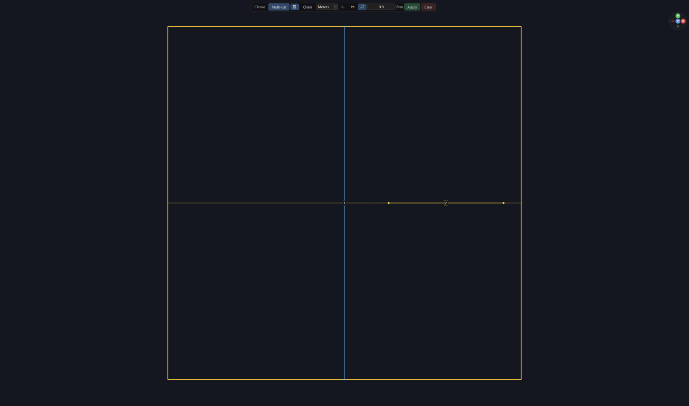

The same two strokes are ready for Bounded and unbounded Apply in a simple box Sector.

| Bounded cut on | Bounded cut off |
| --- | --- |
| 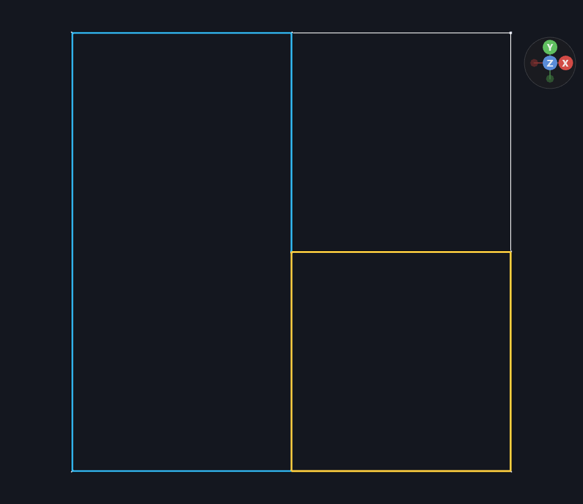 | 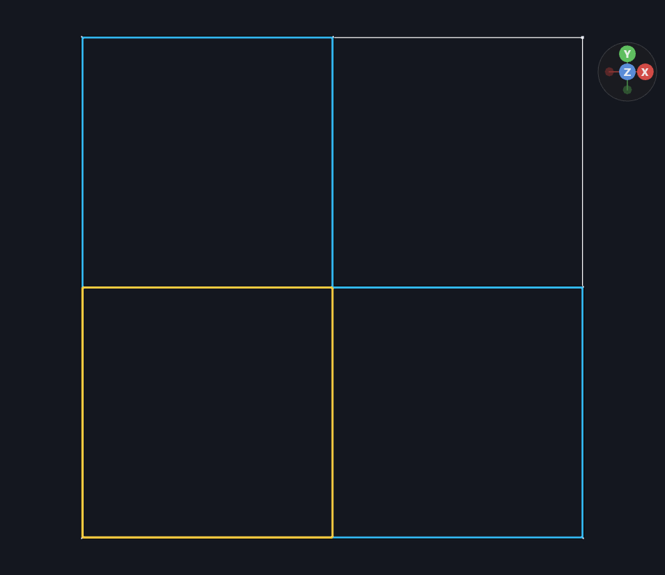 |
| **Three Sector pieces.** Line 2 reaches only the right half. | **Four Sector pieces.** Line 2's infinite plane divides both halves. |

**Cleave walkthrough**

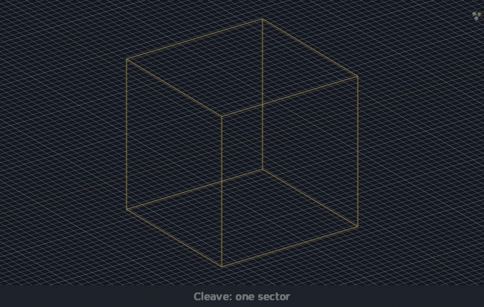

One cut is staged in **Multi-cut** mode, then **Apply** produces two convex sectors. This is the staged workflow, not the
immediate click-drag-release Cleave workflow.

**Multi-cut example**

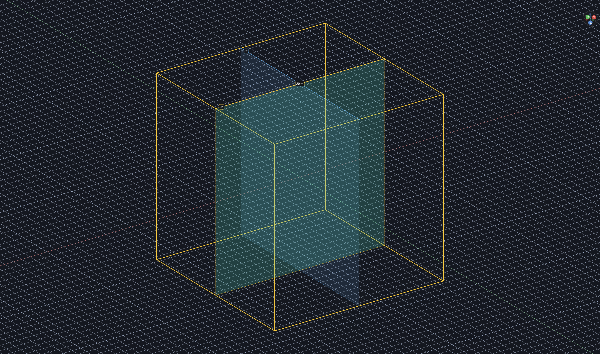

Two perpendicular cut planes staged in one box sector.

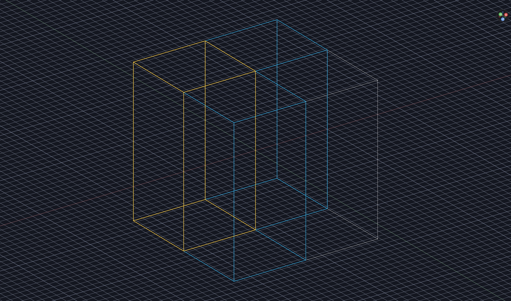

After Apply, the box is split into four convex sectors.

Grid Snap uses the active grid's origin, orientation, and adaptive minor spacing. A cleave point remains on its
active face or construction plane; when that plane is parallel to the grid it lands on the exact displayed lattice,
while an oblique grid is projected into the interaction plane. For a precise planar cut, align the grid as needed, use
`F2` to look perpendicular to it, then enable Grid Snap while placing or moving the endpoint. Ctrl reverses that choice.

### 🔗 Join

Select two or more sectors, make the intended cutter the active selected sector, and press **J**. The active selected
sector is the cutter; every other selected sector is a target. You can select several target sectors, and Join applies the
cutter to each compatible target. If the active sector is not selected, SED uses the lowest-index selected sector as the
cutter. Join uses the cutter volume to split compatible overlapping targets and builds matching portal surfaces, then
shows a preview. Press **Apply** to commit or **Cancel** to discard it.

**Keep overlap pieces** is on by default and retains overlap pieces created by the cutter/target operation. Turn it off
for cut-target-holes-only behavior: SED discards cutter pieces that enter the target volume, keeps the target volume
apart from its surface cuts/adjoins, and retains the outside cutter pieces that form the holes. The preview lines show
the selected sector family involved; the result selection follows the cutter family.
Join does not simply merge all selected sectors into one sector. Frustum-clipped preview lines remain stable near the
camera.

**Join options bar**

| Option | Default | Use |
| --- | --- | --- |
| Keep overlap pieces | On | Retain the cutter/target overlap pieces created by the operation. Turn it off for the cut-target-holes-only behavior described above. |
| Apply | — | Commit the preview as one edit. |
| Cancel | — | Discard the preview. |

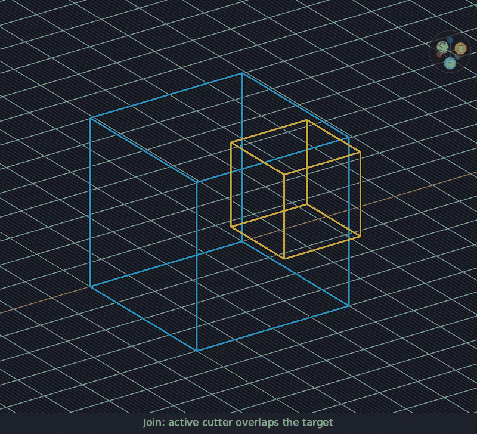

The active selected sector overlaps the target, Join shows the preview, and **Apply** commits it.

### 🧩 Merge

Surface Merge repeatedly combines selected adjacent, coplanar, flat faces in the same sector when the merged result stays
valid and convex. Bent, non-adjacent, incompatible, or cross-sector faces are skipped and remain separate. Sector Merge
similarly retries compatible adjacent pairs from the selected group while each result remains a valid convex sector, so a
selection can produce several merges while incompatible sectors remain separate. Thing ownership, COG references,
reciprocal portals, and UV data are remapped or preserved transactionally; a rejected candidate leaves the level unchanged.

Surface Merge retains the lower-index surviving face's texture mapping and applies that mapping to added corners;
existing surviving corners keep their authored UV values. Different selected UV islands are not stitched automatically.

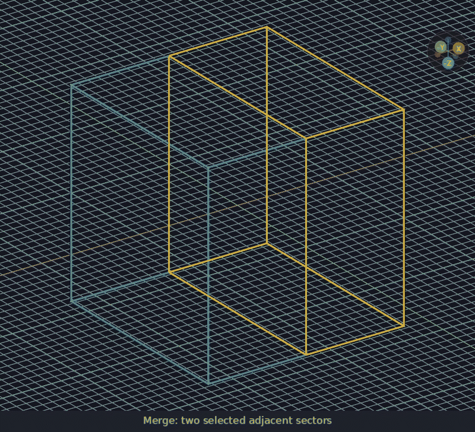

Two adjacent selected sectors merge into one. Outer faces can remain subdivided, so visible outer edges do not all
disappear.

### 📦 Import and export Sector(s)

OBJ import understands polygon objects/groups, positions, UVs, and material names. Multiple sequential closed shells in
one object can become separate sectors. 3DO import uses non-empty hierarchy nodes as sector instances and applies each
node's parent transforms independently. Split import is enabled by default and attempts to adjoin matching faces.

For OBJ, **Transform OBJ coordinate system to SED coordinate system** is enabled by default. Keep it enabled for
ordinary OBJ files exported from Y-up modeling tools. Disable it for an OBJ that is already authored in SED/Sith Z-up
coordinates, such as an OBJ exported by SED. The option rotates positions from OBJ Y-up to SED Z-up without changing
polygon winding or rotating, flipping, or reordering UV islands. 3DO geometry already uses the Sith convention and is
not affected by this option.

SED imports OBJ polygon positions, 2D UVs, object/group names, and `usemtl` material names. Standard weighted positions
are converted correctly, and names containing spaces are retained. OBJ vertex normals are not imported because SED
recalculates reliable Sector normals from the final polygon geometry. MTL libraries, smoothing groups, points, lines,
curves, parameter-space vertices, and optional third texture coordinates are not part of Sector import.

Faces without OBJ texture coordinates receive SED's default projected texture layout. For a normalized live Level,
that projection uses the face MAT's real width and height; if those dimensions cannot be read, the complete import is
rejected instead of creating a misleading or partly converted texture layout.

Ordinary OBJ texture coordinates are normalized, like SED's live editing coordinates, so they import without
material-size scaling. The axis transform affects only 3D positions and never rotates, flips, or reorders the 2D UVs.
SED also recognizes older SED-authored OBJ files marked as pixel UVs; those require each face's real MAT dimensions and
are converted as one complete operation rather than guessed or partly changed. New OBJ exports are explicitly marked
as normalized and round-trip without scaling.

Every imported sector must be closed, manifold, planar-faced, and convex. Invalid input is rejected without partially
changing the document. Combined import is available, but disconnected or concave source geometry usually cannot form one
valid sector.

An import error that reports **open boundary edges** means the source has holes that must be closed or filled. An error
that says the mesh is **closed, but cannot form one SED sector** means some edges belong to three or more faces, usually
because internal, overlapping, or duplicate polygons were exported. Remove those faces or split the mesh into separate
closed convex objects. Expand **Show Details** to see the source mesh/object, affected face or corner, edge endpoint
indices and positions, owning faces, and edge-use count where those details apply. Long issue lists are safely bounded
to 16 topology issues and eight named owning faces per edge; the full edge-use count and omitted counts are retained.
The same details and selected source path are recorded once in `sed.log` under the Core category.

OBJ and 3DO export write selected sectors atomically. Polygon geometry, per-corner UVs, and material names are retained.
OBJ writes normalized UVs. Classic JKDF2/MotS 3DO 2.1 writes pixel UVs using each face's MAT dimensions, while IJIM 3DO
2.3 writes normalized UVs. Editor-only metadata and sector portal relationships are not native OBJ/3DO concepts and
are therefore not stored in those files.

### 📋 Copy and paste

| Action | Shortcut |
| --- | --- |
| Copy | **Ctrl C** |
| Paste | **Ctrl V** |

Ctrl C and Ctrl V copy and paste selected Sectors, Things, baked lights, or MotS ARCHLIGHTING. Copy is based on the
current edit family:

- Sector mode copies complete Sectors
- Thing and Frame modes copy complete Things, including their frames
- Thing Light and Sector Light copy the owning Thing or Sector
- Baked Light copies independent baked lights
- MotS ARCHLIGHTING copies the selected Arch owner's vertex-lighting payload. An effective **Arch flag** (`thingflags & 0x8`) owner
  without an explicit record is still a valid source and contributes virtual zero values.

In MotS **Arch** mode, select an effective Arch owner (a Thing with the effective **Arch flag**, `thingflags & 0x8`) or one
of its selected vertices, then press **Ctrl C**. Select compatible target model Things, whether already Arch owners,
unbound, or unflagged, and press **Ctrl V** or choose **Edit > Paste**. The clipboard stores an immutable
ARCHLIGHTING snapshot, so later source edits do not change the paste. Targets must resolve to the same normalized 3DO
identity and compatible topology at every LOD. Paste promotes a compatible unflagged target by setting its instance
Arch bit while preserving its other flags. A successful paste binds all accepted targets as one Undo step; a no-op,
locked, hidden, stale, or incompatible selection leaves the document and history unchanged.

Surfaces, Edges, and Vertices are parts of a Sector and cannot currently be copied on their own. Copy the complete
owning Sector when you need to move that geometry between levels or SED instances. In Arch mode, selected
vertices are edited as a set; they are not a clipboard entity.

Copy uses the system clipboard, so the selection can be pasted into another running SED instance. SED uses a
private, validated native payload rather than plain text. For Sectors, adjoins between copied Sectors are remapped to
the new copies; links to Sectors that were not copied become safe solid boundaries. Missing layer names are added to
the destination by name. Thing frames and baked-light settings are preserved.

Paste places the copied anchor at the point under the viewport pointer, or at the camera target if there is no usable
point. The pasted entities become the new selection, SED switches to their matching edit mode, and the complete paste
is one Undo step. For ARCHLIGHTING, Paste targets selected model Things with the same normalized 3DO identity and compatible all-LOD
topology, including unbound targets. An effective Arch owner without an explicit record contributes virtual zero values;
a compatible unflagged model target is promoted by setting its instance Arch bit. The source snapshot is immutable and
the target bindings use copy-on-write. A locked, hidden, stale, incompatible, or otherwise invalid target rejects the
whole paste atomically.
There is no separate **Paste in Place** command yet. Resource files are not embedded in the clipboard, so use
compatible templates, materials, models, sprites, scripts, and sounds when copying between different game projects.

## ⚠️ 7. Surface vertices and deliberate destructive repair

**Vertex deletion shortcuts**

| Action | Shortcut |
| --- | --- |
| Delete | **Delete** |
| Force Delete Vertex | **Shift Delete** after its warning |

In Surface Face mode, Delete removes selected faces and can leave an open Sector. In Edge mode, Delete does nothing.
Shift Delete applies only in Vertex mode.

Normal Delete in Surface Vertex mode is conservative. It removes only:

- a vertex unused by every surface, or
- a redundant collinear vertex lying between its neighbors where every sharing face restores the same unsplit edge.

On a shared edge, both faces and their matching UV corners are updated together. Area-selecting a mixture of redundant
and structural vertices removes the safe vertices and leaves the structural ones; it never turns the owning face
selection into a polygon-delete command.

> ⚠️ **Force deletion can damage geometry.** If a selected vertex is structurally required, normal Delete leaves it in
> place. Shift Delete is the explicit force operation. It asks for confirmation because it removes the selected vertex
> references and can intentionally leave invalid surfaces that must be repaired. The warning offers **OK** and
> **Cancel**, with Cancel selected by default. Both commands are undoable.

After structural edits, use the Consistency Checker before saving or exporting.

## 🎨 8. Surface extrusion and UV editing

Extrude creates a live preview from one selected face. Adjust **Length** and **Expand**, then Apply or Cancel. Length
must be positive and extends outward from the face. The result must remain a closed valid sector; newly generated
geometry is checked for convexity while supported legacy source rounding is preserved. Its Grid Snap button is the same setting used by viewport Move: when enabled, both values step on the active grid's currently
displayed minor spacing; when disabled, they keep the exact numeric value you enter. A negative Expand is always kept
above the selected face's collapse limit. Preview opacity is configurable in Preferences. A canceled or unchanged
preview creates no undo entry.

**Extrude options bar**

| Option | Use |
| --- | --- |
| Length | Positive distance outward from the selected face. |
| Expand | In-plane expansion of the new outer face; negative values stop above the collapse limit. |
| Grid Snap | Quantize Length and Expand to the active grid's effective minor spacing. It follows the shared Grid Snap control. |
| Apply | Publish the valid preview as one edit. |
| Cancel | Discard the preview without an undo entry. |

When **Expand** produces a rectangle that fully contains the selected footprint, SED keeps the authored source contour
and builds the surrounding ring from that contour and the rectangle corners. Rounded source corners, UVs, baked-light
colors, and other authored values remain attached to their original corners. Plain translated caps retain every authored
UV and baked-light tuple. Expanded caps retain matching authored corner tuples; newly created cap corners extend the
source mapping deterministically. If that projection cannot be represented safely, SED keeps the geometric mapping for
those new corners while retaining matching authored tuples. Side walls keep their geometric mapping. If the candidate
cannot pass the complete closed-boundary, portal, and generated-face checks, SED retries from the unchanged source using
its fragment construction; an allocation failure leaves the operation unpublished.

### ✂️ Surface Cleave and arch extrusion

For shared controls and modifiers, see [Cleave](#6-build-and-edit-sectors). In Surface Face mode, select one wall face,
arm **Cleave**, and turn on **Multi-cut**. You can draw independent cuts, continue a **Chain**, or use **Add Shape** to
place a centered outline on the face. Choose **Rectangle**, **N-Gon**, **Filled arch**, or **Star**, set its
dimensions and count, then click the placement point. A fresh shape starts at 1 displayed unit, or 0.1 in Bare.
Dimensions use the Cleave bar's project-aware **Units**; changing only the unit preserves the authored physical size.
The width, height, segment, and point controls accept the mouse wheel while hovered. **Ctrl wheel** over the
viewport scales the armed shape uniformly; **Ctrl Shift wheel** rotates it using Angle step, with 5 degrees per
step when Free is selected. Hold Ctrl to reverse Grid Snap or Shift to prefer nearby geometry.
Escape leaves shape placement and keeps the draft. During a live shape wheel gesture, its first Escape instead
restores the pre-gesture placement options and keeps the shape armed.

N-Gon always uses equal dimensions. The polygon width is its circumcircle diameter; **Link** keeps
the other shapes' width and height equal. Filled arch has straight jambs and a curved cap. The new cuts remain ordinary
editable lines. Star includes internal divisions so its concave outline is split into convex pieces; select and
extrude each resulting piece separately. Some point counts create further subdivisions, so a tip need not be one face.
Surface Extrude accepts exactly one selected face at a time.

Sector Add Shape offers the same four shapes. By default it attaches and orients the outline to a Sector surface.
Turn on **Camera plane** to place it freely on a plane facing the camera. This option is available only in Sector
Cleave; Surface Add Shape continues to use the selected face.

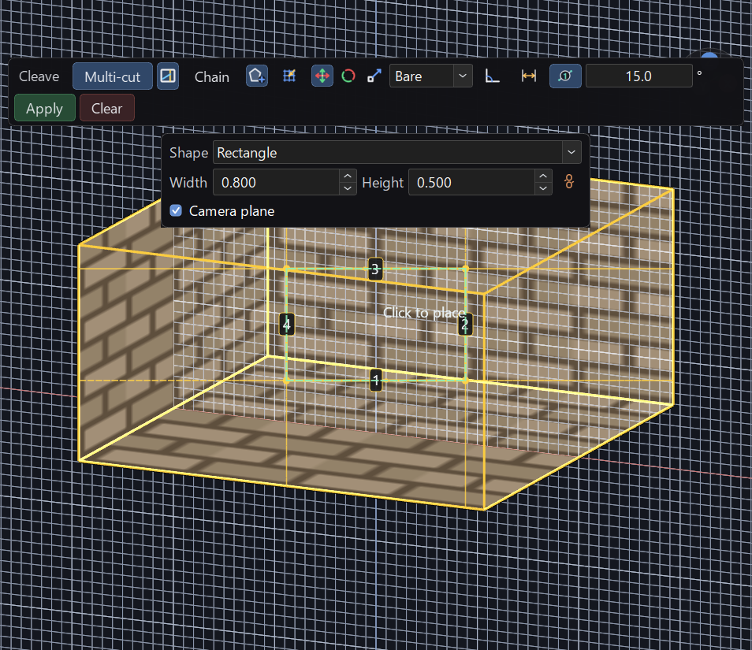

Camera plane places the Sector outline freely on a plane facing the camera.

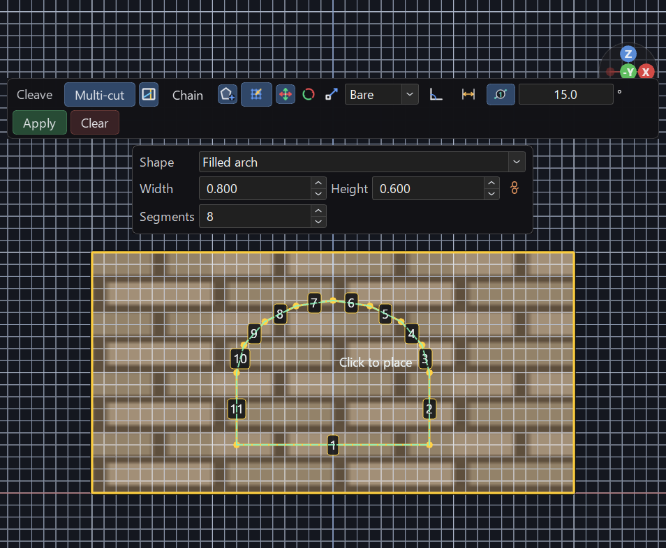

Add Shape places ordinary editable cuts on the selected face.

Select the lines you want to adjust, choose **Rotate**, and drag to the desired angle. You can also Move or Scale the
group. These edits change the pending cuts while the Level remains unchanged.

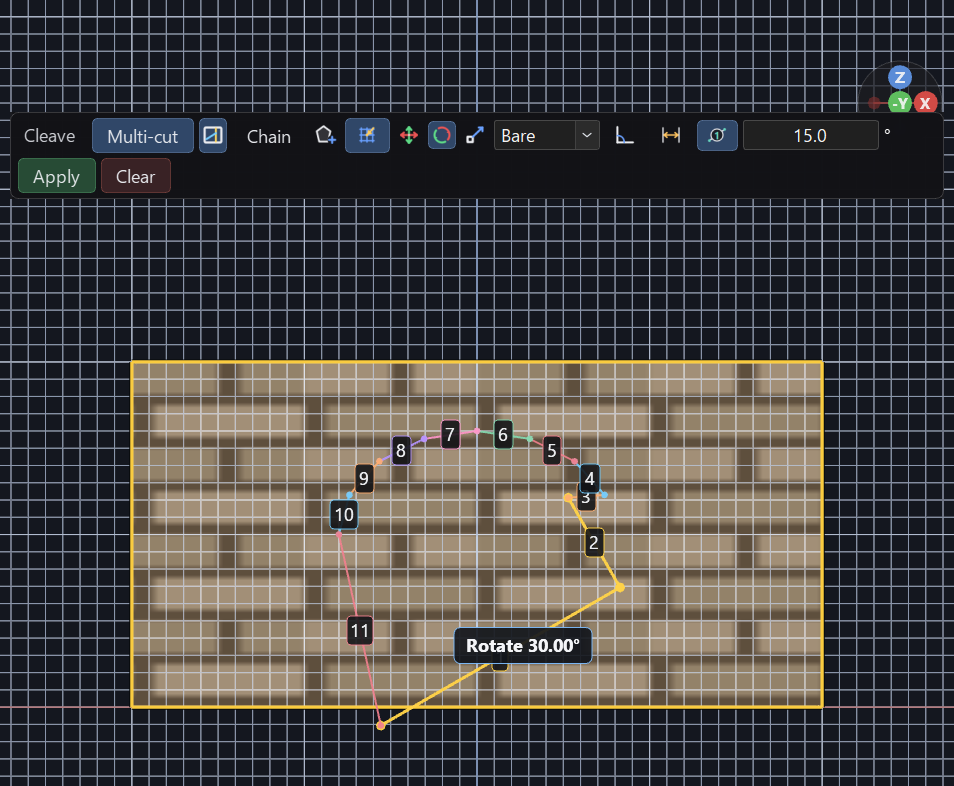

Rotate changes the highlighted draft lines before Apply.

Turn on **Numbers**, click a rank, and type the order in which that line should Apply.

| Edit a rank | Accepted order |
| --- | --- |
|  | 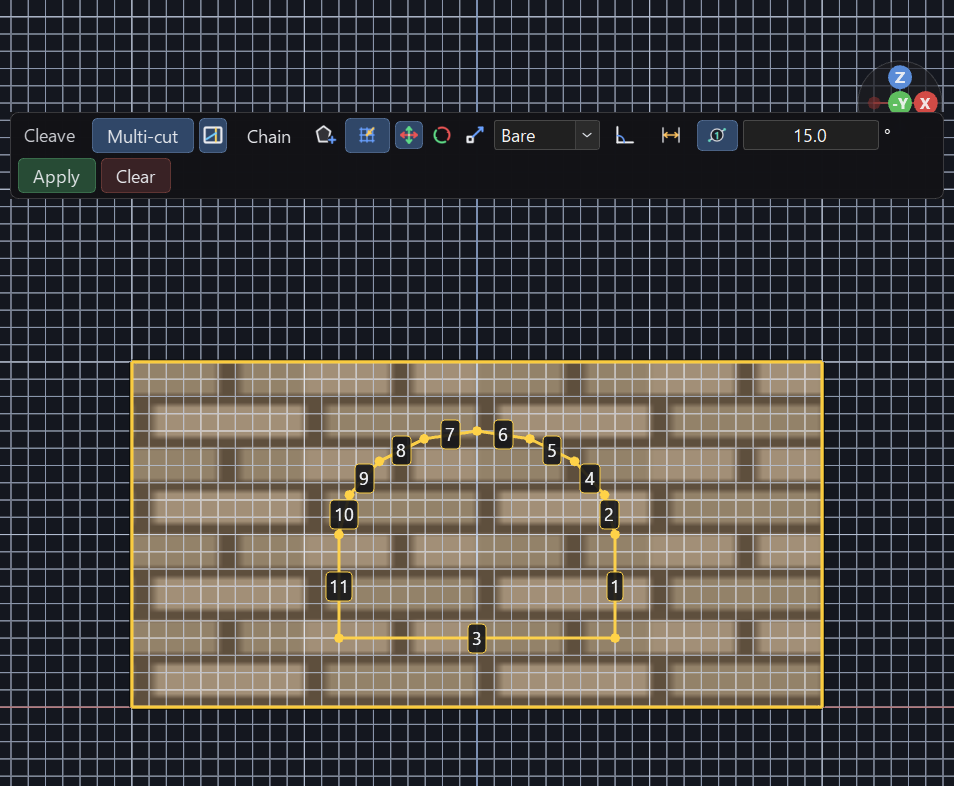 |
| Click a number and enter its new execution rank. | The numbers change while endpoints and joins stay in place. |

**Compare Bounded cut**

Leave Chain off. Draw line **1** vertically across the selected wall, then line **2** horizontally with both endpoints
entirely to the right of line 1. The same two strokes show how earlier cuts limit a later stroke's reach:

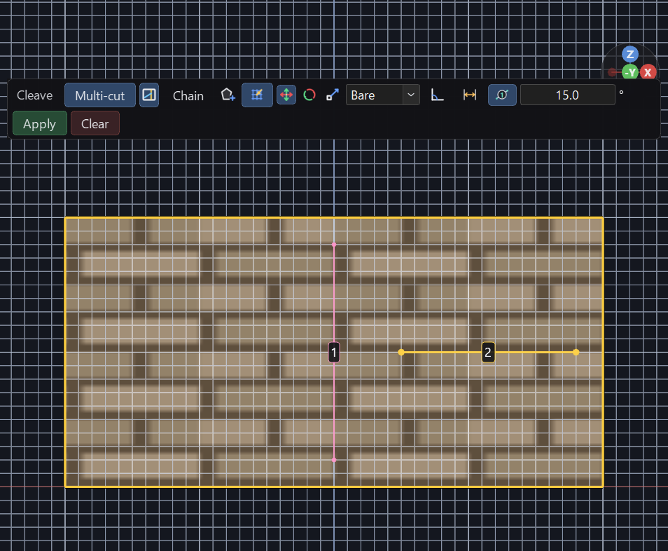

The same two strokes are ready for Bounded and unbounded Apply.

| Bounded cut on | Bounded cut off |
| --- | --- |
| 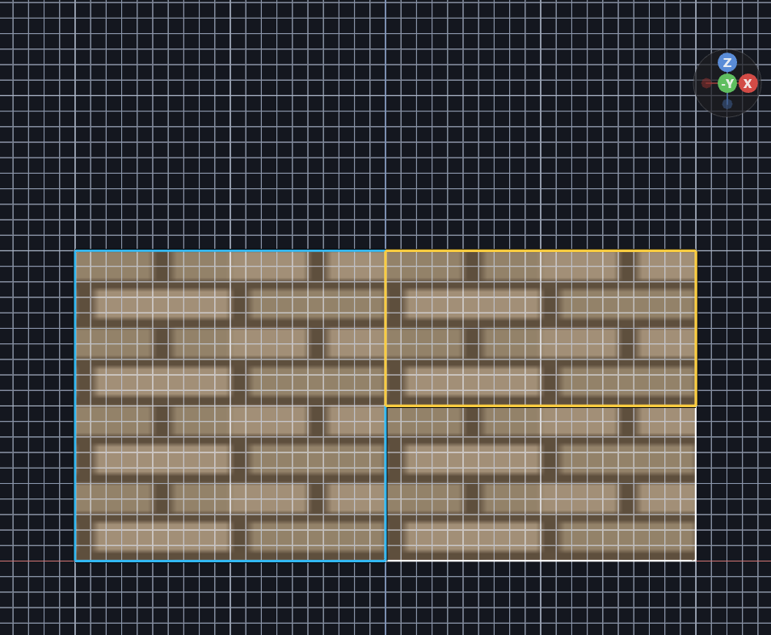 | 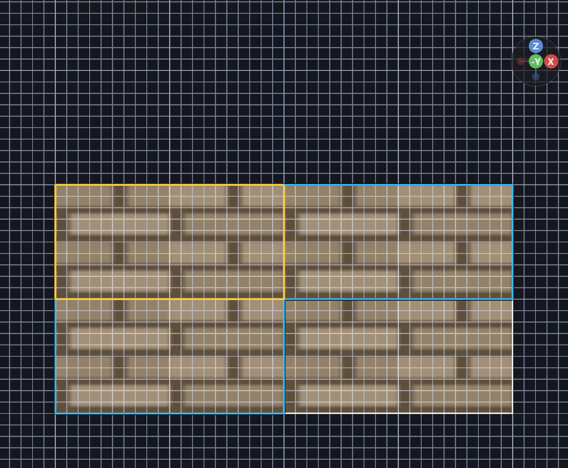 |
| **Three face pieces.** Line 2 reaches only the right half. | **Four face pieces.** Line 2's infinite plane divides both halves. |

Within every reached piece, the plane cuts its full extent. Extend line 2 across line 1 to reach both halves; ending
on line 1 alone does not reach the other half. Apply follows the displayed ranks, so reversing their order can also
change the result.

**Apply and extrude the arch**

When the Filled arch draft is ready, choose **Apply**. Select the central convex arch face and assign a contrasting
material in **Item Edit**.

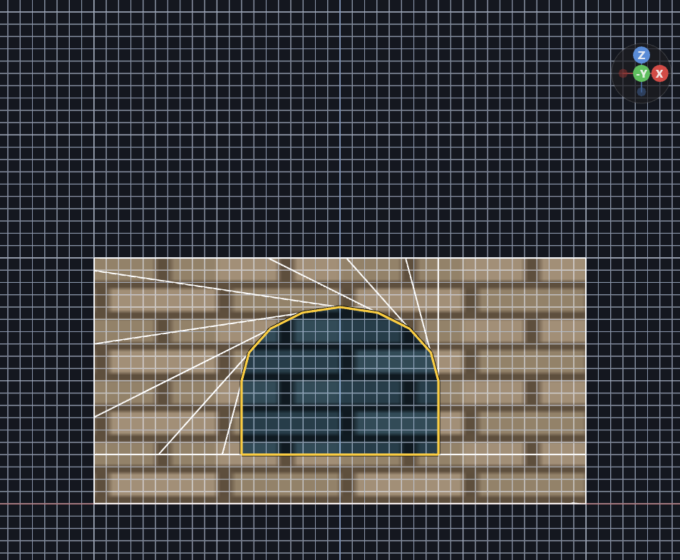

Select the central convex face for extrusion.

Start **Extrude**, set **Length** to `0.25` and **Expand** to `0`, then choose Apply. Turn off
Extrude's Grid Snap if you want the exact entered values. The resulting short arch-shaped extrusion has convex side
faces that are easier to inspect from an oblique view.

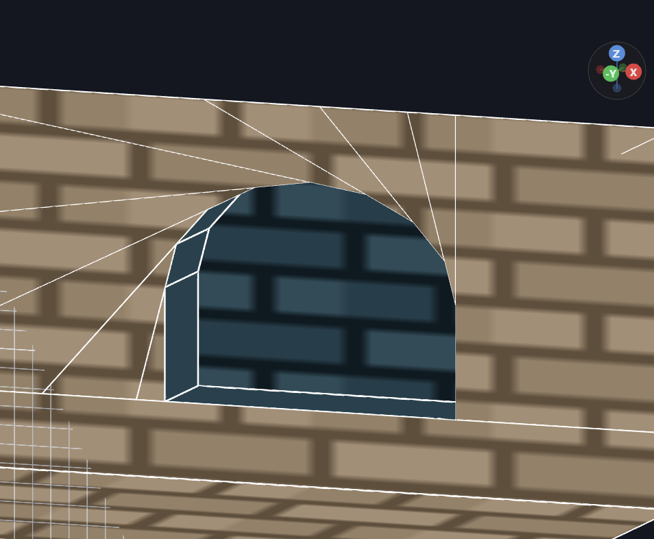

The contrasting materials distinguish the wall and extruded arch.

### 🎨 UV editor

The docked UV editor displays texture islands for selected surfaces. It provides Move, Rotate, and Scale modal tools,
snapping, repeat/grid controls, framing, and display options. A modal transform updates only affected UV ranges while
dragging, creates one undo checkpoint when committed, and creates none when canceled or unchanged. UV state and open
editor layout are included in native SED editor state and recovery.

**UV editor controls**

| Control | Use |
| --- | --- |
| Move / Rotate / Scale | Apply a modal UV transform to the selected island, face, edge, or vertex. |
| Snap | Prefer a valid nearby UV target; hold **Ctrl** during a modal move for a temporary snap. |
| Grid size | Set the main UV drawing and fallback snap spacing. |
| Sub-grid | Draw and snap to four subdivisions inside each main cell; off by default. |
| Minor | Choose **Lines** or **Points** for the sub-grid; Lines is the default. |
| Point diameter | Set sub-grid dots from **0.5–10 logical pixels**, default **2**; affects the Points style. |
| Repeat | Repeat the texture preview beyond the first UV tile. |
| Tile grid | Draw borders between repeated one-UV tiles; off by default. |
| 1 UV | Set Grid size to one complete UV tile (`1.0`). |
| Scale × / Apply | Enter a positive uniform scale multiplier around the current pivot and commit it. |
| View Face | Rotate or reflect the canvas to the active face's viewport orientation without changing stored UVs. |

SED edits UVs in texture-relative units: one unit spans one complete texture, independent of its pixel dimensions.
Coordinates may be negative or extend beyond `1.0` to repeat a texture. Numeric **Move Surface UV**, **Rotate Surface
UV**, and **Scale Surface UV** accept precise decimal or scientific input, using the chosen UI decimal separator. Small
values survive typing, stepping, and focus changes. Canceling either axis leaves the entire operation unapplied.
Classic JKL/JED and 3DO 2.1 files use pixel
coordinates, so SED converts material-bearing faces with the referenced MAT dimensions when opening or exporting; this
does not change the layout seen or manipulated in the UV editor. Classic JKDF2 and MotS files may also contain faces
without a material. During JKL import, SED leaves all-zero unused UVs at zero and gives nonzero values a fresh
geometry-proportional normalized island whose longest planar extent is `1.0`; faces that cannot form an island use zero
UVs. Corner colors are preserved. The import publishes normalized data only after every real MAT
conversion succeeds. If a required MAT cannot be resolved, SED keeps the original pixel data and the warning names
the missing filename; a JKL no-resource or failed-resource load likewise keeps the source pixels. Later resource recovery
preserves unused no-material UVs, and material-less export passes those values through unchanged.

Use Face, Edge, or Vertex mode to choose the selection detail. Repeatedly click the same screen position to cycle
through overlapping UV faces, edges, or vertices from front to back. Face cycling wraps to the front. Edge and Vertex
cycling adds one final step with no red primary marker; the selection stays intact and transforms use its center.
Otherwise the exact active vertex, or the midpoint of the exact active edge, is drawn red and becomes the pivot for
Move, Rotate, Scale, mirror, and numeric scaling. In Face mode, clicking a selected face vertex sets that red pivot
without converting the face into a component selection; clicking the face-center marker restores the usual center
pivot. In Vertex or Edge mode, click the selection-center ring to clear only the exact red pivot and return transforms
to the selection center; the selected vertices or edges remain selected.

Enable **Snap** or hold Ctrl during a modal move to constrain the result to a valid UV target. In Edge mode a compatible
nearby parallel edge can be overlaid endpoint-to-endpoint, including an edge with reversed winding. The move can also
acquire a nearby vertex on any wholly unselected island or, when moving a complete face/island, the center of another
wholly unselected face/island. A moving island never snaps to one of its own vertices, edges, or center. When no nearby
geometry qualifies, the move always falls back to the visible grid rather than leaving the UV at a free unsnapped
position. **Grid size** owns the main spacing. Enable **Sub-grid** to draw and snap to four subdivisions inside each main
cell; it is off by default, and nearby geometry still takes priority. The selected viewport theme controls the UV
canvas background, main and sub-grid colors, and U/V axis colors under Preferences > Viewport > Appearance > Theme.

The **Minor** style and point diameter affect drawing only; Sub-grid still controls quarter-cell snapping. SED suppresses
overcrowded point drawing at dense scales. Appearance choices are remembered in preferences and in native Save,
autosave, and recovery.

**Repeat** repeats the texture preview beyond its first UV tile. The separate default-off **Tile grid** option draws
the white borders between those repeated one-UV tiles. Click the adjacent **1 UV** button to set the main **Grid size**
spacing to the same `1.0` UV tile interval; this changes snap/grid spacing without changing whether texture repetition
or tile borders are shown. Use the compact **Scale ×** field at the end of Transform, enter any positive multiplier
(for example `0.5`, `1.25`, or `2`), and click **Apply** for a precise uniform scale around the current pivot.

**UV operation buttons**

| Operation | Use |
| --- | --- |
| Auto Align | Rebuild the selected surfaces' UV layout from their geometry. |
| Stitch Ref | Copy mapping from the active reference to each selected target independently. |
| Stitch Chain | Align UVs through selected surfaces connected by shared geometry or adjoins. |
| Pack | Pack selected islands without overlap. |
| Smart UV Project | Group by direction, project and rotate islands, then pack them with the requested margin and scale. |
| Follow Active Quads | Propagate the active quad's layout through a compatible selected quad strip. |
| Copy Texture & UV | Use the active reference's texture mapping while retaining target corner lighting. |

Stitch preserves mirrored mapping orientation across shared boundaries, including subdivided portals, and Stitch Chain
requires actual shared geometry. Operations validate their complete result before changing stored UVs.

## 🎭 9. Things, resources, and templates

Resources are discovered from the project directory, configured resource roots, and mounted GOB/GOO archives. Missing
resources are reported in Messages and cached so repeated viewport updates do not repeatedly search the same missing
file.

Use File commands to add a resource root or mount an archive. Resource pickers provide search, categories, thumbnails,
and audio preview where applicable. Loose files can be edited directly; bundled archive resources are read-only until
extracted or recreated as project files. Search waits for a brief pause in typing before refreshing a large thumbnail
list, so several typed characters are applied together without repeatedly rebuilding the current 3D preview.
While the search text is changing, queued model thumbnails pause and resume after a short quiet interval. Closing the
picker cancels the remaining preview queue, so filtering or leaving a large 3DO list does not keep the editor busy.
The 3DO and template browsers prioritize models currently visible in the list. Opening a raw 3DO picker therefore does
not wait for every off-screen model to be read before its first visible thumbnails appear. Reopening a browser can
reuse thumbnails and renderer preparation from the current resource generation. These browsers prepare an empty,
hidden 3D viewport host before opening, but do not read or display a model until a model-backed selection needs it.
This lets the browser paint its dark loading surface and list first without remapping the visible window later. An
initially selected 3DO is queued before background thumbnail batches; a completed selected model is also rechecked
until its interactive preview replaces the loading page.
Editing a loose 3DO, MAT, SPR, or CMP still invalidates the affected preview inputs automatically; mounted archive
replacement is detected as well. If an archive replacement is temporarily missing or malformed, the editor keeps the
prior complete resource index, reports the failure, and retries automatically. After a successful reload, open picker
and template lists and their previews refresh to the new resources.

3DO list thumbnails include every model mesh, including dense small parts such as actor heads, and their normal
materials. Background workers load, render, and cache the thumbnails without blocking the editor; the interface only
publishes completed icons in short visible batches. While you scroll or type a search, completed icons wait briefly so
the list and rotating 3D preview stay responsive; after you pause, the selected item appears first and the visible rows
fill progressively. New icons are deliberately paced between preview frames rather than repainting the list on every
completed worker result. Rows already being prepared wait for their worker completion instead of being repeatedly
checked, and each completed thumbnail repaints only its own tile.
Thumbnails are rendered larger and reduced without changing their proportions, so small model parts remain clear and
wide models are not squeezed. Thumbnail lists scroll smoothly and page scrolling retains one row for visual context.
Use **Preferences > General > Resource previews** to change the worker count or the number of completed thumbnails
shown per interface update. Higher values can fill a cold or warm list faster but use more CPU; the defaults favor
interaction.

Model and sprite previews share the same source texture orientation as the editor viewport. Classic and IJIM model UV
formats are handled automatically, and changing a loose SPR's referenced MAT refreshes both its list thumbnail and
selected preview.

Thing placement uses project templates. Filters and categories help narrow large template collections. Placed Things
can override template values in Properties without changing the source template.

To place one Thing, enter **Thing** mode, choose a template in the placement panel, keep **Place** selected, and click
the target surface. Switch to **Align** when the Thing should follow that surface's normal, or **Free** to place it
inside a sector without surface contact. Choose **Brush** to click or drag repeated placements; its Size, Count, Shape,
Spacing, and Scatter controls determine the stamp. Preview the result and use Undo if a stamp lands on the wrong layer
or surface.

**Thing placement options**

| Control | Default | Use |
| --- | --- | --- |
| Surface / Align / Free | Surface | Place on the picked surface, align to its normal, or place freely inside the containing Sector. |
| Snap to Thing | Off | In Place mode, snap a new Thing to a compatible side or connector on a nearby Thing. Brush samples ignore this option. |
| Rotate to Align | On when Snap to Thing is on | In Place mode, rotate the new Thing to align with the snapped side or connector. Brush samples ignore this option. |
| Layer | Auto | Use the visible target Sector's layer, or the last visible layer when the target layer is unavailable. |
| Place / Brush | Place | Place one Thing per click, or paint repeated placements by clicking or dragging. |
| Active | Off | Keep the selected template active after placing. |

When Brush is active, its options are:

| Option | Default | Use |
| --- | --- | --- |
| Size / Count / Shape | `0.25` / `5` / Circle | Set the brush radius, number of samples, and Circle, Square, or Rectangle footprint. |
| Random rotate | On | Randomize placement rotation. |
| Axes | Pitch off, Yaw on, Roll off | Choose which axes random rotation may change. |
| Angle | `0` | Set the fixed rotation angle when Random rotate is off; with Random rotate on, this control is disabled. |
| Spacing | `0.55` | Set the minimum distance between brush stamps as a multiple of brush size. |
| Scatter | `0` | Randomize sample positions inside each stamp; `1` fully scatters them. |
| Allow air | Off | Allow samples without a surface hit when they remain inside a Sector. |

With **Random rotate** on, the preview shows the final positions but example orientations; placed Things may face different directions.

The default placement modifiers are **Ctrl** for the Surface Tilt modifier and **Shift** for Free Insert. Both bindings
are configurable in **Preferences > Keymap** and can have multiple alternatives. Each placement alternative is
an exact match; if Free Insert and Surface Tilt both match, Free Insert takes precedence. Removing all alternatives
disables that temporary modifier action.

Use **View > Grid > Align View to Grid Plane** (`F2`) to look perpendicularly at the current grid and center the camera
target on its authored origin. The grid origin/orientation itself is unchanged, including for an arbitrarily rotated
grid and when **Reset align/center on camera rotate** is enabled. After alignment, ordinary manual camera rotation can
still reset that temporary grid transform. This is the modern form of JED's View to Grid. **Align Grid Plane to View**
(`F3`) is the reciprocal original-JED command and changes the grid instead of the camera.
Both commands use the complete current camera/grid frame even after the camera has revolved past a pole: F2 retains
the authored grid origin and axes, while F3 retains the origin and copies the visible screen-right/screen-up axes.

### 🧰 Resource categories and previews

Resource Pickers browse the active project's loose resource roots and mounted GOB/GOO archives. They are used for COG,
MAT, 3DO, KEY, WAV, AI, templates, messages, CMP, SND, PUP, SPR, PAR, and UNI resources.

#### Sources, categories, and search

The left **Sections** browser contains **All** and either source locations or a category tree, depending on the resource
kind. Template, material, and sound categories may contain names whose assets are currently unavailable.

| Control | What it does |
| --- | --- |
| **Sections > All** | Lists discovered resources across the project's roots and mounted archives. The WAV view also includes sounds directly in a root or archive, alongside the usual sound directories. |
| Source section | Browses an individual loose root or mounted archive when source sections are available. |
| Category | Filters the list to that category's resource names. Expand a branch to reach its nested categories. |
| **Mask**, with the **Search...** hint | Filters names by case-insensitive text within the current section. Clear it to show the section's full list. |
| **Sort** | Chooses **Name (A-Z)**, **Name (Z-A)**, or **Source order**. Source order follows the selected category or resource list. |
| **Layout**, where available | Chooses **No thumbs**, **Small thumbs**, **Middle thumbs**, or **Large thumbs** for the thumbnail list. |

Right-click a category to add, nest, rename, or delete it. Drag one or more selected resources onto a category to assign
them; Ctrl-drag from a category moves their membership. Project-local category files override shared ones once the level
has a saved directory. Category edits organize names and do not copy their resource files.

#### Selection, preview, and storage

Click an entry to inspect it; the bottom name field shows the current choice. Choose **OK**, or double-click the entry,
to accept it. **Cancel** leaves the calling field unchanged. An unavailable name cannot be confirmed as a loaded resource.

| Display or control | Meaning |
| --- | --- |
| **Preview** | Shows the selected resource's image, model, text, or sound information when supported. A missing or unsupported preview does not identify its storage source. |
| **Storage: &lt;absolute path&gt;** | Shows the full loose-file path resolved for the current item and source section. |
| **Storage: &lt;archive name&gt;: &lt;entry path&gt;** | Shows the GOB/GOO basename and case-preserved entry, for example `Storage: test.gob: misc/snd/Foo.SND`. |
| **Storage: Project data** | The current project provides this resource directly, rather than from a file or archive. |
| **Storage: Template database** | Template entries belong to the active project's template database rather than an individual `.tpl` resource file. |
| **Storage: Unavailable** | The selected file-backed name has no available source in the current context. An empty selection clears the storage information. |
| Bold resource name, in views using loose-copy emphasis | A matching loose copy is available in the configured roots. An explicitly selected archive can still supply its preview; use **Storage** to identify that source. |
| Normal resource name, in those same views | No matching loose copy was found in the configured roots. The item may still be available from an archive. Template and model thumbnail views do not use this font hint. |
| **Orthographic / Perspective**, shading, and **Fit** | Applicable 3D previews offer projection, **Textured / Solid / Wireframe / Vertices**, and framing controls. These change the preview only. |
| Drag / mouse wheel over an interactive 3D preview | Left-drag or middle-drag rotates the view; the wheel zooms. Use **Fit** to frame the resource again. |

The **Storage** line follows selection independently of thumbnail or model loading. It sits below image or rendered
previews and inside text/audio metadata. Material, sprite, model, and template views show images or rendered previews
where supported; text and audio resources use their corresponding preview pages.

#### Sound preview

The WAV picker displays decoded duration and channel information and converts IJIM sounds for preview automatically.
Opening it, restoring its initial selection, and changing categories stay silent.

| Control or action | Playback behavior |
| --- | --- |
| Select another WAV | Starts that sound's preview. |
| **Replay** | Plays the current sound again. |
| **Loop** | Controls repetition; changing it restarts an already playing choice with the new loop setting, and does not start a silent picker. |
| **Volume** | Sets the remembered picker preview volume from 0% to 100% and updates current playback. |
| **OK / Cancel** | Closes the picker and stops its sound preview. |

Viewport sector ambience follows the camera's current sector, crossfades between sounds, and has separate Editor and
Game Preview mute preferences.

### ✍️ Author loose resource files

Choose **Tools > Sprite Editor**, **Tools > UNI Editor**, or **Tools > Sound Class Editor** to open a
resource editor group. A new group starts empty; choose **New** or **Open** to add a file tab. Each editor has one
**New / Open / Save** toolbar. The three groups share a top dock tab bar by default, with one editor visible at a time.
**Tools > COG Script Editor** opens the COG group, with the same file toolbar. All four editors appear in Tools with
matching icons on their docks, floating windows, and grouped dock tabs. They are absent from **View > Windows**.
Drag a group's title/grip to dock it elsewhere or float it as its own resource window, then redock or tabify it with
another group. The SPR, Sound Class, and UNI docked headers offer **Undock** on right-click; their floating headers
have no context menu. COG uses its native dock titlebar.
Drop near a dock's upper or lower edge for a vertical split, near its left or right edge for a horizontal split, or in
its center to join another editor. A whole-window drop onto the same editor kind joins all its files into the target's
document tabs and keeps the dropped window's current file selected. A drop onto a different editor kind joins the
top window tab bar. Release when the docking target appears; enlarge the main window if there is not
enough room for another split. The SPR, Sound Class, and UNI groups use a lighter gray body to distinguish their title/grip.
Each Sprite, Sound Class, UNI, or COG file tab can detach: drag it outside its group to create a separate editor
window, or onto another file tab bar of the same editor kind to join that window. The existing editor, draft, local
Undo/Redo timeline, and modified marker travel with the file. Floating Sprite, Sound Class, UNI, and COG windows have a
native **Maximize** button; restore the window from its titlebar when finished. They keep their group New/Open/Save
toolbar, document tools, and a visible **Dock** return control. Drag the native window titlebar to split
the workspace or join another editor, or choose **Dock** to return the same host to its previous dock area. Individual
file-tab drops on another editor kind or another SED window leave the file in its current host. Native Save and recovery
remember file order, active
tabs, host membership, and floating windows.
During a file-tab drag, a **Join** label marks a same-kind editor that can receive it. Moving the last file
out hides its primary group; reopen it from **Tools** to use **New** or **Open**. An empty detached source closes.

File tabs show only the filename and a modified star. Hover a tab for its full loose path, or its archive and
case-preserved entry path, such as `test.gob: misc/snd/Foo.SND`. That origin survives native Save and recovery;
a successful loose Save replaces it with the destination path. The page does not repeat the filename or keep a
saved-path message on screen.

Each file page also has **Undo** and **Redo** icons inside its document tools. Their tooltips show the configured
Edit bindings, and each direction is enabled only when that file has a command to replay. Clicking an icon always
uses document history, including unfinished resource numeric text. While typing, keyboard Undo/Redo keeps the focused
text field's native history. Native Save, autosave, and recovery preserve each file's document timeline separately
from the Level timeline.

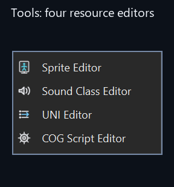

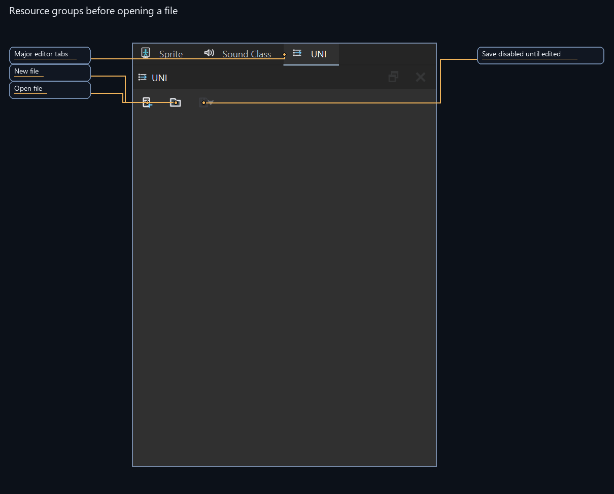

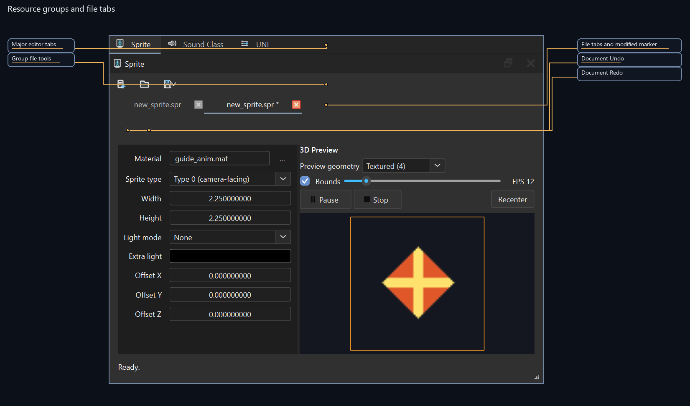

#### Resource fields

| Editor | Fields and controls |
| --- | --- |
| **Sprite (.spr)** | Set Material, Type, Width, Height, Geometry mode, and Light. Both profiles edit Geometry mode; classic pages also edit texture mode, while IJIM preserves that ignored source token. Width and Height edits stop at zero. Extra light uses the active project's SPR layout; offsets X, Y, and Z are stacked vertically. Numeric fields use scrub controls with compact step arrows. Double-click Material or the rendered preview, or choose the **…** picker button, to open the MAT picker. The profile is derived from the active project, with no profile selector, and supported Type/Light choices follow that project. Unsupported imported integers remain intact until edited. Canceling the IJIM extra-light picker leaves all four source channels intact. |
| **Sound Class (.snd)** | Search collapsible groups sorted by engine slot, with the exact mode name and a separate slot badge. Click a mode header to expand or collapse it, or use the top **Expand All / Collapse All** controls. Expanded modes have a lighter gray entry canvas, their own column headings, and ordered alternatives: Sound (WAV), Flags, **Min**, **Max**, and **Volume**. Min and Max are sound radii; hover their headings for distance units. Double-click Sound for the project picker or Flags for its flag popup; hover the row to reveal playback, Loop, and removal controls. **Add Entry** is the footer for its mode; **Add sound mode** opens a searchable list for adding another group. |
| **UNI (.uni)** | Search and edit the ordered Key and Text rows. The unused legacy number is hidden in every project while its signed value is retained. Both profiles preserve exact key case and game bytes; IJIM also preserves embedded quotes and backslashes. Text that cannot be represented by one game byte remains in the EDIT draft and blocks external Save. |

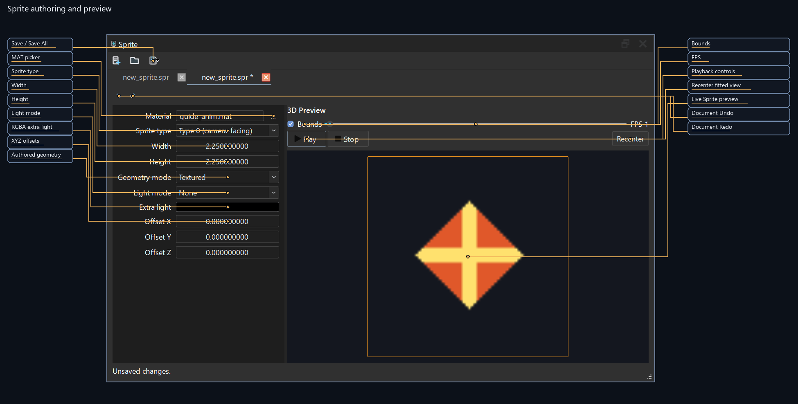

Sprite preview controls are presentation-only. For animated MAT files, the **FPS** slider plays cels from 0 to 99 (0 pauses);
**Pause** holds the current cel, **Play** resumes at the selected rate, and **Stop** returns to cel zero while paused
without changing the rate. Animation controls are hidden when the MAT has no animation. **Bounds** starts on and toggles the outline,
and **Recenter** fits the card and displayed bounds in a straight-on view. Width, Height, and XYZ edits preserve your orbit
and pan, expanding the framing only when needed. Numeric scrubs update the preview while you drag. Classic
camera-facing types use X for right, Y for depth, and Z for up; depth changes do not move the card sideways in a straight
orthographic view. IJIM fixed type 2 ignores XYZ offsets and hides those controls.
If the current clipping planes cannot contain the preview, the status explains it while keeping the camera and draft.
**Geometry mode** selects **Not drawn**, **Vertices**, **Wireframe**, **Solid**, or **Textured** for both project profiles.
It edits the SPR and updates the isolated preview in one undoable change. The regular IJIM viewport continues to use
the engine's global geometry path, so its presentation may differ from the isolated Sprite preview.
Zero dimensions can remain in native drafts; external SPR Save requires positive Width and Height.
The isolated preview has no ambient illumination, so a lit mode with zero extra light is dark. Choose full-bright
mode 0 (**Fully lit** in classic projects or **None** in IJIM) to inspect the MAT without extra lighting.

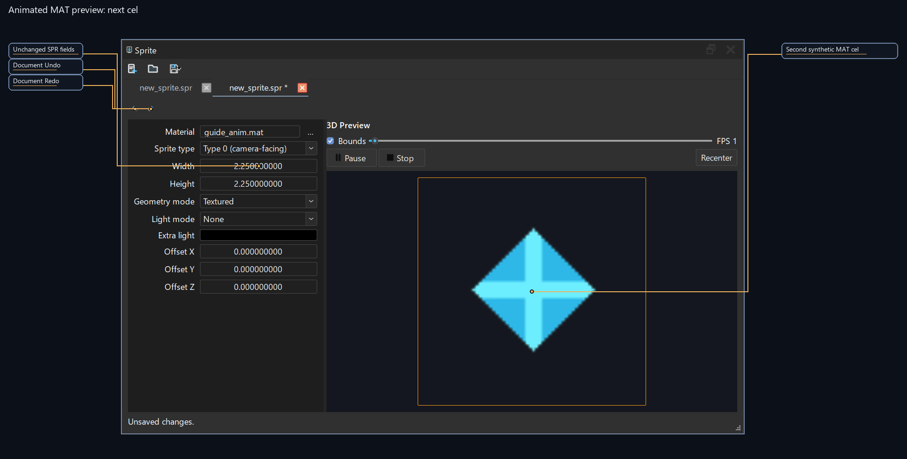

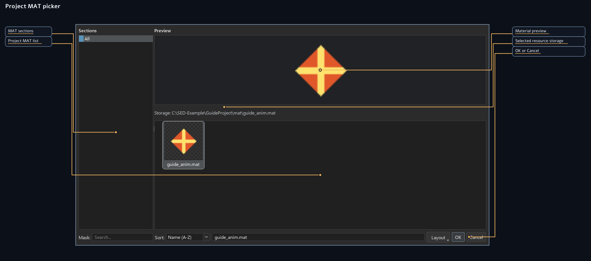

Native SED Save remembers Bounds, FPS, paused playback, the form/preview splitter, and the preview camera;
the animation cel phase is derived when reopened. Sound Class Loop choices are also remembered without changing SND flags. Volume
editing is limited to 0 through 1; a higher imported value is preserved until explicitly edited. Numeric text keeps the
stored float precision, and unfinished Sprite numeric text survives native Save and recovery. The 4096-row input budget
is an editor safety limit, not an engine cap on alternatives for one mode.

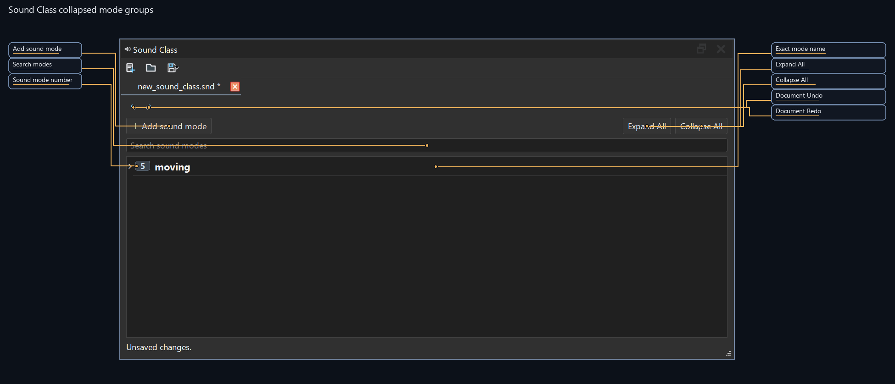

Adding a Sound Class mode expands and focuses an empty group ready for **Add Entry**, clearing a pane search that would
hide it. Native SED Save and recovery retain that group;
external SND Save writes only its real entries. Reopening or reloading an external SND recreates groups from those
entries. Volume sliders and values stay centered within their rows, with the same layout before and during editing.
Sound rows stay unhighlighted while field editing and Undo/Redo remain available. Flags, Min, and Max are centered.
The playing row keeps Stop and Loop visible when you move the pointer elsewhere, until playback stops.
The editor's minimum width keeps the compact fields, Volume slider, and Remove control visible. Manually enlarging
a column can require horizontal scrolling. Default fitting first gives Sound 65% of the width beyond column minima,
then moves 40% of the resulting Volume width into Sound, stopping when Volume reaches its 230-pixel minimum. Drag a
heading boundary to resize a column across all groups.
Remove stays inside the visible Volume cell; if scrolling leaves too little room,
it hides until its button, value, and usable slider fit again. The controls remain inside their own cells.
Right-click the sound canvas for local Undo/Redo.

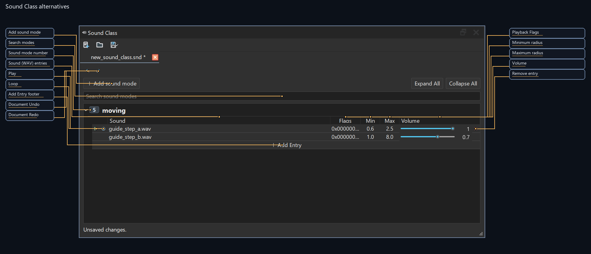

The number beside a Sound Class mode is its engine slot. COG `PlaySoundClass(thing, mode)` uses that number to select
the Thing's sound mode and choose an alternative; it is not a WAV index or a count of alternatives. This is the
[classic playback contract](https://github.com/shinyquagsire23/OpenJKDF2/blob/02297602cb289b113df27be33b5a7dddbe3d91c1/src/Cog/sithCogFunctionSound.c#L285-L304)
and the [IJIM playback contract](https://github.com/smlu/OpenJones3D/blob/b9c0eaa56bb51307b0787add4b614d9468e5d372/Libs/sith/Cog/sithCogFunctionSound.c#L299-L320).

External Save checks the target engine's resource names: SPR Material accepts up to 31 game bytes in JKDF2/MotS or
63 in IJIM; SND WAV accepts 31 or 121 respectively. The SPR reader admits only safe material tokens up to 255 bytes;
unsafe or longer names reject Open/Reload without replacing an existing draft. An admitted name beyond its project's
external limit stays intact in the draft and must be
corrected before external Save. UNI output declares its current row count for both profiles; native drafts retain
the imported capacity and all hidden metadata.

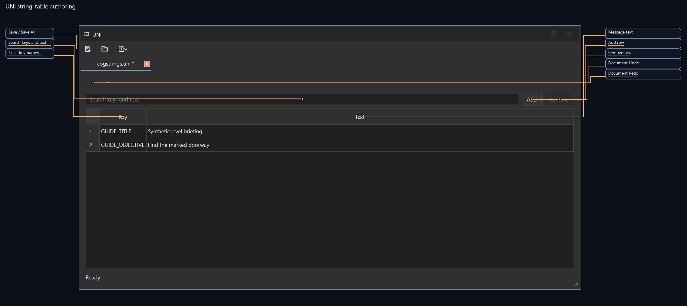

The UNI search filters visible rows. Clearing a nonempty search brings the selected cell back into view; changing an
active query or editing the already-empty search does not move the table's scroll position.

#### Resource actions

These actions describe the SPR, Sound Class, and UNI groups. The [COG workflow](#cog-script-editor) uses its
script working-copy behavior and the same individual-file docking workflow.

| Action | What it does |
| --- | --- |
| **Tools > Sprite Editor / Sound Class Editor / UNI Editor** | Opens or activates its editor group without creating a file tab, file, or project folder. |
| **Group toolbar: New** | Adds another clean named draft file tab in that editor group without replacing the current one. Works while the group is empty. |
| **Group toolbar: Open** | Opens the active project's resource picker and loads its selection into a new file tab. Project resources from loose roots and mounted archives are read into memory; an archive entry is never extracted. Opening a source already owned by a tab activates that tab and keeps its edits. |
| **Group toolbar: Save** or focused **Ctrl S** | Validates and atomically writes the active resource as a loose file. The toolbar becomes available after an edit, including unfinished numeric text. A new draft asks for a destination. An archive-backed resource saves under its original basename in the project's `misc/spr`, `misc/snd`, or `misc` directory for UNI, with a brief saved-path notice. Untitled projects use the configured loose-resource root, falling back to the first existing non-Episode resource root. The project stays Untitled, and no folder or file is written until you explicitly save the resource. |
| Focused **Ctrl Shift S** | Opens Save As for the active resource, using the same validation and atomic replacement as Save. |
| **Save dropdown > Save All** | Saves modified files of that editor kind, including files in detached windows, and skips unchanged tabs. Each file is replaced atomically. Cancel or an error stops the sequence: successful earlier files stay saved, and remaining drafts keep their edits and modified markers. The current file stays selected. Save All is disabled when the group has no edits. |
| **Drag a group / file tab** | A group title moves its whole dock. A file tab detaches, redocks, or moves the existing page to another window of the same editor kind. |
| **File > Save** | Writes the native `.sed` project and stores open resource drafts in its EDIT state. It does not write `.spr`, `.snd`, or `.uni` files or clear their external modified markers. |

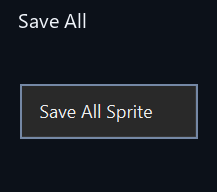

The Save dropdown remains available when another file of that editor kind has edits. A plain Save on an unchanged
current file writes nothing. Ordinary Save of an opened loose SPR, Sound Class, or UNI file writes back to its
original source, including a configured resource root outside the active project. New drafts, archive overrides,
and Save As keep their project-destination rules.

Use **Group Save** to write the loose resource file, then **File > Save** when you also want the SED project workspace
saved. When a resource group or its controls own focus, **Ctrl S** saves its active resource and **Ctrl Shift S**
opens its Save As flow; a cancelled or failed resource save still consumes the shortcut. With the viewport or another
level control focused, **Ctrl S** saves the native SED project and its EDIT draft state. Close or document replacement
names the resource file and asks **Save**, **Discard**, or **Cancel** before losing its edits; **Save** is the default,
and **Escape** chooses **Cancel**. The same question style identifies the file kind as **Unsaved sprite**, **Unsaved
sound class**, **Unsaved string table**, or **Unsaved COG script**. Invalid intermediate
table and Sprite numeric text also survives native Save, autosave, recovery, and tab movement. SPR, SND, and UNI
document changes use local Undo/Redo; text controls retain their own text undo.
Undo/Redo back to the external saved checkpoint clears that file's modified marker. Manually typing the saved values
again keeps the file marked modified because it creates another authored history step.

#### External file changes

Open loose SPR, Sound Class, UNI, and COG files watch their source and its folder. When another program changes or
removes a source, SED names that file and offers **Reload** or **Keep**, including when the current buffer is clean.
Keep retains the current text, selection, modified marker, and document history, and acknowledges that disk revision.
Reload reads the latest source and starts a clean replacement history. A failed Reload keeps the existing buffer and
history and reports the filename. Saving from SED accepts its own bytes without a change offer; Save As moves the
watch to the new source. Offers wait for mouse gestures and other dialogs to finish, then appear one at a time.

Ordinary loose COG **Save** also checks the current source before formatting or writing. If the disk bytes changed,
SED offers **Reload from Disk**, **Overwrite Disk**, or **Cancel**, with Cancel as the default. Cancel retains your
exact text, history, cursor, and selection. Reload rereads the latest bounded source before replacing the buffer;
Overwrite explicitly replaces the disk revision with your authored text. Choosing Keep in an earlier watcher offer
does not authorize an overwrite. An unknown accepted source baseline, including a clean legacy buffer, uses the same
conservative choice. Successful Reload or Save establishes the next accepted baseline.

Opening COG source into a new buffer and Reload admit at most 16 MiB. Manual Reload checks the limit before asking to
discard edits and again when it rereads after confirmation. If the source grows beyond the limit while the question is open, SED reports
the limit and preserves your text, Undo/Redo history, cursor, and selection. Watcher Reload uses the same limit.
Archive Open checks the winning source before creating its editable working copy. An oversized or unreadable winner
reports an error without extracting it or silently opening another copy. Reopening an already open winning loose
script or selected archive working-copy tab activates its current buffer without rereading source bytes. Your edits
and Undo/Redo history remain intact; use Reload to replace that buffer from its current file.

See the [resource format and validation details](resource_authoring.md).

## 🗂️ 10. Layers

Layers organize sectors and related level content. Use the layer editor to add, rename, reorder, recolor, hide, or lock
layers.

- Hidden layers are not rendered or picked in Editor mode. Game Preview can either render them or respect the hidden
  state according to its Preview preference.
- Locked layers remain visible but their contents are read-only.
- Layer colors help identify geometry in the viewport and Outliner.

The Outliner normally filters out entities on hidden layers. Click its crossed-out eye button to enable **Show entities on
hidden layers in the Outliner** (off by default). This read-only toggle rebuilds the Outliner list; it does not unhide the
layer in the viewport or make those entities editable. Click it again to restore the filter.

Layer visibility and lock commands are also available from the Map menu. Selection and editing commands respect both
states. Visibility changes preserve stable picking metadata and publish one combined viewport update. CPU mesh work,
bounded graphics-buffer uploads, and material batches share one progress lifecycle. On an unusually large level, an
indeterminate **Updating layer visibility…** indicator appears in the status bar only after the operation has lasted
half a second; ordinary changes show no progress flash. The same behavior applies to one layer and **Show All**. The
indicator updates between safe stages. If the graphics
driver itself performs one long allocation, the next visual update occurs when that driver call returns.

## 📐 11. Grid and viewport settings

**Viewport Settings** groups its controls into the collapsible **Appearance**, **Gizmos**, **Grid Behavior**, **Grid Appearance**, and **Grid Transform** sections. Use **Viewport Settings > Gizmos** to control marker visibility; **Preferences > Viewport > Gizmos** configures marker sizes, colors, and offsets. Level-geometry and ARCH vertex marker sizes are in **Preferences > Viewport > Selection markers**.

The **Gizmos** section contains persistent visibility toggles for **Baked Lights**, **Thing Lights**, and **Thing Type** in every
project, **Arch Things** in JKDF2/MotS, and **Sector Lights** plus **Sector Thrust Vectors** in IJIM. **Thing Type** controls
the Thing-type marker; the other choices control light or sector-thrust markers. In **Preferences > Viewport > Gizmos**,
the preference groups are singular: **Thing Type**, **Light**, and **Arch Thing**. Project badges show where a
preference applies; the **Arch Thing** group is always available and carries a **JKDF2 / MotS only** badge. Its
visibility and offset settings affect Arch Thing markers in those games and have no effect in IJIM. In these games,
Thing flag `0x8` is the **Arch flag**. It marks an Arch Thing rendered as part of level geometry and, in MotS, eligible for ARCHLIGHTING. In
MotS the ARCH owner marker represents that flag; no second marker is drawn. IJIM uses Thing flag `0x8` as the
Whip-climb flag and does not display an Arch Thing marker. **Stack spacing** sets the shared world-space gap between
stacked Thing Type, Light, and Arch Thing markers in every project; its default is `0.01` units. The **Thing Type >
Offset** and **Light > Thing Light offset** preferences add extra clearance to their respective marker lanes. A zero
offset still places markers above the model because the editor reserves each marker's height and the shared spacing
automatically. Actor Headlights remain at their authored emitter offset. Editor and Game Preview remember marker choices
separately; **Arch Things** defaults on in Editor and off in Game Preview.

The light-gizmo choices control whether each light family remains visible when it is not the active edit family. Arch
edit mode temporarily forces the marker for every effective MotS ARCH owner and the model vertex gizmos while the mode is
active; when you leave it, the saved **Arch Things** choice controls the owner marker again. With **Sector Thrust
Vectors** enabled, every finite, nonzero authored IJIM thrust vector stays visible regardless of selection. When the
setting is off, passive vectors are hidden; the active Sector Thrust tool keeps its existing visibility rules, including
**Show all zero handles**.

Behavior includes grid visibility, following the camera, rotating to the view, adaptive spacing, depth presentation,
and the optional **Keep rotated grid visible** behavior. The latter draws a camera-side visual proxy if the authored
view-aligned plane passes behind the camera; it does not move the stored grid origin or change snapping.
**Reset grid on camera rotate** clears a temporary centered/aligned grid on the first camera rotation, including a
grid whose origin or angles were entered directly in Viewport Settings.

Appearance controls spacing, major divisions, colors, opacity, and line thickness. **Minor grid** defaults to **Lines**;
choose **Points** for dots at the minor-grid intersections. **Dot size** sets their diameter from `0.5` to `10` logical
pixels, with a default of `2`. Major grid lines and colored axes remain lines. These controls are also available in
**Preferences > Viewport > Grid**. Viewport Settings applies changes immediately; Preferences applies them when you
choose **OK**, and **Cancel** leaves the current style and size unchanged. Dot size is available when Points is selected.
The choices are remembered in app preferences, native SED projects, autosave, and recovery. They change grid appearance
without changing its snapping lattice.

Transform controls grid origin and Pitch/Yaw/Roll. Quick buttons align the grid to XY, XZ, or YZ, align it to the view
or selection where applicable, center it, and reset it. Buttons display the current configured shortcuts and update
after key bindings change.

**Grid commands and default shortcuts**

The **Grid** toggle in Viewport Settings uses **G** while the viewport owns ordinary input. Active Cleave Multi-cut
uses G for its local Move mode instead.

| View > Grid command | Default shortcut | Effect |
| --- | --- | --- |
| Grid Visible Through Walls | None | Draw the grid over solid geometry and Thing objects. |
| Grid Always Behind Geometry | **Insert** | Draw the entire grid behind scene geometry. |
| Align View to Grid Plane | **F2** | Look straight at the grid and center the view on its origin. |
| Align Grid Plane to View | **F3** or **Numpad 0** | Set the grid plane parallel to the current view. |
| Snap Grid to Item | **Shift S** | Align or move the grid to the active editing item; unavailable while Fly is active. |
| Orient Grid to Selection | None | Orient the grid from the current selection when the command is chosen. |
| Center Grid on Selection | **Ctrl Alt Shift G** | Move the grid origin to the current selection. |
| Reset grid align/center | None | Clear temporary grid alignment and center overrides. |

Actions marked **None** have no default shortcut but can be assigned in **Preferences > Keymap**. The menu and
tooltips show the current bindings after a rebind.

**Snap Grid to Item** (`Shift S` while you are not flying the camera) uses the active editing item. A face aligns the
grid plane and first axis, an edge aligns to its active edge, and a vertex, Sector, Thing, Frame, or Light moves the
origin without inventing an orientation. In Light mode this works for baked, Thing/Head, and IJIM Sector point lights
and uses the real emitter position rather than a presentation-only lifted icon.
It is independent of the camera's current revolution, so orbiting upside down cannot change which selected item,
vertex, edge, or face supplies the grid origin and orientation.

New projects and imported JKL/NDY levels start with the centered XY grid. Native SED files restore their saved grid and
viewport editor state.

### Level Settings by project

Open the top-right **Level Settings** control to edit values stored in the level header. The popup is scrollable when
the viewport is short. Every committed field edit is one Undo/Redo step; opening the popup or running the buffer report
does not modify the level.

| Group | JKDF2 | MotS | IJIM | Fields shown |
| --- | :---: | :---: | :---: | --- |
| **General** | ✓ | ✓ | ✓ | Gravity and **Extra buffers > Configure…** |
| **Classic Level Header** | ✓ | ✓ | — | Mipmap distance 1–4, LOD distance 1–4, Perspective distance, Gouraud distance, Pixels per unit, Master CMP |
| **Horizon Sky** | ✓ | ✓ | ✓ | Distance, Offset X/Y; **Pixels/Rev** is shown only for JKDF2/MotS |
| **Ceiling Sky** | ✓ | ✓ | ✓ | Height and Offset X/Y |
| **Fog** | — | — | ✓ | Enabled, Color, Start, End |

Use the fields for these purposes:

| Field | Purpose |
| --- | --- |
| **Gravity** | Sets the project gravity value used by level physics and gameplay-facing calculations. |
| **Mipmap distance 1–4** | Sets the classic distance thresholds at which successive texture mip levels are selected. |
| **LOD distance 1–4** | Stores the classic model-detail distances for ordinary 3DO Things. With **3DO Model LOD** enabled, two geosets use distance 2; three use distances 1 and 2; four or more use distances 1–3. Arch Things stay at geoset 0. Distance 4 remains imported/exported but is not used for this model choice. |
| **Perspective distance** | Sets the classic distance used by perspective correction. |
| **Gouraud distance** | Sets the classic distance used by Gouraud-shading selection. |
| **Pixels per unit** | Sets the classic texture-mapping scale used when SED calculates or rebuilds UVs. |
| **Master CMP** | Selects the classic level master colormap resource. |
| **Horizon Sky: Distance** | Sets the horizon sky's depth or draw distance. |
| **Horizon Sky: Pixels/Rev** | Sets classic horizon texture pixels per full revolution; the row is hidden for IJIM. |
| **Horizon/Ceiling Offset X/Y** | Moves the corresponding sky texture or projection offset without moving level geometry. |
| **Ceiling Sky: Height** | Sets the height at which the ceiling sky is presented. |
| **Fog: Enabled, Color, Start, End** | Enables IJIM fog and controls its color and near/far interpolation range. |

The classic LOD thresholds compare camera-forward depth at the Thing origin, rather than straight-line distance
to the camera; at an exact threshold the next lower-detail geoset appears. SED's editor camera has no MotS gameplay
zoom state, so it uses the normal unzoomed camera depth.

The panel uses the same stored header model for all three projects. “Hidden” means that SED deliberately does not show
or edit that row for the project; it does not mean that an imported value is discarded. **Master CMP** is a classic
colormap field and therefore belongs to the classic group. IJIM uses the NDY presentation rules, keeps the General,
Horizon Sky, and Ceiling Sky groups, and replaces the Classic Level Header group with Fog. MotS shares the JKDF2 panel
shape, while its separate Light-mode **Architectural
lighting** data is documented in [MotS Architectural lighting](#mots-architectural-lighting).

#### Level Settings captures

The classic and MotS panel is taller than a small viewport, so the first two captures show its upper and lower scroll
positions. IJIM replaces the classic header group with its project-specific Fog group.

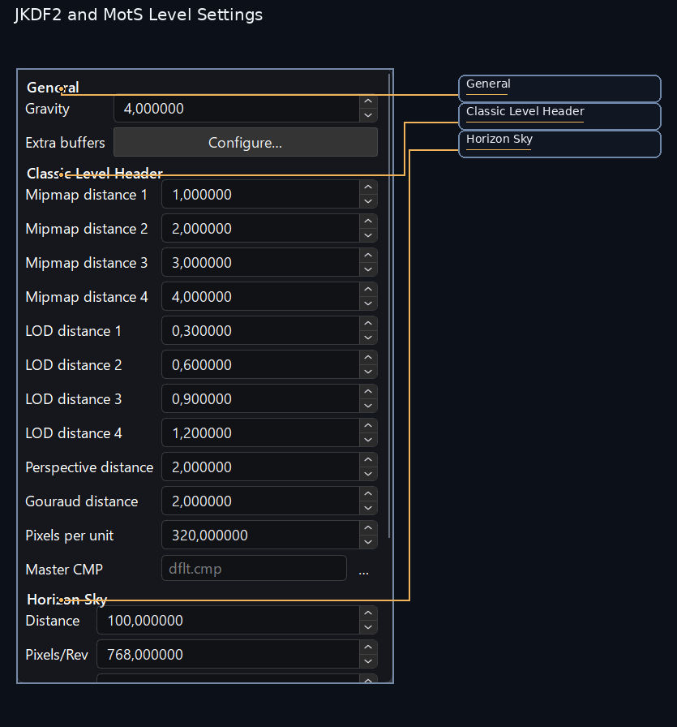

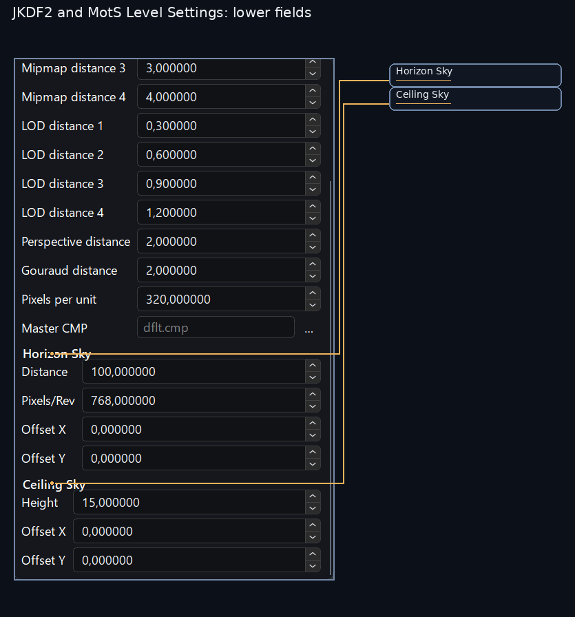

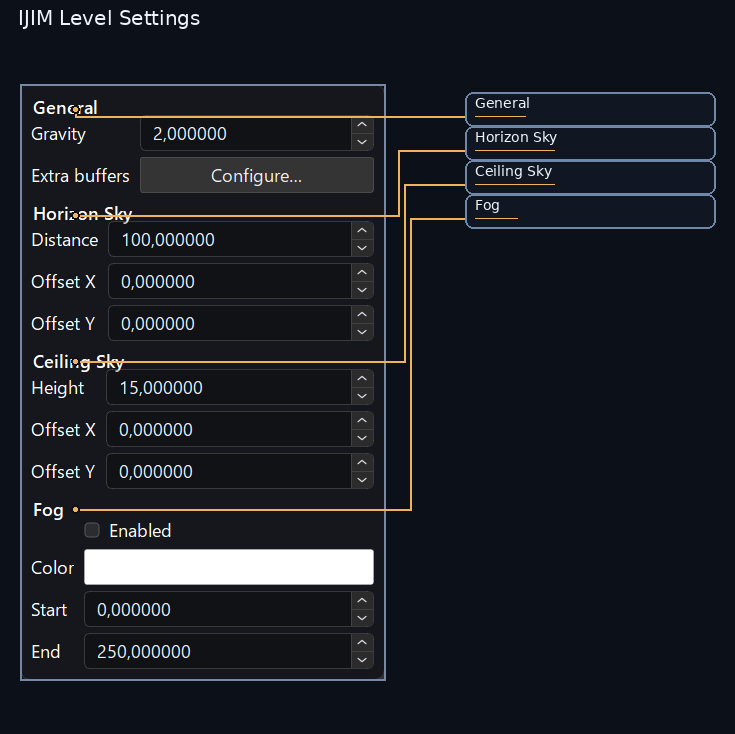

New projects use header version `1` for JKDF2/MotS and `3` for IJIM. Gravity starts at `4.0` for JKDF2/MotS and
`2.0` for IJIM. The common seed values are Horizon distance `100.0`, Horizon Pixels/Rev `768.0`, Ceiling height
`15.0`, Mipmap distances `1.0/2.0/3.0/4.0`, LOD distances `0.3/0.6/0.9/1.2`, Perspective distance `2.0`,
Gouraud distance `2.0`, Pixels per unit `320.0`, and `dflt.cmp` as the classic master colormap. Fog starts disabled,
white, with Start `0.0` and End `250.0`; the Fog controls are exposed only by IJIM. Imported JKL/NDY or native SED
files keep their authored values.

#### Extra Buffers

**Extra Buffers** is a report-and-capacity editor for growable JKL/NDY resource pools. **Configure…** first takes a
report-only dependency snapshot and then shows a row for each pool with **Required**, editable **Extra**, and **Export
total**. Export total is `Required + Extra` up to the text-world capacity limit; setting Extra to zero is valid and
requests no spare slots. The report does not change geometry or allocate resources, and a warning is shown if an
unavailable dependency prevents a complete Required count.

| Extra pool | JKDF2 new project | MotS new project | IJIM new project |
| --- | ---: | ---: | ---: |
| Sounds | 0 | 0 | 80 |
| Materials | 0 | 0 | 64 |
| AI classes | 64 | 64 | 64 |
| Models / 3DO | 1024 | 1024 | 1024 |
| Sprites | 128 | 128 | 128 |
| Keyframes | 512 | 512 | 512 |
| Puppets | 64 | 64 | 64 |
| Sound classes | 128 | 128 | 128 |
| COG scripts | 128 | 128 | 128 |
| COG instances | 0 | 0 | 0 |
| Templates | 0 | 0 | 0 |
| Things | 256 | 256 | 256 |

The only new-project capacity differences are IJIM's 80 Sound and 64 Material slots; JKDF2 and MotS share the classic
zeroes, and all other editable extras are shared across the three project types. These are starting allowances, not
engine minimums. **Restore Defaults** returns the current project's configured values, and **Preferences > Resources >
New Project Extra Buffers** changes the defaults used by subsequently created projects. Imported JKL/NDY levels infer
each Extra value from `declared capacity − parsed required records`, clamped at zero, so an imported file can
legitimately show a different value, including zero.

Only growable pools use Extra Buffers. Geometry, colormap, sector, editor-light, layer, and MotS ARCHLIGHTING headers are
exact record counts; increasing those counts without records would break parsing. Resource lists, COGs, templates, and
Things are capacity pools. IJIM Materials has one specific runtime restriction: set **Materials Extra** to **0** or
**64**. Zero adds no spare dynamic MAT slots; 64 adds exactly 64 beyond the required dynamic MAT rows. Other
values may remain in an imported or native project, but NDY export stops with a message directing you to
**Level Settings > Extra Buffers** to repair Materials. The report stays available for that repair, and a zero total
capacity is not rejected solely because it is zero.

COG scripts and COG instances are separate rows. Script filenames are deduplicated for the script list, while every
explicit non-empty/non-`none` `cog=` occurrence on an emitted template or placed Thing consumes an instance. Repeated
uses of the same script therefore increase Required COG instances even when Required COG scripts stays unchanged.

#### Extra Buffers report captures

The following captures show the Required, Extra, and Export total columns in the live dialog. The lower views are a
second scroll position of the same real dialog and include the final COG, template, and Thing rows.

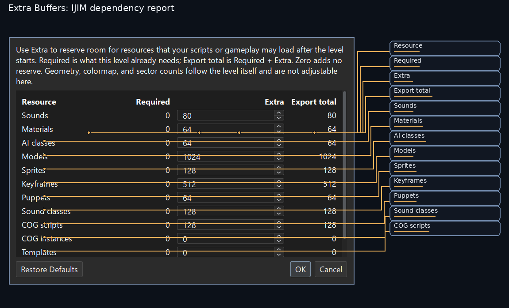

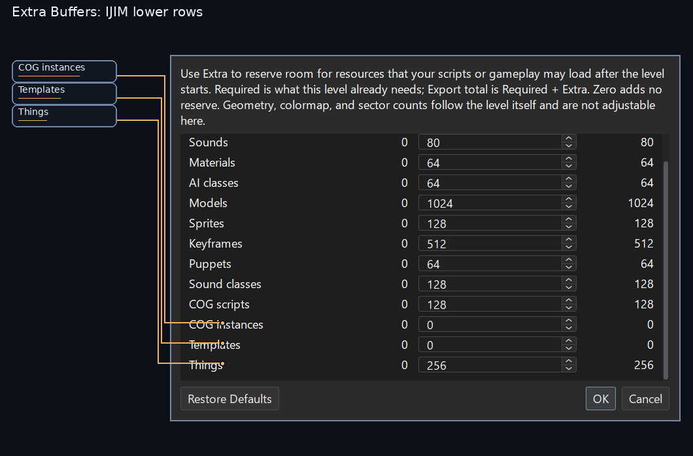

## 💡 12. Lighting

The useful first decision is where the light data lives. Enter **Light** edit mode with **4**, then choose
**Baked**, **Thing**, **Arch**, or **Sector** when the project offers that family. The families look similar in
the viewport but have different owners, persistence, and runtime effect.

In Light mode, **Shift 1** selects Baked and **Shift 2** selects Thing. **Shift 3** selects Sector in IJIM or Arch
in MotS; JKDF2 has no third light family, so that shortcut leaves the current family unchanged.

Click a visible light gizmo to select it, or drag a selection box around its center with Select active. Baked, Thing,
and IJIM Sector light selection works in perspective and orthographic views, including from outside level geometry.
An invisible single-sided backface does not block selection; an opaque wall in front of the light does. Enable
**X-Ray Selection** only when you want to select through that wall.

### Choose the light family

| Editor choice | What you author | Where it is rendered |
| --- | --- | --- |
| **Baked** | A SedLight with position, layer, flags, intensity, range, and (for MotS/IJIM) color. | Recalculation writes combined results into surface vertex lighting. In MotS, **Affect Arch Things** can also bake flagged sources into eligible Arch Thing model vertices. |
| **Thing** | A runtime light parameter attached to a Thing. | The frame-local runtime preview can shade the scene and the owning Thing; it never writes baked vertices. |
| **Actor headlight** | A Thing lightintensity and lightoffset on an actor/player with the headlight type flag. | The frame-local runtime preview follows the actor/player orientation. |
| **Arch** | MotS ARCHLIGHTING mono/RGB vertex channels attached to a model Thing. | The frame-local preview applies the authored model-vertex lighting; it is separate from Baked and runtime point lights. **Arch** is MotS-only. |
| **Sector** | An IJIM AVERAGE LIGHT point light stored by its owning sector. | Runtime preview shades 3DO Things in that sector; it is not a world-geometry bake. The Sector submode and **Add Sector light** are IJIM-only. |
| **Sector Tint** | The classic sector **Tint** Item Edit property in JKDF2/MotS. | It is a sector presentation input, not a point-light gizmo or an IJIM source. |

#### Light-family reference captures

These synthetic-project captures show the project-specific family selectors. MotS Arch controls and its tool
sheet appear beside the detailed ARCHLIGHTING workflow below.

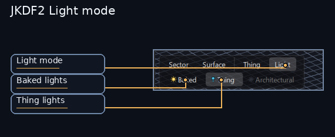

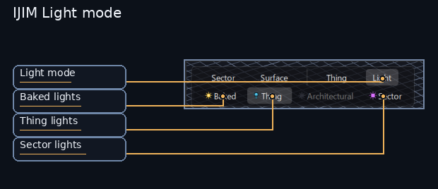

Open light tool-strip and Thing-light menu details

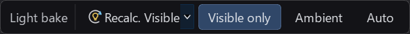

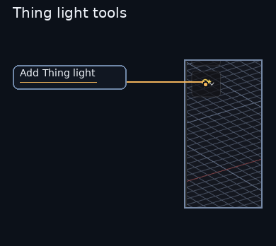

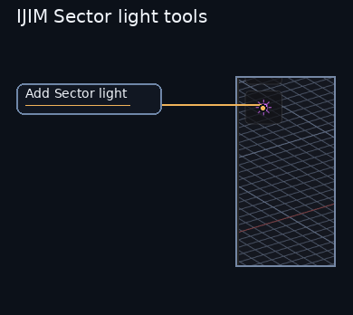

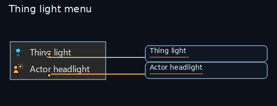

For a visual-designer pass:

1. Enter **Light** mode and choose the family that owns the effect.
2. Edit the family fields or property popup, then use Move and Scale where that family exposes them.
3. Choose the surface **Lighting > Type** and viewport **Lighting mode** that match the result you want to inspect.
4. Compare **Editor** authoring visibility with **Game Preview** from a valid camera sector.

Move a regular Thing light by moving its Thing owner. **Headlight** Move edits the local offset. Light mode does not
expose Rotate. For JKDF2/MotS Thing lights and Headlights, Scale changes authored intensity and the engine-derived
range; IJIM Thing lights scale their authored range. Arch edits model vertex lighting values.

### 🔆 Baked lights

Select **Baked** and double-click a light gizmo, or use its **Edit...** property button, to open the live **Baked light**
parameters. The property panel also exposes the authored fields directly.

| Property | Available behavior |
| --- | --- |
| **Flags** | `0x01 - Not blocked` bypasses geometry blocking during a bake. MotS also offers `0x20 - Affect Arch Things`, which includes eligible Arch Thing model vertices in the bake. |
| **Layer** | Chooses the light's authored layer. Visibility and locked-layer rules still apply to a bake. |
| **Range**, **Intensity** | Non-negative scrub fields. Zero makes the source unusable for a contribution and lets a recalculation clear its affected output. |
| **Color** | Available for MotS and IJIM; the color editor writes RGB in its display range. JKDF2 uses scalar light. |
| **Position** | Edit X, Y, and Z directly or use Move. |

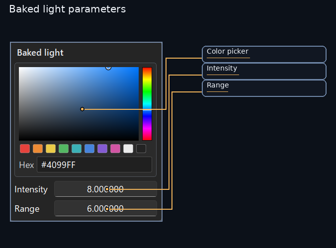

The Light bake strip is visible in **Light > Baked** and hidden in Game Preview.

In MotS, turn on **0x20 - Affect Arch Things** in a Baked light's **Flags** editor to include its contribution in
eligible Arch Thing model vertices. Recalculation adds the current flagged-source result over each Thing's preserved
authored ARCH baseline, so repeating a bake does not accumulate values. Removing or clearing the last flagged source and
recalculating restores that baseline. This option does not change the regular surface bake and is hidden in JKDF2 and
IJIM projects.

| Control | Default | Effect |
| --- | --- | --- |
| **Recalc. Visible** / **Recalc. All** | Last selected scope | Recalculate the visible unlocked scope or all unlocked sectors. |
| **Recalc. Selected** | Off | Uses selected Baked lights to find the affected area, then evaluates every contributing Baked light there. |
| **Visible only** | On | Limits manual and automatic targets to visible, unlocked layers. |
| **Ambient** | Off | Derives sector Ambient from baked vertex colors and Surface Extra Light; when clear, authored Ambient is retained. |
| **Auto** | Off | Watches Baked SedLight changes and recalculates their dirty region. It does not react to Thing lights, IJIM Sector lights, or arbitrary geometry edits. |

A manual request captures its scope, visibility, Ambient choice, targets, and undo label. A later selection or option
change cannot retarget that queued request. Stale or canceled work is discarded as one transaction, so it cannot
overwrite newer authored data. Use **Recalc. Selected** when the selected light's old or new range is the useful
work area; the lighting equation still includes all lights that contribute there.

### 💡 Thing lights and runtime options

A Thing's property rows named light, lightintensity, and lightoffset remain ordinary editable parameter fields.
The ... button beside those rows, double-clicking a parameter field, or double-clicking a Thing-light gizmo in the
viewport opens **Thing light** or **Headlight** parameters. The popup is live: valid color, intensity, range, or
offset edits update the document while it is open, and closing it does not roll those edits back. Use Move on a
regular Thing light to move its owner Thing; for an Actor headlight, Move edits the local lightoffset.

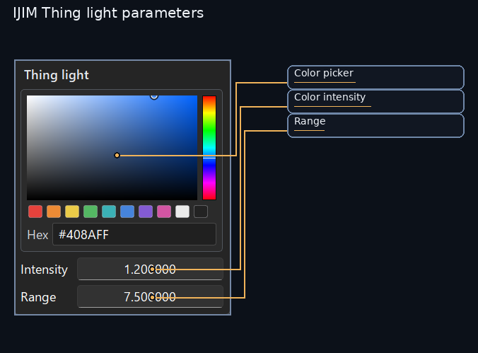

| Project | Regular Thing light | Actor/player Headlight | Sector point light | Collected Thing cap |
| --- | --- | --- | --- | ---: |
| JKDF2 | Positive finite scalar light. | Positive scalar lightintensity and rotated lightoffset. | None. | 32 |
| MotS | Positive finite scalar light. | Positive scalar lightintensity and rotated lightoffset. | None. | 32 |
| IJIM | Raw light=(r/g/b/range); RGB can exceed 1. A range at or below 0.01 is a flat owner self-light, not a scene source. | Raw lightintensity=(r/g/b[/range]) and rotated offset. | AVERAGE LIGHT. | 64 |

Classic scalar lights derive their inner and outer radii from intensity and also raise only the owning Thing's camera
ambient floor. IJIM dynamic sources use their authored RGB and range; an IJIM flat source adds RGB only to its owner.
Headlights do not raise the owner camera ambient. These are runtime frame rules, so editing a light does not trigger a
bake or alter stored surface vertices.

### 🏮 Sector lighting

#### IJIM sector point lights

Choose **Sector** only for IJIM point lights. With no point light, the sector **Lighting** group offers **Add Point
Light**. Once present, its fields are:

| Field | Meaning |
| --- | --- |
| **Color** | Non-negative authored RGB for the IJIM point light. |
| **Pos X**, **Pos Y**, **Pos Z** | Point-light position in world coordinates. |
| **Ranges: Min / Max** | Min is the outer falloff cutoff and Max is the inner full-strength radius. The link control is on by default and preserves the current ratio; clear it for independent edits. |

The point-light popup represents authored RGB as a color plus intensity, followed by the same **Ranges** controls. It
has no separate position row because the position is edited in the sector property panel. A sector point-light gizmo
can be moved and double-clicked like other light families. Its runtime contribution is collected for 3DO Things in the
owning sector, not for level geometry.

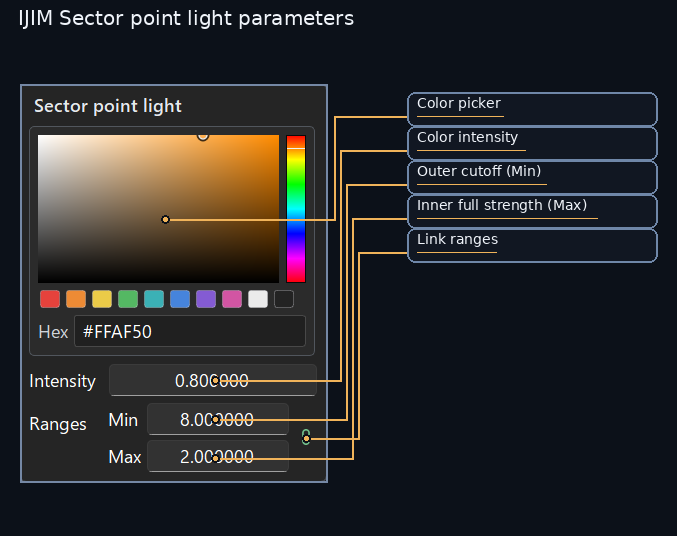

#### JKDF2/MotS sector Tint

In JKDF2 and MotS, **Tint** is a sector Item Edit field alongside **Ambient**, **Extra**, and **Colormap**. It is
not a Sector light. In Editor mode, each visible classic sector uses its own authored Tint on its geometry and actual
Things even when the camera is outside that sector. An adjoin keeps its material color and owning-sector Tint; an
exposed translucent adjoin remains inspectable from either side. Game Preview uses the **current camera sector's Tint
for the complete scene**; outside every sector the result is neutral. IJIM does not use classic Sector Tint. Compare a
camera inside a valid sector when judging engine-facing Tint behavior.

The sector **Ambient** and **Extra** fields are separate from Tint and from IJIM point-light RGB. JKDF2/MotS expose
finite signed scalar Ambient and Extra values (shown as equal RGB channels) with six decimal places; values outside
`[0,1]` remain authored and the renderer applies its display clamp during composition. Non-finite and out-of-float-range
commits are rejected without changing the document or history. IJIM exposes RGB Ambient and Extra, with **Calculate
ambient from surface colors** using the brighter average of baked vertex colors and Surface Extra Light. The sector flags
**No ambient light** and, for IJIM, **No RGB ambient light** change the bake's ambient derivation. JKDF2/MotS render
Thing and sprite ambient as a scalar: SED averages the combined sector Ambient and Extra RGB channels, then clamps the
result to `[0,1]`. This keeps colored baked surface lighting from adding a hue to classic Things and sprites. IJIM keeps
its RGB Thing ambient.

### 🧩 MotS Architectural lighting

MotS **Arch** Light submode edits the per-vertex `ARCHLIGHTING` records attached to model Things. This is separate
from Thing and IJIM Sector point lights, so it has no point-light range control.

#### Interactive vertex editing

1. In **Viewport Settings > Gizmos**, **Arch Things** controls persistent visibility of MotS ARCH owner markers. This
choice is separate from **Baked Lights** and **Thing Lights**; **Sector Lights** is available only in IJIM. Editor and Game
Preview remember these choices independently. Switch to **Light** mode and choose the **Arch** submode. This submode is
enabled only for MotS and temporarily shows its ARCH owner and model-vertex gizmos; the saved **Arch Things** choice is
unchanged and controls the owner marker again when you leave the submode. Every Thing with the effective **Arch flag** (`thingflags & 0x8`) is an ARCH owner, even when
its ARCHLIGHTING index is `-1`; that state is treated as a virtual all-zero record. Selection is vertex-first: clicking an
owner marker selects all of that owner's published vertices, while vertex clicks, Shift/Ctrl, and marquee selection
build exact selections across multiple Things. A plain click on empty space or a non-ARCH surface clears the current
ARCH owner and vertex selection; Shift/Ctrl-click misses and empty marquee drags preserve it. Compatible ARCHLIGHTING
Paste can target an unflagged model Thing. Hidden, locked, or invalid targets remain unavailable.

While Arch is active, the transform toolbar exposes **Select** only; Move, Rotate, Scale, grid, and orientation controls
are hidden. The **T** and **E** shortcuts do not activate transforms in this submode. Leaving Arch restores the usual
transform controls for the active editing mode.

2. After an owner icon selects all of its vertices, click a vertex without a modifier to narrow that implicit expansion
   to one exact vertex. Once you have an explicit subset, clicking a selected member preserves the batch, while clicking
   an unselected vertex replaces it. Hold **Shift** to build an arbitrary vertex subset or **Ctrl** to remove vertices;
   marquee selection can include vertices from multiple selected Things. Double-click a vertex to edit that exact
   selected set. Double-click an ARCH owner icon to edit all published vertices of every currently selected eligible
   ARCH Thing. Selected and hovered markers retain their authored fill color and use a dark outline for contrast.

| Popup control | **RGB color** channel | **Mono grayscale** channel |
| --- | --- | --- |
| **Edit channel** | Shows RGB editing controls and previews stored RGB. | Shows Mono controls and previews the stored `mono` value as grayscale in the ARCH editor. |
| **Color picker** | Selects the RGB hue for the selected vertices. The color is combined with the current RGB intensity when applied. | Hidden; Mono is authored numerically or with the slider. |
| **RGB intensity** | Changes brightness. Editing intensity alone scales each selected vertex's own RGB values; editing color sets the selected hue at this intensity. There is no serialized RGB intensity field. | Hidden; Mono has no intensity multiplier. |
| **Mono value** | Hidden. | Writes the raw stored `mono` value. The numeric field accepts finite signed and HDR values. |
| **Mono grayscale slider** | Hidden. | Writes a convenient grayscale value from 0 to 1 and stays synchronized with the numeric field. |
| **Dismiss popup** | A valid changed selection commits as one Undo step. | Same commit behavior. |

Control changes preview in the viewport while the popup is open; they do not update the document or history until dismissal.
Click outside, press **Escape**, or close the buttonless popup to commit a valid edit. Dismissing without changes preserves
all selected records bit-for-bit. Invalid input discards the entire staged edit. A changed model, topology, resource,
selection, or locked/hidden layer also clears the stage without publishing a partial result. Shared records use
copy-on-write only when selected and unselected Things need different values.

**Example:** In RGB mode, changing only **RGB intensity** brightens or dims each selected vertex while keeping its
individual color. Choose a color as well when the selected set should share a hue. In Mono mode, enter an exact signed
or HDR value such as `1.25`; closing the popup commits it as one Undo step.

3. The ARCH editor normally shows stored RGB. Game Preview always uses the engine's RGB presentation. Returning to the
   ARCH editor restores its chosen channel; leaving the Arch submode resets the editor view to RGB. RGB and Mono remain
   separate stored channels.

To make the markers easier to see or select, open **Preferences > Viewport > Selection markers > ARCH vertices**.
This section stays visible in every project and carries a **MotS only** badge. The **Marker size** setting accepts
3–24 screen pixels and defaults to 14; the displayed marker and its pick radius follow that setting and account for
display DPI. This is separate from the **Level Geometry** vertex marker size in the
same Selection markers group. Markers use the selected vertex's authored ARCHLIGHTING RGB by default. Turn
off **Use authored vertex color** to use the configurable **Fallback color** instead. A dark outline is always drawn for
contrast. These settings change the editor overlay only and do not alter the saved vertex data. The Thing Type icon,
regular Thing-light icon, and ARCH owner marker occupy separate screen-up lanes above the Thing origin and clear the model bounds. In MotS the ARCH marker
also represents the effective **Arch flag** (`thingflags & 0x8`), which marks an Arch Thing rendered as part of
level geometry and, in MotS, eligible for ARCHLIGHTING. The Arch Thing marker is controlled through
**Viewport Settings > Gizmos > Arch Things** in JKDF2 and MotS. IJIM does not display this marker because its Thing
flag `0x8` has a different meaning.
Actor Headlight icons remain at their authored, rotated `lightoffset` emitter position.

There is no Add-placement or Remove-binding toolbar action in the Arch submode. Press **Delete** to reset selected
explicit ARCHLIGHTING values to zero; this keeps the Thing's **Arch** flag and binding. A virtual or already-zero
record is already at its default, so Delete does not create an edit. **Ctrl C** and **Ctrl V** provide the
ARCHLIGHTING snapshot workflow described above. Paste can set the instance **Arch flag** (`thingflags & 0x8`) on an unflagged model
Thing, preserves its other flags, and never edits the Thing template. A non-default ARCHLIGHTING record remains dormant
in the SED file if the **Arch** flag is cleared, and is restored when the flag is re-enabled if its model topology
still matches.

Use viewport **Lighting mode > Gouraud** when comparing ordinary ARCHLIGHTING shading. **Fully Lit** deliberately
ignores authored vertex and face light values (and dynamic-light target colors); a sector ambient floor can also make a
small ARCHLIGHTING value change look unchanged until the ambient contribution is reduced.

Native SED
V3/V4 preserves dormant non-default ARCHLIGHTING records and omits explicit zero/default dormant records; when
external-only template data makes a reference ambiguous, serialization retains it conservatively. MotS JKL export writes
the zero record for every effective Arch Thing by default. In its export options, **Omit default zero ARCHLIGHTING records** is an opt-in; when checked, the
export writes index `-1` for zero records and the game uses the 3DO's vertex lighting, which may differ from the editor
preview. Entity copy/paste and Undo/Redo preserve ARCHLIGHTING values and references.

The accelerated viewport replaces the model vertex RGB with the record's RGB channels. The source model alpha remains
available to normal face-opacity handling: opaque faces stay opaque, and explicitly translucent faces follow their
opacity rules. `mono` remains the brightness channel used by the software engine path and is never opacity. Invalid indices, non-finite channels,
missing models, or incompatible topology leave the preview unchanged.

### 👁️ View lighting and preferences

The viewport **Lighting mode** menu changes presentation, not necessarily stored data.

| View mode | Presentation |
| --- | --- |
| **Fully Lit** | Shows surfaces at the full-light level; stored vertex and face light values do not darken the view. Dynamic-light target colors are not visible in this mode. An active classic Sector Tint can still multiply the preview. |
| **Lit** | Flat baked and ambient lighting. |
| **Diffuse** | Flat directional lighting per face. |
| **Gouraud** | The ordinary shaded editor view: authored/baked vertex lighting and dynamic-light contributions are interpolated across faces. |

The top-right viewport **Lighting mode** popup and **View > Lighting** menu both provide runtime contribution switches
for **Thing Lights** and **Sector Point Lights**. Both are on by default and apply in Editor and Game Preview. The
Sector Point Lights switch stays visible but disabled in classic JKDF2/MotS projects; its checked state is retained and
applies again in IJIM. These switches control light contributions to the viewport; **Viewport Settings > Gizmos** only
controls whether light markers are drawn. They do not change baked lighting or authored light records.

Under **Preferences > Viewport > Rendering**, **Dynamic lights** selects **Gouraud (per-vertex)** by default or
**Phong (per-pixel diffuse)** as an optional enhancement for effective Gouraud geometry. The choice affects frame-local
runtime-light sampling; it does not change baked vertex data. Viewport Settings > Gizmos toggles **Baked Lights** and
**Thing Lights** everywhere, **Sector Lights** in IJIM, and **Arch Things** in JKDF2/MotS. Their Editor and Game Preview
choices are remembered independently. Arch mode temporarily forces its owner and vertex gizmos for editing; the saved
**Arch Things** choice controls owner-marker visibility again when the mode ends.

Sector ambient masks affect baking rather than the ownership of runtime lights. **No ambient light** skips the ambient
light contribution during baked-light calculation. IJIM's **No RGB ambient light** keeps only the ambient intensity
when deriving the baked ambient, so its resulting ambient channels are equal. These flags do not turn an IJIM Sector
point light into a baked light and do not remove a Thing light or headlight.

**Show Hidden Things** is an authoring preview option: it can display inherited
Thing lights even when their Things are disabled or invisible. Game Preview
matches runtime presentation and excludes those disabled emitters
([PreviewRuntimeParity](architecture.md#lighting-ownership-and-pipelines)).
Nonzero ARCH values, model-vertex lighting, face-extra lighting, and Sector
lighting can remain even without a baked source. **Fully Lit** intentionally
shows full-light surfaces; it does not imply that the stored lighting inputs
are all zero.

## 📜 13. COG Script Editor

COG scripts control level logic. **Tools > COG Script Editor** opens the group; its **Open** button loads a script
from the project picker. You can also open one from the COG list or a placed COG. **Edit > COG >
New COG Script...** opens a name dialog, validates open tabs and project files case-insensitively, and adds .cog when
the typed name has no suffix. It creates a modified in-memory draft and its placed COG; the first explicit Save writes
`<project>/cog/<script>.cog`. For an Untitled project it uses the configured loose-resource root's `cog` directory.
The group **New** button opens that same name dialog. Opening an archive-backed script creates an editable working
copy under the project's loose `cog` directory, or the configured resource root's `cog` directory for an Untitled
project, retaining its original basename. The tab hover identifies the original archive and entry, such as
`test.gob: cog/Foo.COG`, independently of the working-copy path. Save writes that working copy; it never changes the
archive, and its tab hover then shows the full loose path. A successful
Save briefly shows the saved path in the status bar; cancelling an overwrite keeps the previous status.

### Script editor highlights

The group **New / Open / Save** toolbar has a **Save All** dropdown for modified COG tabs in every primary or
detached COG window. Save All stops on cancellation or error, retains later drafts, and keeps the selected file.
Drag a script tab outside its group to open a separate dockable window without recreating the text editor or history.
Use its native **Maximize** button to enlarge a floating editor and restore it from the same titlebar. Use the titlebar to
split or tabify the workspace, its **Dock** control to return the host, or drag its file tab
onto another COG tab bar to join that host. Dropping the whole window onto another COG editor joins its files into that
editor's document tabs; dropping onto another editor kind keeps separate window tabs. The document's **Undo / Redo /
Whitespace / Format / Insert** buttons share the toolbar icon theme. Use the Format arrow for its options and the
Insert menu for script constructs. Undo/Redo follows the current script's text timeline and survives native Save and
recovery; it does not consume Level commands.
The **Join** label marks the valid target during a file-tab drag. Moving the last script out hides its primary group, which
**Tools > COG Script Editor** can reopen empty; an empty detached source closes.

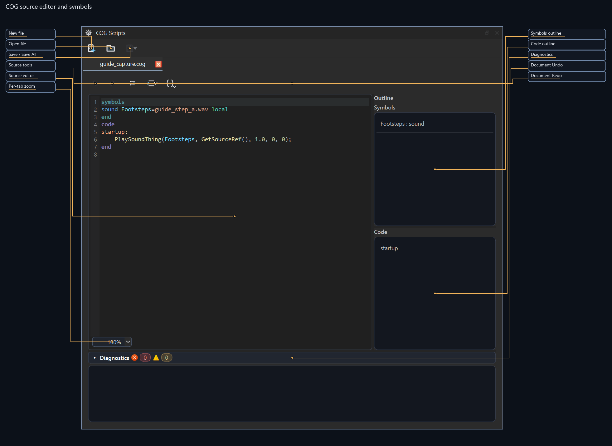

| Area | What to use |
| --- | --- |
| **Symbols** and **Code** outlines | Separate, resizable navigation panes with autocomplete, go-to-definition, insertion helpers, and symbol-attribute actions. |
| **Diagnostics** | Expandable pane with severity, line/column, counts, navigation, and Copy. |
| **Find** | Incremental **Find**, **Match case**, **Whole word**, **Previous**, **Next**, and an X of N/No results status. |
| **Format** | **Format with current options** plus tabs/spaces, indent width 1-8, brace style, body/comment indentation, spacing, blank-line cleanup, and format-on-save. |
| **Insert** | Script sections, **Add Symbol**, messages, code labels, snippets, and **COG flags...**. |
| **Presentation** | Per-tab zoom from 20% through 400%, installed font/fallback family, size, bold/italic, themes, and whitespace display. |

When the COG editor owns focus, these configured actions are available:

| Action | Shortcut |
| --- | --- |
| Find | **Ctrl F** |
| Find Next | **Ctrl G** |
| Completion | **Ctrl Space** |
| Format | **Ctrl Shift F** |
| Toggle Whitespace | **Ctrl Alt W** |
| Go To Definition | **F12** |
| Insert at caret | **Insert** |

With the source editor focused, **Insert** opens **Add Symbol** when the caret is in `symbols`, or the existing
message/code-label insertion menu between code handlers. Within a handler it keeps the text editor's normal Insert
behavior. This shortcut uses the keyboard caret, not the mouse position, and never activates the viewport grid.
**Preferences > Keymap > Editors > COG Script Editor** also exposes **Add Symbol**, **Add Message**, **Add Code Label**,
and **COG Flags...** without default shortcuts. These commands reuse the same menus and local Undo as the Insert toolbar.

`Insert > Add Symbol` lists primitive and entity types alphabetically, followed by the resource types `ai`, `keyframe`,
`material`, `model`, `sound`, and `template` in alphabetical order.

In a script's `symbols` section, literal initializers keep their value style: resource names and quoted values use the
string style, while numeric values use the number style. A resource name remains a literal even when it matches a
symbol name.

Semantic reference highlighting and navigation use symbol declaration names and references in code. Values assigned in
symbol initializers or metadata attributes such as `desc=` remain literal text, even when they match a symbol name; they
do not count as references. The **Find** pane still finds those values.

#### Inline resource pickers

Hover a supported resource initializer in `symbols` to reveal a small **…** button at the right edge of its value.
For declarations without an initializer, hover the symbol name; the button appears after the name, and choosing a
resource adds ` = value`. Select the button to open the regular resource picker. Choosing an entry replaces only the
initializer in one undoable edit and preserves the declaration's other attributes, comments, and literal-default
semicolon. Cancelling the picker or choosing the existing value leaves the script unchanged. The inline resource buttons
are available for `material`, `sound`, `template`, `model`, `ai`, and `keyframe` defaults.

#### Symbol flags and masks

Hover the numeric value of `flags=` or `mask=` to reveal its **…** button, then choose the bits in the popup anchored
to that value. **OK** commits one undoable source edit; **Cancel** leaves the declaration unchanged.

| Attribute | Workflow |
| --- | --- |
| Symbol `flags=` | Edit the declaration's numeric flags while preserving its initializer and other attributes. |
| Symbol `mask=` | Choose which source types can trigger messages for the symbol. The all-bits `mask=-1` sentinel is accepted without an unsupported-bits warning. |

No-op or cancelled edits preserve the original numeric spelling and unknown bits. Script-wide flags use
**Insert > COG flags...**, described below.

### Zoom, appearance, and safe script saves

Hold **Ctrl** and use the editor wheel to change the active tab's zoom in 10% steps; per-tab zoom remains bounded from 20%
through 400%. The zoom combo also accepts a value in that range. Set font, size, weight, italic, theme, and
whitespace display under **Preferences > COG Script Editor > Appearance**; formatting choices are under **Preferences >
COG Script Editor > Formatting**.

**Ctrl S** saves only the active COG script while its editor owns focus. Saving the native SED project separately
captures modified COG buffers in the editor session; it does not silently overwrite their loose files. Before saving
a draft, SED refuses a path already open in another COG tab and asks before replacing an existing loose script. A
loose file newer than the saved SED checkpoint prompts to reload it or keep the SED buffer. Tabs can be closed in
bulk with **Close Others**, **Close to the Right**, **Close Saved**, or **Close All**; pinned tabs are protected, and a
Save/Discard/Cancel prompt stops a bulk close when Cancel is chosen.

### Placed COG defaults and export values

Placed COG arguments come from public symbols in the script's `symbols` section. An explicit public declaration default
wins for types that support one. Vector declarations are the exception: write `vector name` without an initializer;
the engine parser zeroes that storage. An initializer written there is ignored by the engine. SED uses these type
defaults:

| Public symbol kind | Script/default rule | Empty JKL/NDY export |
| --- | --- | --- |
| Entity reference: `cog`, `sector`, `surface`, `thing` | `-1` | `-1` |
| Scalar: `int`, `flex`, `float` | `0` | `0` |
| Vector | No declaration initializer; placed value starts at zero, shown as `(0/0/0)` | One canonical `(x/y/z)` vector token |
| Resource: `ai`, `key`, `material`/`mat`, `model`, `sound`, `template` | Empty authored value | `-1` |

COG runtime code uses a different vector spelling: a value is single-quoted, space-separated text such as
`direction = '1 2 3';`. The `(1/2/3)` form belongs to placed level/JKL/NDY values; it is not a script declaration
initializer.

Explicit resource names remain valid, including `sound`/WAV names. Local symbols and message declarations are not placed
arguments, so they never shift the positions of public values. When a valid script schema is available and an imported JKL
row omits trailing arguments, SED fills those positions from the corresponding script declaration defaults before the
values are shown or exported. An identity-order import without a valid script schema preserves its raw values. JED
`surface` values continue to load from their `sector surface` token pair.

After a script Save, SED refreshes every placed instance that uses that script. A declaration with the same name and
type at the same declaration occurrence keeps its authored value, new declarations receive their defaults, and removed
declarations are discarded. A valid empty `symbols` section clears the placed arguments. Missing, unreadable, or malformed scripts leave the previous
placed values in place and report the failure. The refresh is one undoable Level change covering all matching instances;
an equivalent schema creates no history entry, and undo/redo changes the Level without writing the loose script.

Loose-file changes are debounced and checked against the current project and resource mapping before they are applied.
Deleting a script leaves its placed values in memory and never recreates the file; a directory watch applies a valid
schema when the file reappears. The script tab buffer and placed-instance schema are separate: a valid external disk
change may refresh placed instances through the guarded watcher even while a dirty tab remains open. Automatic
[Reload or Keep offers](#external-file-changes) resolve the open text buffer separately; Keep does not roll back the
disk copy or that independent placed-instance refresh. To reload intentionally, choose **Reload from disk** in the
source editor's context menu or use its configured Reload shortcut. This action confirms before discarding local edits;
automatic change offers handle the usual external-edit workflow without a toolbar Reload button.

### COG flags and diagnostics

**Insert > COG flags...** edits the optional leading `flags=` line. Values are hexadecimal even without `0x`
(`flags=10` means `0x10`). Its frameless popup is anchored to the flags value. Leaving the value unchanged preserves its
authored spelling; an accepted change writes the canonical padded form. Unknown authored bits are preserved.

| Flag | Value | Flag | Value |
| --- | ---: | --- | ---: |
| Debug | 0x001 | Disabled | 0x002 |
| Pulse active | 0x004 | Timer active | 0x008 |
| Paused | 0x010 | Class | 0x020 |
| Local | 0x040 | Server | 0x080 |
| Global | 0x100 | No sync | 0x200 |

Pulse active and Timer active are engine-managed and read-only in the dialog; unknown authored bits are preserved.
Diagnostics cover unsupported delimiters and malformed or undeclared constructs, while the target engine remains the
final authority for game-specific behavior. COG supports `#` and `//` line comments, not C-style `/* ... */`
blocks; quoted colons remain text, `else if` is valid, and `else-if` is diagnosed.

## ↩️ 14. History, undo, and redo

An accepted editing operation creates one descriptive checkpoint. Continuous previews and modal drags commit only their
final changed result. Canceling or making no change adds no checkpoint.

An active Multi-cut draft uses [saved draft history](#cleave-draft-history) for viewport/Level Undo and Redo. A retained
inactive draft releases those commands until its matching Cleave context resumes. Focused resource/COG document
histories and native editable-text Undo retain priority. Undoing Apply restores that family's pre-Apply cuts,
selection, and Move/Rotate/Scale tool while preserving the other family's compatible work. Immediate Redo reapplies the Level cut while the
restored arrangement is unchanged. Edits to the other draft, camera, selection, or future shape settings do not alter
that arrangement; editing its cuts, order, or Bounded choice, or using its local Undo/Redo, returns Redo to draft history.

| Action | Editor mode | Game Preview |
| --- | --- | --- |
| Click a history row | Restores that undo/redo depth and rebuilds the editor at that checkpoint. | Does not move the history depth; the timeline remains view-only. |
| Double-click a row (**Go To & Select**) | Restores the depth, cancels an active tool, arms **Select**, switches to the inferred mode/submode, selects every identifiable output, and frames one deterministic primary output. | Unavailable as an editing selection operation; navigation is camera-only. |
| Context **Go To** | Restores the depth, then frames the primary identifiable output while preserving the current selection, mode, and tool. | Camera-only navigation; it does not move the depth. |
| **Undo** / **Redo** | **Ctrl Z** / **Ctrl Shift Z** use the active command context: file/text history, an active Multi-cut draft, or the Level timeline. | Disabled while Preview is active. |

A history transition with no reliable target still restores its checkpoint in Editor mode but has nothing to select or
frame. Native SED can store the timeline as optional saved history. If saved history is damaged or exceeds safe limits, SED warns and opens the current level/session without it. Files saved
without history open normally.

## 💾 15. Save, Save As, and engine export

Use the native SED format as the editable master. Native Save retains both Sector and Surface Multi-cut drafts,
including their independent Undo/Redo and options, while active or inactive; you can save before Apply. Opening it restores the saved editing context; retained
inactive cuts do not automatically arm Cleave. Exported engine files are interchange/runtime files and do not replace the
native document path.

### Commands

| Command | Shortcut | Result |
| --- | --- | --- |
| **File > Save** | **Ctrl S** | Save the current project as native .sed; with a focused COG or Resource Editor tab, save only that active resource buffer. A failed or cancelled editor save consumes the shortcut. |
| **File > Save As...** | **Ctrl Shift S** | Choose the native .sed destination without changing engine-export preferences; with a focused Resource Editor tab, save that buffer to a loose file. |
| **File > Export** | **Ctrl E** | Reuse the last compatible .jkl/.ndy target when available, otherwise open **Export level**. |
| **File > Export As...** | **Ctrl Shift E** | Always open the project-aware **Export level** chooser. |

### 🗂️ Editor SED file format

Native .sed is the complete Sith Editor document format, rather than an engine export. It stores the complete level and
editor session, including geometry, resources, Things, COG instances, baked lights, viewport and dock state, selection,
open COG and resource-editor buffers (including raw intermediate table cells), and optional saved undo history. Opening valid SED restores that session instead of applying the
camera reset used by engine-format imports.

The saved session contains settled workspace choices and authored drafts. Resource panes restore their selected
cells, scroll positions, line and table caret/selection positions, and manually sized Sound Class columns. If a table
cell was being edited, its raw text and deferred caret are kept; Open leaves the cell editor closed until you enter
the cell normally. These presentation choices do not add resource Undo steps or change the
resource's authored dirty state. Explicit UV pivot choices still reset. Template Editor geometry is saved; an unaccepted
modal working draft is not. The [editor-state inventory](editor_state.md) lists the retained domains and boundaries.

If a JKL COG import has pending default hydration because its script is unavailable, native Save retains the import
marker and Surface-reference map. After that script becomes available, opening the native project can retry hydration
without losing supplied raw arguments. Ambiguous imported Surface ordering still needs resource-backed COG information
before native Save or engine export. Large imports with unavailable scripts can exceed the saved-history budget because
their pending Surface maps repeat across Undo/Redo states. In that case Save retains the current Level and pending
import information, omits saved Level history, and reports a warning in Messages.

Save writes the complete document through an atomic staging step; a failed write leaves the previous complete file in
place. If a manual Save or Save As cannot complete, SED shows one critical **Save failed** message box and records the
detail in Messages. The existing target and project path stay unchanged, and the document's saved/unsaved state does not
change.
If optional saved history is too large or cannot be written, SED saves the current level and editor session,
omits that history, and reports the loss in Messages; history is never required to open the current level.

SED includes built-in checks and repair data that can recover a limited amount of missing or damaged content. This is
an integrity and recovery aid, not a backup; keep independent copies for important milestones. See the [native SED
format overview](sed_format.md) and [project and recovery context](project_context.md) for the limits.

When a legacy pixel-space project is normalized in memory, **Upgrade and Save** writes native V2 without retained
MotS arch-lighting records or authored bake baselines, or V3 when either remains. **Keep legacy pixel space and Save**
writes a true pixel-space V1 copy without either or V4 when MotS records or bake baselines remain, while leaving the
open project normalized. Cancel leaves the
existing path unchanged. Keeping pixel space is refused safely if any MAT size needed to convert the current project or
its history is unavailable.

**Open** and **Save** remember one shared folder: if you Save As in another directory, the next Open starts there.
**Import** and **Export** remember their own folders after you use them. Before a group has its own folder, it starts
in the most recent folder used by any Open, Save, Import, or Export dialog.

### 📤 JKL & NDY level file format

**Export level** uses the project-aware suffix and filter: JKDF2/MotS use .jkl, IJIM uses .ndy. The first
**Export** opens the chooser when no compatible reusable path exists; a compatible .jkl/.ndy path then opens the
separate **Export options** dialog. **Export As...** always repeats both steps. Legacy .jed export remains available for
JKDF2/MotS and skips the runtime options dialog. Canceling either chooser or options dialog leaves the document unchanged.

The fixed-size **Export options** dialog stacks its choices vertically. Only **Weld nearby vertices** and **Max distance**
share a row, and the distance editor is enabled only while welding is checked.

| Option | Default | Effect |
| --- | --- | --- |
| **Include lights** | Off | Include editor light data in the exported level. |
| **Include layers** | Off | Include editor layer data in the exported level. |
| **Compact output** | On | Remove writer-only padding and field comments plus unnecessary whitespace while preserving parsed content and the copyright block. |
| **Clamp extra light** | On | Clamp finite classic scalar and IJIM RGB Surface Extra Light values to signed [-1,1]; alpha is unchanged. Clear it to preserve authored finite values such as 10 or -2. |
| **Weld nearby vertices** | Off | Opt in to projection-only welding of close exported world vertices. |
| **Max distance** | 0.00001 | Maximum Euclidean world-space distance for welding. It must be positive; the minimum accepted value is 1e-8, and it is active only when welding is checked. |

With welding off, authored-equal coordinates are shared as before. With it on, SED keeps the first deterministic
representative and rejects collapsed distinct corners or newly invalid faces/sectors; the open Level, native SED data,
and Undo/Redo history are unchanged. The options are remembered for the current session and are captured into the
asynchronous export snapshot, so repeating Export uses the accepted choices even if the live editor changes while a
write is in progress.

Engine files do not carry every native editor field, COG buffer, or history checkpoint. Keep the SED file as the source
of truth and inspect the exported JKL/NDY in the target game.

## 🛟 16. Autosave history and crash recovery

SED uses two related safety systems.

### 🚑 Live recovery

The live recovery checkpoint protects the last fully published atomic snapshot from a crash, power loss, forced
termination, or interrupted session. It is updated after meaningful changes and periodically; edits made after the last
completed checkpoint may still be lost. Editor-only camera, tool, and layout checkpoints do not prompt or rotate
Autosave History. Pending Multi-cut edits and their local Undo/Redo are retained before Apply; authored changes to
those cuts count as unsaved work and can produce a recovery offer even when the Level is otherwise saved. A valid
eligible live checkpoint is offered at startup or when its matching source is opened.

Recover installs the checked snapshot as unsaved work. Discard retires the selected live recovery. Cancel leaves both
the current document and recovery untouched. Recovery never overwrites the source level automatically.

### 🕘 Autosave History

Periodic autosaves are durable restore points available from File > Open Recent > Autosave History. They remain after a
normal close, including a close where the unsaved-changes prompt chose Discard. They are deleted only by explicit user
deletion or when retention rotates the oldest entry beyond ten snapshots for that editing session.

Restoring an autosave does not consume it. Save the restored document explicitly when you decide it should become the
new project state.

## 🩹 17. Self-healing and damaged files

Native SED protects the level, editor state, and history in independently recoverable sections. The authoritative level
and editor state receive the stronger protection; optional history uses a smaller protection level to reduce file size
and save/open time.

In practical terms:

- Small isolated damage can often be repaired automatically.
- Damage beyond the history budget drops only history when the authoritative level remains healthy.
- Damage to an optional editor section falls back to safe defaults where possible.
- Damage to required level data is never guessed silently.

If a file needs repair, SED keeps a forensic copy and reports what was recovered or lost. When required level sections
cannot be fully recovered, SED can offer an uncompacted text salvage plus a manifest explaining uncertainty. The source
file is not silently overwritten. Save a recovered document to a new file until you have inspected it and run the
Consistency Checker.

> ⚠️ **Keep backups.** Self-healing protects against limited storage corruption; it does not replace backups or source
> control.

## 🩺 18. Checks, messages, and troubleshooting

The Consistency Checker reports invalid geometry, references, resource issues, and project-specific problems. Items can
navigate to the affected object when a reliable target exists. Run it after imports, forced vertex deletion, major
merges, or recovery from a damaged file.

In the Consistency Checker's settings, **Geometry precision** defaults to **Game-compatible**. This allows the
coordinate-rounding differences found in original game levels when checking planarity and convexity. Choose
**Precise** for tighter checks; a warning explains that these can report rounding differences in original levels.
The choice is saved separately for each game project type. It changes diagnostics only, not editing-tool validation
or snapping precision. Adjoin checks still reject real gaps between surface boundaries.
Cleave and Extrude separately recognize bounded rounding in imported geometry while preserving original corners and
exact shared boundaries. Materially distorted faces, invalid topology and mismatched portals are still rejected.
Changing the checker preference does not change editing eligibility. Extrude reports the affected sector and surface
and the reason for rejection; an invalid live preview disables Apply until its inputs are corrected.

The Messages window records resource failures, recovery warnings, save/export results, and background operations.
Repeated missing-resource lookups are cached, so one missing MAT, 3DO, SPR, or other asset should not continually stall
the editor.

Important diagnostics are also written to `sed.log` beside `sed.ini`, including open/save, import/export, resource
decoding, sound playback, recovery, and failed editing-tool diagnostics. Use **Preferences > General > Logging** to:

- stop or start all file logging with the master switch
- independently include or exclude App, GUI, Core, and Resources records
- choose Debug, Information, Warnings, or Errors as the minimum detail
- set the file's rotation size

All four categories are enabled by default. The master switch exists as a quick way to stop the file without losing
the category selections. While it is off, the detail, category, and rotation controls are unavailable; enabling file
logging restores the saved choices. **App** covers editor workflows, while **GUI** covers Qt, windows, widgets, and
window-system messages. Debug detail is useful when a geometry tool refuses an operation.

Confirmation prompts are recorded after you choose an action, not as warnings merely because the prompt opened.
Discard and other destructive choices are warnings, Save/Yes choices are information, and Cancel/No choices are debug
detail. Where available, the record includes the active level path and the operation that requested confirmation.
When the size limit is reached, the previous file is kept as `sed.log.1`.

If an operation is disabled, check:

- whether Game Preview is active,
- the current edit mode and Surface/Light submode,
- whether the required selection count is present,
- whether the selection belongs to a hidden or locked layer,
- whether another modal tool or preview owns viewport input.

### 🔎 Find and project utilities

Edit > Find searches the entity type belonging to the current edit mode and presents only relevant filters. In
Thing mode, the **Template** criterion searches the Thing template name (falling back to its instance name when
the template name is empty), and its **...** entry button opens the Template picker. Find Next (**Ctrl G**)
continues that search. Other material/resource fields can open their matching picker directly. Find is
intentionally disabled in Light mode, where several different owner families share the viewport.

[Level Settings by project](#level-settings-by-project) covers level-wide properties such as gravity, sky, fog, and
project-specific fields. Its Extra Buffers
dialog shows the required exported resource count, editable extra reserve, and final total for each supported pool. A
zero extra value is valid. It appears immediately and checks level dependencies in the background; **OK** becomes
available when the Required counts are ready. Imported JKL/NDY files derive the current extra reserve from their
declared capacity.

The episode/campaign editor manages the game's episode metadata separately from level geometry. Treat those files as
project deliverables and review their level names after moving or renaming exported levels.

## ⚙️ 19. Preferences and key bindings

Preferences organize settings by purpose, including viewport/navigation, grid, selection, surface normals, previews,
lighting, recovery/autosave, file logging, COG formatting/themes, resources, and key bindings. Viewport preferences
remain visible in every project; an applicability badge identifies the games affected by a project-specific setting.
Shared viewport settings have no badge. Other per-project settings, such as resource paths, are grouped under their
project names.

**General > Numbers > Decimal separator** selects **Dot (.)** by default, **Comma (,)**, or **System locale**.
It controls numeric fields and readouts throughout the editor. Choose OK to apply it; Cancel keeps the previous choice.
Numbers have no thousands separators. Use the selected decimal symbol when entering a value, including scientific
notation. During a live edit, unfinished input keeps its exact text and original input format until you finish it, then
adopts the new display format. Native projects, autosave, recovery, exported levels, and saved resources keep their existing numeric
formats: accepted numeric text still uses a dot (`.`), and binary values keep their existing encoding. Script source, UNI text, and resource names
remain verbatim. Restored resource drafts retain their text but use the decimal policy active at restoration; their
input locale is not saved, so an unfinished value may need correction before committing.

Under **Viewport > Things > Collision preview**, **Node mesh radius scale** adjusts only the displayed MotS
`collide=2` tree-collision wire spheres. The engine uses `treesize` as a broad-phase radius and tests each hierarchy
node with `0.75 × mesh radius`. The preference defaults to `0.75` to match that node test and accepts `0.01–10.00`
for inspection. It is tagged **MotS only**; it never changes game collision or writes to SED/JKL level data.

For very small UV islands, **Viewport > Grid > UV editor maximum zoom** controls the canvas maximum in pixels per UV
unit. It defaults to `48000` and accepts `480` through `480000`; the normal canvas default remains `48`, and wheel
zoom keeps the UV point below the cursor while fitting and workspace recovery honor the configured maximum.

**Viewport > Appearance > Theme** selects the built-in **Midnight Blue** and **JED** palettes or a named user theme.
A theme changes the viewport background, wireframe, grid and axes, selection highlights, COG-pick colors, plus the UV
canvas background, main/sub-grid colors, and U/V axes. **JED** uses the Pascal editor's 2D map colors: black background,
white geometry, magenta grid, yellow X axis, blue Y axis, red primary selection, and cyan multi-selection. Modern
edge/active/vertex and COG-pick roles reuse the nearest legacy selection colors, and Z keeps the current blue because the
Pascal map had no Z-axis color. Built-in palettes are embedded and stay unchanged. To customize one, select it and choose
**Add New...** to copy it under a name; then edit its color swatches and choose **Update Theme**. **Add New...** can also
duplicate a saved theme. **Delete Theme** removes the selected user theme immediately. Color edits remain a draft until **Update
Theme**; switching to another theme discards the draft. Add New, Update Theme, and Delete Theme write the named theme
files as soon as the action succeeds, so closing Preferences with Cancel does not undo those theme-file actions.

Viewport/app themes are stored by default at the root of `data/themes` beside SED's settings file; COG themes are stored
by default in `data/themes/cog`. Viewport themes placed in `data/themes/app` and COG themes placed at the shared root are
also discovered. The `.app.json` and `.cog.json` suffixes keep same-name files distinct, while embedded
`sed.app-theme.v1` and `sed.cog-theme.v1` tags determine which editor loads each definition. Each file stores its display
name in the top-level `name` field and its complete color set in the nested `colors` object. If the portable locations
cannot be written, SED uses matching locations under its per-user application-data folder. Built-in palettes remain
embedded in the application. In **COG Script Editor > Appearance**,
color swatches are per-color overrides for the current editor palette; **Reset to Theme** restores those colors from the selected
theme. **Add New...** copies the selected theme and currently shown colors. **Update Theme** and **Delete Theme** act on
named user themes.

The separate **Appearance** controls include line widths, **Wireframe AA**, **MSAA samples**, frame-path sizes,
and layer-color toggles. **Wireframe AA** controls smoothing for wireframe strokes and fill-owned edges. It is independent
of scene multisampling: setting **MSAA samples** to **Off** disables framebuffer multisampling, while Wireframe AA can
still smooth supported overlay edges. **MSAA samples** requests Off, 2, 4, 8, or 16 samples per pixel, with 4 as the
default. The graphics driver may provide fewer samples than requested. Changing this value takes effect after restarting
SED, before the next viewport OpenGL context is created.

**Viewport > Banners** controls the appearance and hide time of temporary viewport messages. Each kind has its own
settings: Messages, Projection, Fly speed, Errors, Cleave rotation, Cleave scale, and Placement rotation. Choose a hide
time from **0.10 to 30.00 seconds** and use the Text, Background, and Border color swatches to set colors and opacity.
A transparent border keeps the usual borderless message style. Messages and Errors can keep their original durations
with **Use message duration**, or use the time you choose. Cleave rotation and scale start at **0.40 seconds**, including
their brief fade-in and fade-out. Their
time measures inactivity; hiding the readout keeps the current transform active. These are application preferences
shared by every project. **OK** saves them, **Cancel** keeps the previous settings, and **Restore Defaults** restores
the original colors and times. Banner-only changes repaint overlays without changing level geometry.

**Save & Recovery > Legacy Level UVs** controls how older native SED V1/V4 projects are handled. Automatic normalization
is the recommended default; Ask gives a decision for each convertible legacy pixel-space project; Keep legacy pixel space never
promotes it automatically. A project that cannot be converted completely remains in pixel space. An amber **UV: Legacy
pixels** status identifies that compatibility state. If missing MATs later become available, it changes to **UV: Ready
to normalize** under a policy that leaves the choice to you; Automatic mode safely retries the complete Level and
Undo/Redo history in the background.

The off-by-default **General > Things > Template picker** preference can make
an explicit template pick replace the selected Thing's name with that template
name. Leave it off when Things have designer-authored names; manual name edits
and ordinary template placement remain independent.

Expanded and collapsed Preferences sections are remembered while the application remains open. This is temporary
workspace convenience state and is not written to the saved Preferences configuration.

Key bindings and their categories are ordered alphabetically by their displayed names at every level. Hovering a row
does not highlight its background; its tooltip still explains the command. Their stable Binding ID is shown in the description for
advanced troubleshooting. Changes update menus and toolbar shortcut labels without restarting the editor.
Shortcut labels separate keys with spaces: **Ctrl Shift Z** means holding Ctrl and Shift while pressing Z.
**Numpad +** means the plus key on the numeric keypad; its plus sign is part of the key name.
**Toggle Grid** includes its default **G** binding. Each command has one row and a compact shortcut editor: select an
alternative to edit it, use **+** to add another, or **−** to remove it. **Align Grid Plane to View** retains **Numpad 0** and
**F3** as alternatives of the same command. Viewport display and Map Settings commands without an existing shortcut
start unbound, including **Always Align Grid to View**, Grid Snap, Grid Stick, Strict, and Normals.

Some viewport commands use modifier-only alternatives. Every modifier in one displayed combination must be held, and
any configured combination can activate that command. Selection modifiers accept their required combination even
when additional selection modifiers are held; X-Ray cycling, placement mode switches, and transform hold modifiers
require an exact combination. Free Insert takes precedence over Surface Tilt when both bindings match. Removing the
last alternative explicitly disables that hold action instead of restoring its former default. Tooltips show the
configured alternatives; selection hints show the combination currently held.

Conflicting shortcuts are explained below the list and must be resolved before choosing OK. The check includes every
alternative and commands that can run in the same context; separate script, UV, viewport, and Fly contexts can reuse
a key. Existing intentional default overlaps remain available.

Mouse-wheel editing is intentionally conservative: combo boxes do not change from wheel scrolling, and spin/slider
controls require real keyboard focus. This prevents a scrolling settings panel from accidentally changing a hovered
value. Open combo lists remain ordinary scrollable lists.

An unchanged Accept returns without rewriting settings/key bindings or reapplying viewport and layout state; Cancel
also leaves persisted settings untouched. Updating the active game-install directory stages archive
mounting in the background after Preferences closes; a brief status message is shown only when that update is not
immediate, and the previous resource set remains usable until the complete replacement is ready. An install change for
another project is discovered when that project is next opened, so unused archives never delay Preferences.

SED rejects an install directory only when standard archive names clearly identify another supported game. Custom or
incomplete layouts and shared roots containing resources from multiple supported games remain allowed.

## ✅ 20. A safe level-design routine

1. Create the correct project type and save a native SED project.
2. Configure resource roots and archives, then resolve missing resources.
3. Build closed convex sector geometry and connect it with valid portals.
4. Organize work into visible, unlocked layers.
5. Place Things, COGs, and runtime lights.
6. Author and recalculate baked lighting.
7. Run the Consistency Checker and review Messages.
8. Save the native SED project.
9. Export JKL/NDY and test it in the target game.
10. Keep autosave history enabled and retain external backups for important milestones.
